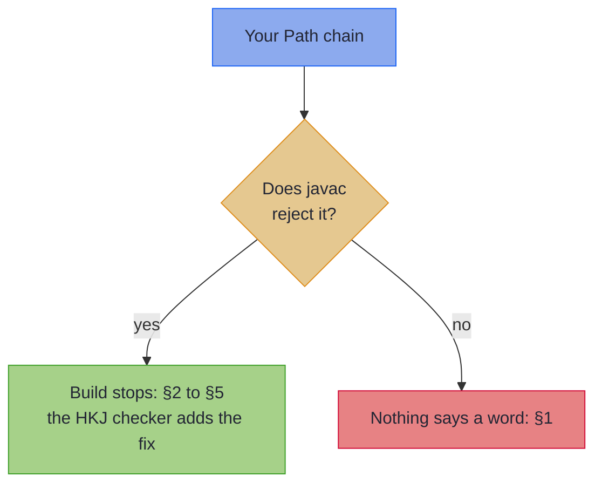

# Common Compiler Errors

Java's type inference works well for most Effect Path usage, but generic-heavy code occasionally produces confusing messages. This page covers the five things that most often go wrong. Find your symptom in the [Find your message](#find-your-message) table and follow it to its section.

~~~admonish info title="What You'll Learn"
- Which Path mistakes javac catches, and the one nothing catches
- How to read a message that names `Chainable<? extends EitherPath<? extends AppError,?>,B>`
- How to pin the error type `E` so it never silently becomes `Object`
- How to convert at the boundary when a step returns the wrong kind of Path
- When to reach for `map` rather than `via`, and how to unblock a lambda javac cannot infer
~~~

~~~admonish warning title="Four of these five are javac errors"
- **§2 to §5 stop the build.** The message is quoted in each section. With the build plugin, the HKJ checker adds a line beside javac's for §2 and §5, and for a lambda in §3, that names the fix. See [Compile-Time Checks](../tooling/compile_checks.md).
- **§1 compiles, and nothing reports it.** `E` becomes `Object` and stays there, until a chain typed on a real error rejects it.

The silent case carries a snippet the book's build compiles, asserting that it still compiles. A change that makes it loud fails that build rather than passing in silence.
~~~

---

## Find your message

| The symptom | What it is | Caught by |
|-------------|------------|-----------|
| [`Path.right`/`left` silently gets `E = Object`](#1-the-phantom-error-type-e-on-pathright) | `E` is unconstrained, so javac defaults it | Nothing. Add the witness yourself |
| [`MaybePath<User> cannot be converted to Chainable<? extends EitherPath<…>,B>`](#2-a-step-that-returns-the-wrong-kind-of-path) | A step returns another kind of Path | javac, and the `path-type-mismatch` note |
| [`via mapper must return EitherPath`, an `IllegalArgumentException`](#2-a-step-that-returns-the-wrong-kind-of-path) | The same mistake, through a raw type or an older build | The run-time check |
| [`Chainable<? extends ReaderPath<? super Config,?>,B>`, or a `WithStatePath`, `WriterPath` or witness](#2-a-step-that-returns-the-wrong-kind-of-path) | A step with another environment, state, log or witness type | javac |
| [`method via is not applicable`](#3-method-via-is-not-applicable-for-the-arguments) | The function returns a plain value, not a Path | javac, and the `via-non-path` note for a lambda |
| [`lambda body is neither value nor void compatible`](#4-lambda-body-is-neither-value-nor-void-compatible) | A lambda's branches return different types | javac |
| [`EitherPath<String,User> cannot be converted to Chainable<? extends EitherPath<? extends AppError,?>,B>`](#5-a-step-that-fails-with-another-error-type) | A step fails with an error the chain does not carry | javac, and the `error-type-mismatch` note |
| [`Chainable<? extends EitherPath<? extends UserNotFound,?>,B>`, naming one variant](#a-chain-typed-on-one-variant) | The chain is typed on one variant of the error | javac, and the `error-type-mismatch` note |
| [`inference variable E has incompatible bounds`](#a-chain-typed-on-one-variant) | The same, where the step's error is inferred too | javac, and the `error-type-mismatch` note |

Who speaks depends on the mistake:



---

## 1. The phantom error type `E` on `Path.right(...)`

**This compiles, and nothing reports it.** `Path.right(value)` carries `E` only in its return type. When the context constrains `E`, javac binds it; when nothing does, javac resolves `E` to `java.lang.Object` and says nothing.

**The trigger:**

<!-- verify -->
```java
EitherPath<AppError, User> findUser(String id) {
    User user = repository.findById(id);
    return Path.right(user);  // E bound to AppError by the return type: fine
}

var p = Path.right(user);     // nothing constrains E, so E = Object, and it compiles
```

**The fix:** pin `E` explicitly, so the intent is recorded and `Object` never leaks in:

<!-- verify -->
```java
EitherPath<AppError, User> pinned = Path.<AppError, User>right(user);
```

~~~admonish note title="When the witness matters" collapsible=true
With a clear target type the witness is optional:

<!-- verify -->
```java
EitherPath<AppError, User> path = Path.right(user);   // E = AppError, from the variable

EitherPath<AppError, User> chained =
    Path.<AppError, String>right(userId)
        .via(id -> Path.right(loadUser(id)));         // E from the previous step
```

Without one, `E` becomes `Object` silently:

<!-- verify -->
```java
var path = Path.right(user);                          // E = Object: add the witness
```

The witness costs nothing at runtime and keeps the error type honest.
~~~

~~~admonish note title="Why it is silent, and what older write-ups said" collapsible=true
Older write-ups described a `cannot infer type-variable(s) E` error here:

```
error: cannot infer type arguments for right(A)
  reason: cannot infer type-variable(s) E
```

On the supported compiler, the modern `javac` the HKJ build plugin targets, this does not happen. The code compiles. That is the more dangerous outcome, because the mistake is now silent rather than loud.

When `E` defaults to `Object`, later code expecting a specific error type fails to type-check. At a *consumer* it is an ordinary incompatible-types error somewhere else. As a step of a chain typed on a real error, javac rejects it, as [§5](#5-a-step-that-fails-with-another-error-type) shows, and the HKJ checker's note names the witness to add.

The HKJ compile-time checker does not flag the bare `E = Object` default, because it is not reliably distinguishable from code that means `EitherPath<Object, …>`.
~~~

---

## 2. A step that returns the wrong kind of Path

**A javac error.** A step passed to `via`, `then`, `zipWith`, `recoverWith` or `orElse` must be a Path of the chain's own kind, so a step that returns another kind does not compile.

**The error:**

```
error: incompatible types: cannot infer type-variable(s) B
        .via(id -> findUser(id))
            ^
    (argument mismatch; bad return type in lambda expression
      MaybePath<User> cannot be converted to Chainable<? extends EitherPath<? extends AppError,?>,B>)
```

Read the last line as "this step is a `MaybePath`, and the chain needs an `EitherPath` step that fails with an `AppError`". With the build plugin, the HKJ checker adds a line that names the conversion: `Path type mismatch in via(): expected EitherPath but received MaybePath`.

**The trigger:**

<!-- verify:rejects "User> cannot be converted to" -->
```java
MaybePath<User> findUser(String id) {
    return Path.maybe(loadUser(id));
}

EitherPath<AppError, String> result =
    Path.<AppError, String>right(userId)
        .via(id -> findUser(id))               // returns MaybePath, not EitherPath
        .map(User::name);
```

**The fix:** convert at the boundary with `toEitherPath`, which turns `Nothing` into a `Left`. A lambda selects the deferred overload, so the error is built only on the branch that uses it.

<!-- verify -->
```java
EitherPath<AppError, String> result =
    Path.<AppError, String>right(userId)
        .via(id -> Path.maybe(loadUser(id))
            .toEitherPath(() -> new AppError.UserNotFound(id)))  // MaybePath -> EitherPath
        .map(User::name);
```

### Common conversions

| From | To | Method |
|------|----|--------|
| `MaybePath<A>` | `EitherPath<E, A>` | `.toEitherPath(errorValue)`, `.toEitherPath(errorSupplier)` |
| `TryPath<A>` | `EitherPath<E, A>` | `.toEitherPath(exceptionMapper)` |
| `EitherPath<E, A>` | `MaybePath<A>` | `.toMaybePath()` |
| `ValidationPath<E, A>` | `EitherPath<E, A>` | `.toEitherPath()` |

~~~admonish note title="Why the message names Chainable" collapsible=true
`via` is declared once, on the `Chainable` capability interface, for every Path. Its type parameters say what a step may return: a `Chainable` of the receiver's *family*, the Path's own class with its value left open. An `EitherPath<AppError, A>` belongs to the family `EitherPath<? extends AppError, ?>`, so its steps must be `Chainable<? extends EitherPath<? extends AppError,?>,B>`. See [Capability Interfaces](capabilities.md#the-family-parameter).

The same message names the environment of a `ReaderPath`, the state of a `WithStatePath`, the log of a `WriterPath` and the witness of a `FreePath` or `GenericPath`. A `ReaderPath` step may need less of the environment, a supertype of the chain's; the others must match exactly.

Each Path still checks a step's kind when the chain runs, for code that reaches `via` through a raw type or was compiled against an older release. There the mistake throws `IllegalArgumentException: via mapper must return EitherPath, got: …`, and the fix is the same conversion.
~~~

---

## 3. "Method via is not applicable for the arguments"

**A javac error.** `via` is the Effect Path equivalent of `flatMap`, so it requires a function returning a `Chainable`, which every Path type implements. A function returning a plain value needs `map`.

**The error:**

```
error: method via in class EitherPath<E,A> cannot be applied to given types;
            .via(this::processOrder);
            ^
  required: Function<? super Order,? extends Chainable<? extends EitherPath<? extends AppError,?>,B>>
  found:    this::processOrder
  reason: cannot infer type-variable(s) B
    (argument mismatch; bad return type in method reference
      String cannot be converted to Chainable<? extends EitherPath<? extends AppError,?>,B>)
```

**The trigger:**

<!-- verify:rejects "cannot be applied to given types" -->
```java
// processOrder returns the wrong type
String processOrder(Order order) {    // returns String, not a Path
    return order.id();
}

EitherPath<AppError, String> chained =
    Path.<AppError, Order>right(order)
        .via(this::processOrder);     // via needs a Path-returning function
```

**The fix:** use `map` for plain transformations and `via` for Path-returning functions.

<!-- verify -->
```java
// For plain transformations: use map
EitherPath<AppError, String> mapped =
    Path.<AppError, Order>right(order)
        .map(this::processOrder);              // map: A -> B

// For Path-returning functions: use via
EitherPath<AppError, Order> chained =
    Path.<AppError, Order>right(order)
        .via(this::validateAndProcessOrder);   // via: A -> Path<B>
```

**Rule of thumb:**

- `map`: your function takes `A` and returns `B`
- `via`: your function takes `A` and returns a `Path<B>`, of any Path type that matches the chain

~~~admonish tip title="The HKJ checker explains a lambda step"
For a lambda that returns a plain value, the `via-non-path` check adds a line beside javac's error, with the actionable "use `map` for a plain transformation" message. It does not read a method reference such as `this::processOrder`. See [Compile-Time Checks](../tooling/compile_checks.md).
~~~

---

## 4. "Lambda body is neither value nor void compatible"

**A javac error.** A lambda whose branches do not all return a value of the same type gives javac nothing to infer `B` from.

**The error:**

```
error: lambda body is neither value nor void compatible
    .map(o -> {
         ^
error: method map in class EitherPath<E,A> cannot be applied to given types;
  required: Function<? super Order,? extends B>
  reason: cannot infer type-variable(s) B
    (argument mismatch; bad return type in lambda expression
      missing return value)
```

**The trigger:**

<!-- verify:rejects "lambda body is neither value nor void compatible" -->
```java
EitherPath<AppError, Double> total =
    Path.<AppError, Order>right(order)
        .map(o -> {
            if (o.isValid()) {
                return o.total();    // returns Double
            }
            // missing return: compiler cannot determine B
        });
```

**The fix:** make every branch return the same type, or give the parameter an explicit type.

<!-- verify -->
```java
// Fix 1: ensure all branches return the same type
EitherPath<AppError, Double> total =
    Path.<AppError, Order>right(order)
        .map(o -> {
            if (o.isValid()) {
                return o.total();
            }
            return 0.0;              // all branches return Double
        });

// Fix 2: add explicit types when inference fails
EitherPath<AppError, Double> explicit =
    Path.<AppError, Order>right(order)
        .map((Order o) -> o.total());
```

Two things bring this on: a lambda with branches of different return types, or one branch missing altogether, and a lambda parameter whose type cannot be inferred in a complex chain. In long chains where inference struggles, lifting the lambda into a named method usually settles it:

<!-- verify -->
```java
private Double extractTotal(Order order) {
    return order.isValid() ? order.total() : 0.0;
}

// Method reference: no inference needed
EitherPath<AppError, Double> total =
    Path.<AppError, Order>right(order)
        .map(this::extractTotal);
```

---

## 5. A step that fails with another error type {#5-a-step-that-fails-with-another-error-type}

**A javac error.** A step must fail with the chain's error type, or a subtype of it such as one variant of a sealed error. A step whose error the chain does not carry does not compile.

**The error:**

```
error: incompatible types: cannot infer type-variable(s) B
    EitherPath<AppError, User> wrong = validated.via(id -> lookupUser(id));
                                                    ^
    (argument mismatch; bad return type in lambda expression
      EitherPath<String,User> cannot be converted to Chainable<? extends EitherPath<? extends AppError,?>,B>)
```

Read `Chainable<? extends EitherPath<? extends AppError,?>,B>` as "your chain is typed on `AppError`". The type before it is the step, which fails with `String`.

**The trigger:**

<!-- verify:rejects "User> cannot be converted to" -->
```java
// lookupUser returns EitherPath<String, User>, which is the wrong error type
EitherPath<String, User> lookupUser(String id) {
    return id.isEmpty()
        ? Path.<String, User>left("User not found")   // error type is String
        : Path.<String, User>right(new User(id));
}

EitherPath<AppError, String> validated = validateInput(input);

EitherPath<AppError, User> wrong = validated.via(id -> lookupUser(id));
```

**The fix** depends on how the two error types are related. With the build plugin, the HKJ checker's note beside javac's error says which applies, and names what to write.

| The step fails with | The note says | The fix |
|---|---|---|
| An unrelated type, such as `String` | `which does not extend AppError` | Map the step's error into the chain's, with `mapError` inside the step |
| A type sharing a supertype with the chain's, such as a sibling variant | `the chain is typed on UserNotFound` | Type the chain on the supertype where it is typed |
| `Object`, because nothing typed its chain | `this step is typed on Object` | Pin the step's error where its chain starts, as in [§1](#1-the-phantom-error-type-e-on-pathright) |

For an unrelated type, unify the error type or convert it at the boundary:

<!-- verify -->
```java
// Option 1: change lookupUser to use AppError
EitherPath<AppError, User> lookupUser(String id) {
    return id.isEmpty()
        ? Path.<AppError, User>left(new AppError.NotFound("User not found"))
        : Path.<AppError, User>right(new User(id));
}

// Option 2: convert the error type at the boundary
EitherPath<String, User> lookupByName(String id) {
    return Path.<String, User>right(new User(id));
}

EitherPath<AppError, String> validated = validateInput(input);

EitherPath<AppError, User> converted =
    validated.via(id -> lookupByName(id)
        .mapError(msg -> new AppError.NotFound(msg)));  // String -> AppError
```

Option 1 is preferred for new code. Option 2 is useful when integrating with existing methods you cannot change.

### A chain typed on one variant {#a-chain-typed-on-one-variant}

A step may fail with a subtype of the chain's error, but not with a supertype or a sibling. A chain that starts from a path typed on one variant stays on it, so a later step that fails with another variant is rejected:

<!-- verify:rejects "UserNotFound,?>,B>" -->
```java
EitherPath<AppError, Order> placeOrder(User user) {
    return Path.<AppError, Order>right(order);
}

EitherPath<AppError, Order> placed =
    Path.maybe(loadUser(userId))
        .toEitherPath(new AppError.UserNotFound(userId))   // typed on UserNotFound
        .via(found -> placeOrder(found));                  // fails with any AppError
```

javac names the chain's error inside the `Chainable`, here `UserNotFound`:

```
error: incompatible types: cannot infer type-variable(s) B
        .via(found -> placeOrder(found));
            ^
    (argument mismatch; bad return type in lambda expression
      EitherPath<AppError,Order> cannot be converted to Chainable<? extends EitherPath<? extends UserNotFound,?>,B>)
```

Where the step's own error type is inferred too, javac reports the two bounds it could not reconcile instead. The upper bound is the chain's error, and the lower bound the step's:

<!-- verify:rejects "has incompatible bounds" -->
```java
EitherPath<AppError, User> found =
    Path.<String, String>left("bad id")
        .mapError(AppError.NotFound::new)                  // typed on NotFound
        .via(id -> Path.tryOf(() -> loadUser(id))
            .toEitherPath(e -> new AppError.UserNotFound(id)));
```

```
error: incompatible types: inference variable E has incompatible bounds
    upper bounds: NotFound,Object
    lower bounds: UserNotFound
```

Write the wider type where the chain is typed. The HKJ checker's note names the place: `Type the chain on AppError where it is typed: write .<AppError>toEitherPath(...)`.

<!-- verify -->
```java
EitherPath<AppError, Order> placed =
    Path.maybe(loadUser(userId))
        .<AppError>toEitherPath(new AppError.UserNotFound(userId))
        .via(found -> placeOrder(found));
```

The same witness fixes the other places a chain is typed:

| The chain starts with | Write |
|---|---|
| `mapError(UserNotFound::new)`, opening an inner chain | `.<AppError>mapError(UserNotFound::new)` |
| `toEitherPath(...)` | `.<AppError>toEitherPath(...)` |
| `Path.right(...)` or `Path.left(...)` | `Path.<AppError, User>right(...)` |
| A helper that returns `EitherPath<UserNotFound, User>` | `.<AppError>mapError(e -> e)` after the call, or declare the helper on `AppError` |

A `ValidationPath` or an `EitherOrBothPath` changes its error type only with a semigroup for the new one, so it widens with `mapErrorWith(e -> e, semigroup)`. A chain typed on a container of errors, such as `NonEmptyList<UserNotFound>`, is not widened by the variant rule, because `NonEmptyList<UserNotFound>` is not a `NonEmptyList<AppError>`. Map the container instead, as in `mapErrorWith(errors -> errors.<AppError>map(e -> e), NonEmptyList.semigroup())`.

~~~admonish note title="Why a variant is accepted and a supertype is not" collapsible=true
A step's error must be assignable to the chain's, because the chain hands that error on as its own. A `UserNotFound` is an `AppError`, so an `AppError` chain accepts a step typed on `UserNotFound`. The reverse would let an `AppError` that is not a `UserNotFound` travel as one, and fail with a `ClassCastException` wherever it is read.
~~~

---

~~~admonish info title="Key Takeaways"
* **Four of the five are javac errors.** The build plugin's checker adds a line beside javac's that names the fix.
* **Pin `E` at the source.** `Path.<E, A>right(...)` costs nothing at runtime and stops `Object` leaking into an error type.
* **A step must be the chain's own kind of Path.** Convert at the boundary with `toEitherPath` or `toMaybePath`.
* **`map` transforms, `via` chains.** A function returning a plain value belongs in `map`; one returning a Path belongs in `via`.
* **A step may fail with a variant of the chain's error, not a wider one.** Type the chain on the wider error where it starts, or map the step's error into the chain's.
~~~

~~~admonish tip title="See Also"
- [Compile-Time Checks](../tooling/compile_checks.md): the checker's notes beside these errors, with setup and configuration
- [Capability Interfaces](capabilities.md#the-family-parameter): the family parameter that makes javac check each step
- [Optics Compiler Errors](../optics/compiler_errors.md#generatepathbridge-and-pathvia): what `@GeneratePathBridge` and `@PathVia` report, and why
- [Type Conversions](conversions.md): full reference for converting between Path types
- [Troubleshooting](../tutorials/troubleshooting.md): tutorial-specific issues (Kind types, annotation processors, IDE setup)
- [Cheat Sheet](../cheatsheet.md): quick reference for Path types and operators
~~~

---

**Previous:** [Type Conversions](conversions.md)
**Next:** [Production Readiness](production_readiness.md)
