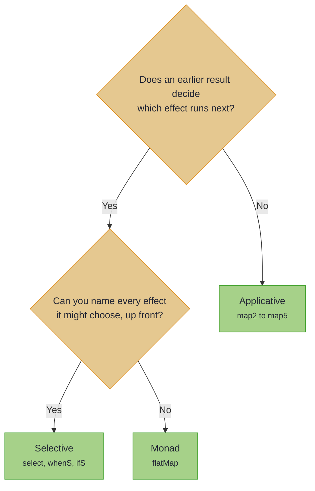

<!-- description: Choose between Applicative, Selective and Monad by one question, and see why an applicative program can be read and checked before it runs. -->

# Applicative, Selective or Monad?

_Pick the least powerful of the three that does the job, and keep what that buys._

<!-- source: Arthur Conan Doyle, "A Scandal in Bohemia" (1891), in The Adventures of Sherlock Holmes; text checked against Project Gutenberg eBook #1661 -->
> _"It is a capital mistake to theorise before one has data."_
>
> — Arthur Conan Doyle, *A Scandal in Bohemia*

Theorising about a `flatMap` chain before it runs is Holmes's mistake: its next step is built from data that arrives only when the program runs. An applicative program names every step before any runs, so you can read it first.

~~~admonish info title="What You'll Learn"
- Choose between `Applicative`, `Selective` and `Monad` by whether a step needs an earlier result
- Say what each level can express that the one before cannot
- Hold an applicative program as data, and count or check its instructions before it runs
- Say why a monadic program cannot be read in advance
~~~

~~~admonish example title="See Example Code"
**The code on this page is [AbstractionBook.java](https://github.com/higher-kinded-j/higher-kinded-j/blob/main/hkj-examples/src/main/java/org/higherkindedj/example/book/foundations/abstraction/AbstractionBook.java)**, with examples from the [Applicative](applicative.md) and [Monad](monad.md) pages: the page includes them, so the build compiles and runs them. [AbstractionBookTest.java](https://github.com/higher-kinded-j/higher-kinded-j/blob/main/hkj-examples/src/test/java/org/higherkindedj/example/book/foundations/abstraction/AbstractionBookTest.java) holds what the page says. [StaticAnalysisExample.java](https://github.com/higher-kinded-j/higher-kinded-j/blob/main/hkj-examples/src/main/java/org/higherkindedj/example/basic/free_ap/StaticAnalysisExample.java) and [PermissionCheckingExample.java](https://github.com/higher-kinded-j/higher-kinded-j/blob/main/hkj-examples/src/main/java/org/higherkindedj/example/basic/free_ap/PermissionCheckingExample.java) take the analysis further.
~~~

---

## Two questions decide {#two-questions-decide}

Ask whether an earlier result decides which effect runs next, and then whether you can name every effect it might choose before the program runs.



In words: if results are only combined, as `map2` adds two prices, use `Applicative`. If a result only picks among effects you can name, use `Selective`. If the next step is built from the result, use `Monad`. Each level can express what the one before it can, and each step up gives something away. An applicative program can be read before it runs. A selective one names every effect it might run, and a monadic one names only its first.

## Applicative: steps that do not depend on one another {#applicative}

The code on this page uses these imports, with `LineItem`, `Order`, `OrderLenses` and `OrderStatus` from the order records the [Optics](../optics/ch_intro.md) chapter introduces:

<!-- verify -->
```java
import static org.higherkindedj.example.book.foundations.OrderOpKindHelper.ORDER_OP;
import static org.higherkindedj.hkt.id.IdKindHelper.ID;

import java.math.BigDecimal;
import java.util.Map;
import java.util.function.Function;
import org.higherkindedj.example.book.foundations.OrderOp;
import org.higherkindedj.example.book.foundations.OrderOpInterpreter;
import org.higherkindedj.example.book.foundations.OrderOpKind;
import org.higherkindedj.example.book.optics.cast.LineItem;
import org.higherkindedj.example.book.optics.cast.Order;
import org.higherkindedj.example.book.optics.cast.OrderLenses;
import org.higherkindedj.example.book.optics.cast.OrderStatus;
import org.higherkindedj.hkt.Applicative;
import org.higherkindedj.hkt.Kind;
import org.higherkindedj.hkt.Monad;
import org.higherkindedj.hkt.TypeArity;
import org.higherkindedj.hkt.WitnessArity;
import org.higherkindedj.hkt.free_ap.FreeAp;
import org.higherkindedj.hkt.free_ap.FreeApAnalyzer;
import org.higherkindedj.hkt.id.Id;
import org.higherkindedj.hkt.id.IdKind;
import org.higherkindedj.hkt.id.IdMonad;
```

A line item's SKU, quantity and price are checked on their own, so `map3` combines them, and no check can change which others run. With `Validated`'s instance, every failing check is reported, as [Applicative](applicative.md) shows:

```java
{{#include ../../../hkj-examples/src/main/java/org/higherkindedj/example/book/foundations/applicative/ApplicativeBook.java:generic}}
```

## Selective: one of a few effects, named up front {#selective}

A large order is flagged for review, and a small one is not. The flag's effect is passed in before the condition runs, and the condition only decides whether it runs. `whenS` and `ifS` work this way, as [Selective](selective.md) shows. Every effect that might run is a value you passed in.

## Monad: the next step built from the last result {#monad}

Saving an order needs the order the lookup found, so the save is built from that result, and does not exist until the lookup runs. That is `flatMap`, as [Monad](monad.md) shows:

```java
{{#include ../../../hkj-examples/src/main/java/org/higherkindedj/example/book/foundations/monad/MonadBook.java:generic}}
```

## Reading a program before it runs {#reading-a-program-before-it-runs}

An applicative program can be held as data, so you can check it before anything runs. Count its instructions to estimate the work, look for one that needs a permission, or log what it will do. A [Free Applicative](../monads/free_applicative.md) holds a program this way. Reading a `Selective` program before it runs is not supported yet, and a monadic one cannot be read in advance.

The instructions here are the order service's. Each is a record: `PriceOf` asks for a SKU's price, and `Cancel` cancels an order. Its `k` turns the instruction's result into the program's value, so `price -> price` keeps the price. [`@EffectAlgebra`](../effect/effect_handlers.md#defining-effects) generates `OrderOpKind`, `ORDER_OP` and `OrderOpInterpreter` from it.

```java
{{#include ../../../hkj-examples/src/main/java/org/higherkindedj/example/book/foundations/OrderOp.java:order_op}}
```

A program prices two SKUs, neither depending on the other, and adds the prices:

```java
{{#include ../../../hkj-examples/src/main/java/org/higherkindedj/example/book/foundations/abstraction/AbstractionBook.java:program}}
```

`FreeApAnalyzer` reads the program without running it:

```java
{{#include ../../../hkj-examples/src/main/java/org/higherkindedj/example/book/foundations/abstraction/AbstractionBook.java:analyse}}
```

An interpreter then decides what each instruction does, and `foldMap` runs the program with it. [`Id`](../monads/identity.md) adds nothing to a value, so the run gives the plain total:

```java
{{#include ../../../hkj-examples/src/main/java/org/higherkindedj/example/book/foundations/abstraction/AbstractionBook.java:interpreter}}
```

```java
{{#include ../../../hkj-examples/src/main/java/org/higherkindedj/example/book/foundations/abstraction/AbstractionBook.java:run}}
```

A `flatMap` chain cannot be read this way: its second step is a function, and what that function does is known only when it runs on the first step's result.

## Things people get wrong {#things-people-get-wrong}

~~~admonish warning title="Common Misunderstandings"
- **"`Monad` is the safe default."** It can do everything, and costs what the others keep. `Validated`'s `map3` reports every failing check where its `flatMap` stops at the first, and a `flatMap` chain cannot be read before it runs.
- **"An applicative program runs its steps at the same time."** No instance on these pages does, as [Applicative](applicative.md#things-people-get-wrong) says.
- **"A `Selective` program can be analysed before it runs."** Only a Free Applicative program can be read first.
- **"Only built-in operations can be read first."** Any sealed set of instructions will do, such as `OrderOp`.
~~~

---

~~~admonish tip title="See Also"
- [Applicative](applicative.md): combining steps that do not depend on one another
- [Selective](selective.md): one of a few effects, chosen by an earlier result
- [Monad](monad.md): chaining steps that depend on the last result
- [Free Applicative](../monads/free_applicative.md): applicative programs held as data
~~~

~~~admonish tip title="Further Reading"
- **Chris Penner**, [Monads Are Too Powerful](https://chrispenner.ca/posts/expressiveness-spectrum): the article this page's question comes from
- **Andrey Mokhov, Georgy Lukyanov, Simon Marlow and Jeremie Dimino**, [Selective Applicative Functors](https://dl.acm.org/doi/10.1145/3341694): the paper that introduced `Selective`
~~~

---

**Previous:** [MonadZero](monad_zero.md)
**Next:** [Bifunctor](bifunctor.md)
