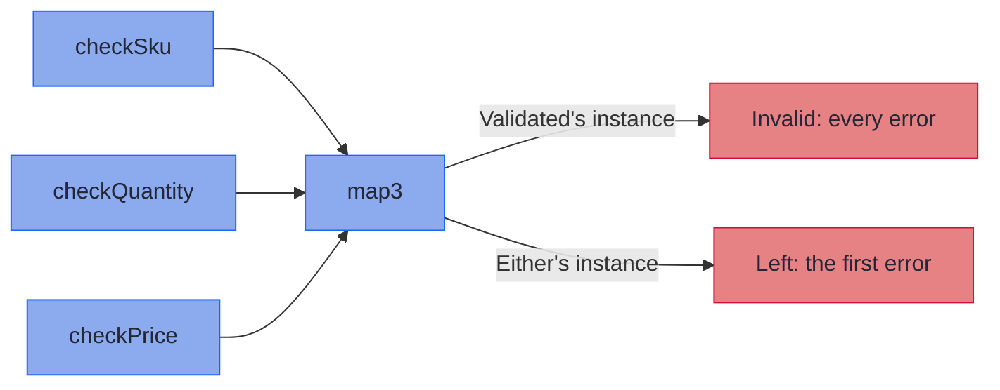

<!-- description: Combine independent values with Applicative: build one value from several with map2 to map5, see what each instance does, and check the four laws with hkj-test. -->

# Applicative: Combining Independent Computations

_Combine values that do not depend on one another, and let each container's instance decide what a failure does._

<!-- source: John Locke, An Essay Concerning Human Understanding, Book II, Chapter XII, section 1, a passage added in the fourth edition (1700); text checked against A. C. Fraser's edition (Clarendon Press, 1894), vol. I, p. 213 -->
> _"The acts of the mind, wherein it exerts its power over its simple ideas, are chiefly these three: (1) Combining several simple ideas into one compound one; and thus all complex ideas are made."_
>
> — John Locke, *An Essay Concerning Human Understanding* (Book II, Chapter XII)

`map3` performs Locke's first act: it combines three checked values into one line item.

~~~admonish info title="What You'll Learn"
- Build one value from several independent ones with `map2` to `map5`
- Say what `of` and `ap` add to `Functor`
- Predict what each instance's `map2` does: combine the errors, keep the first, or give every combination
- Choose between `map3` and `flatMap` by whether a step needs another's result
- Check an instance against the four applicative laws with `hkj-test`'s `ApplicativeLaws`
~~~

~~~admonish example title="See Example Code"
**The code on this page is [ApplicativeBook.java](https://github.com/higher-kinded-j/higher-kinded-j/blob/main/hkj-examples/src/main/java/org/higherkindedj/example/book/foundations/applicative/ApplicativeBook.java)**: the page includes it, so the build compiles and runs it. [ApplicativeBookTest.java](https://github.com/higher-kinded-j/higher-kinded-j/blob/main/hkj-examples/src/test/java/org/higherkindedj/example/book/foundations/applicative/ApplicativeBookTest.java) holds what the page says each instance does, and [FoundationsLawsBookTest.java](https://github.com/higher-kinded-j/higher-kinded-j/blob/main/hkj-examples/src/test/java/org/higherkindedj/example/book/foundations/FoundationsLawsBookTest.java) checks the laws.
~~~

---

## When `map` is not enough {#when-map-is-not-enough}

[Functor](functor.md)'s `map` changes the value inside one container, and cannot reach a second. A line item needs three values: a SKU, a quantity and a price, each checked on its own. None of the checks needs another's result, so a line item that fails two checks could report both.

For one container, an [Effect Path](../effect/ch_intro.md) combines values with `zipWith`, and `ValidationPath`'s `zipWithAccum` keeps every error, as [Error Accumulation](../effect/path_validation.md#error-accumulation-the-point-of-it-all) shows. `ListPath`'s `zipWith` pairs by position, where `List`'s `Applicative` and `NonDetPath` give every combination. Application code stays on the Paths. This page is for a method written once for any container.

The code on this page uses these imports, with `LineItem` from the order records the [Optics](../optics/ch_intro.md) chapter introduces:

<!-- verify -->
```java
import static org.higherkindedj.hkt.either.EitherKindHelper.EITHER;
import static org.higherkindedj.hkt.instances.Witnesses.either;
import static org.higherkindedj.hkt.validated.ValidatedKindHelper.VALIDATED;

import java.math.BigDecimal;
import java.util.List;
import org.higherkindedj.example.book.optics.cast.LineItem;
import org.higherkindedj.hkt.Applicative;
import org.higherkindedj.hkt.Kind;
import org.higherkindedj.hkt.Semigroups;
import org.higherkindedj.hkt.TypeArity;
import org.higherkindedj.hkt.WitnessArity;
import org.higherkindedj.hkt.either.Either;
import org.higherkindedj.hkt.either.EitherKind;
import org.higherkindedj.hkt.instances.Instances;
import org.higherkindedj.hkt.validated.Validated;
import org.higherkindedj.hkt.validated.ValidatedKind;
```

Each check returns a [`Validated`](../monads/validated_monad.md): a `Valid` holding the value, or an `Invalid` holding a list of errors.

```java
{{#include ../../../hkj-examples/src/main/java/org/higherkindedj/example/book/foundations/applicative/ApplicativeBook.java:checks}}
```

## What an `Applicative` adds {#what-an-applicative-adds}

`Applicative<F>` extends `Functor<F>` with two methods, and builds `map2` to `map5` from `map` and `ap`:

<!-- verify -->
```java
public interface Applicative<F extends WitnessArity<TypeArity.Unary>> extends Functor<F> {

  <A> Kind<F, A> of(@Nullable A value);

  <A, B> Kind<F, B> ap(Kind<F, ? extends Function<A, B>> ff, Kind<F, A> fa);

  // abridged: the null checks and a curried overload are left out,
  // and map3, map4 and map5 follow the same pattern
  default <A, B, C> Kind<F, C> map2(
      Kind<F, A> fa, Kind<F, B> fb, BiFunction<? super A, ? super B, ? extends C> f) {
    return ap(map(a -> b -> f.apply(a, b), fa), fb);
  }
}
```

`of` lifts a plain value into the container: `Validated`'s gives a `Valid`, and `Maybe`'s a `Just`. `ap` applies a function held in a container to a value held in another.

You will rarely call `ap` yourself. `map(a -> b -> f.apply(a, b), fa)` gives a `Kind<F, Function<B, C>>`: the first value inside a function that waits for the second. `ap` applies that function to `fb`. `map3` to `map5` add an input each the same way, and they are what you call.

## One method for any container {#one-method-for-any-container}

`lineItem` is written over `Applicative`. It takes the `Applicative` for `F` and calls `map3` on it:

```java
{{#include ../../../hkj-examples/src/main/java/org/higherkindedj/example/book/foundations/applicative/ApplicativeBook.java:generic}}
```

Run it with `Validated`'s `Applicative`, then with `Either`'s, on a blank SKU and a quantity of zero:

```java
{{#include ../../../hkj-examples/src/main/java/org/higherkindedj/example/book/foundations/applicative/ApplicativeBook.java:instances}}
```

The call is the same both times. `Instances.validated` builds `Validated`'s instance from a [semigroup](semigroup_and_monoid.md), here one that joins two lists, so it reports both errors. With `Semigroups.first()` it would report only the first. `Either`'s instance always keeps the first. `toEither()` turns each check's `Validated` into an `Either` holding the same errors, so only the instance differs.

## What each instance does {#what-each-instance-does}

`Applicative` promises that `map3` combines the three values when all are there. What it does otherwise is each instance's own:



The diagram shows three checks that never see one another's results, meeting only at `map3`, where the instance decides what comes out. With two inputs, the instances you will meet most behave like this, and `map3` to `map5` do the same with more:

| Instance | What `map2` does with its two inputs |
|---|---|
| `Validated`, from `Instances.validated(semigroup)` | Gives the combined value if both are valid; otherwise the invalid inputs' errors, combined by the semigroup in the order of the inputs. `Semigroups.list()` keeps every error |
| `Either`, `Try` | Gives the first failure, and drops the second |
| `Maybe`, `Optional` | Is empty if either input is empty |
| `List`, `NonEmptyList` | Gives every combination: two lists of two give four values |
| [`IO`](../monads/io_monad.md), `VTask` | Builds a new deferred value that, when it runs, runs the first input and then the second. If the first fails, the second never runs |
| `CompletableFuture` | Completes when both inputs have. `map2` starts neither future, so whether their work overlaps depends on what completes each one |
| `Writer`, from `Instances.writer(monoid)` | Gives the combined value, with both logs joined by the monoid |

So `Applicative` promises neither that errors accumulate nor that inputs run at the same time. Its promise is smaller: the inputs do not depend on one another. An instance can use that, as `Validated`'s does, or not, as `Either`'s does. To run two `VTask`s at the same time, use [`Par.map2`](../monads/vtask_monad.md#parallel-composition-with-par).

## Should you use `map3` or `flatMap`? {#map3-or-flatmap}

- **Use `flatMap` when a step needs the previous result.** Finding an order's customer needs the order first. `flatMap` is [Monad](monad.md)'s. On a failure that holds no value, such as a `Left`, it stops, because the next step has nothing to run on.
- **Use `map2` to `map5` when the steps are independent.** The instance can then do more with the failures, as `Validated`'s does.

The two can differ on one instance. `Instances.validated` returns a single instance with both methods: its `map3` combines the errors of every invalid input, and its `flatMap` stops at the first. [Choosing Your Abstraction Level](abstraction_levels.md) walks through the choice, `Selective` included.

## Four laws {#four-laws}

An `Applicative` keeps four laws. Together they say that `of` adds nothing of its own, and that `ap` gives the same result however you group the calls.

~~~admonish note title="Laws"
- **Identity: applying a lifted `a -> a` changes nothing.** `ap(of(a -> a), fa)` equals `fa`.
- **Homomorphism: a lifted function on a lifted value lifts the result.** `ap(of(f), of(x))` equals `of(f.apply(x))`.
- **Interchange: lifting the value instead of the function changes nothing.** `ap(ff, of(x))` equals `ap(of(f -> f.apply(x)), ff)`.
- **Composition: grouping the applications differently changes nothing.** `ap(ap(ap(of(compose), u), v), w)` equals `ap(u, ap(v, w))`, where `compose` is `f -> g -> x -> f.apply(g.apply(x))`.

Two containers are equal when they hold equal values, or equal errors, in the same shape. For a deferred container such as `IO`, they are equal when running both gives equal results. The laws assume functions that never return `null`, and [Values, never null](../hkts/core-concepts.md#values-never-null) says what each type does with one.

`ApplicativeLaws`, beside `FunctorLaws` in [`hkj-test`](../tooling/test_assertions.md#adding-the-dependency)'s `org.higherkindedj.hkt.laws` package, checks each law on any instance. `KindEquivalence.byEqualsAfter`, in `org.higherkindedj.hkt.assertions`, builds the equality from a function it applies to both sides before comparing them with `equals`. Here `VALIDATED::narrow` unwraps the `Kind`. Two `IO`s that give the same result are different objects, so for `IO` the function must also run it, as [Functor's laws test](functor.md#two-laws) does. The test checks `Validated`'s instance twice, once with every value valid and once with every value invalid. In the invalid case, Composition must join the three errors in the same order on both sides. `ORDER` is any `Order`, and the test uses these imports, with JUnit's:

<!-- verify -->
```java
import static org.higherkindedj.hkt.validated.ValidatedKindHelper.VALIDATED;

import java.util.List;
import java.util.function.Function;
import org.higherkindedj.example.book.optics.cast.Customer;
import org.higherkindedj.example.book.optics.cast.EmailAddress;
import org.higherkindedj.example.book.optics.cast.Order;
import org.higherkindedj.hkt.Applicative;
import org.higherkindedj.hkt.Semigroups;
import org.higherkindedj.hkt.assertions.KindEquivalence;
import org.higherkindedj.hkt.instances.Instances;
import org.higherkindedj.hkt.laws.ApplicativeLaws;
import org.higherkindedj.hkt.validated.Validated;
import org.higherkindedj.hkt.validated.ValidatedKind;
```

```java
{{#include ../../../hkj-examples/src/test/java/org/higherkindedj/example/book/foundations/FoundationsLawsBookTest.java:applicative_laws}}
```
~~~

## Things people get wrong {#things-people-get-wrong}

~~~admonish warning title="Common Misunderstandings"
- **"`Applicative` accumulates errors."** `Validated`'s instance does. `Either`'s keeps the first error, and both are `Applicative`s.
- **"`Applicative` runs its inputs at the same time."** No instance on this page starts its inputs together: `IO` and `VTask` run them in order, and `CompletableFuture`'s waits for two futures it never started. For `VTask`s that run at once, use `Par.map2`.
- **"`Applicative` is `Monad` without `flatMap`."** Every `Monad` has an `ap`, but an instance's `ap` can do what its `flatMap` cannot, as `Validated`'s does.
- **"`map2` is only for two values."** `map3`, `map4` and `map5` take more, and stop at five. For a record with more fields, `Validated.fields()` in [Accumulating Assembly](../monads/validated_assembly.md) takes more.
~~~

~~~admonish tip title="You can ship now"
You can now build one value from several independent ones, in a method written once for any container, as `lineItem` is. You can say what each instance does with a failure, and check an instance against the four laws. The rest of this page is for which types have an `Applicative`, where `Validated` bends a rule, and what builds on `Applicative`.
~~~

---

## The fine print {#the-fine-print}

### Which types have an `Applicative` {#which-types-have-an-applicative}

| Types | Their `Applicative` comes from |
|---|---|
| Every token in `Witnesses` | Their `Monad`, so [`Instances.applicative(token)` always succeeds](instances_facade.md#what-the-compiler-checks) |
| `Validated`, `Writer`, `EitherOrBoth` and the transformers | Their `Monad`, from `Instances` with its argument, such as `Instances.validated(semigroup)` |
| `Free` | Its `Monad`, built with `new FreeMonad<>()` |
| `Const`, `FreeAp` and `Fetch` | An `Applicative`, with no `Monad` |
| `EitherF` and `Coyoneda` | Nowhere: they have a `Functor` only |

### Where `Validated` bends a rule {#where-validated-bends-a-rule}

A `Monad`'s `ap` should agree with its `flatMap`: `ap(ff, fa)` should equal `flatMap(f -> map(f, fa), ff)`. `Validated`'s instance breaks this on purpose, as its javadoc says, so that `map2` to `map5` can combine the errors of every input. `hkj-test`'s `MonadLaws` checks the three monad laws, not this one. [Validated](../monads/validated_monad.md) says when you want each behaviour.

### What builds on `Applicative` {#what-builds-on-applicative}

- **`Monad` extends `Applicative`.** Every monad on the next pages has `of`, `ap` and `map2`.
- **`Selective` and `Alternative` extend it too.** [Selective](selective.md) adds steps that run only when a condition holds, and [Alternative](alternative.md) adds a fallback.
- **`Traverse` takes an `Applicative`.** `traverse` runs a function on every element and combines the results with the instance it is given, so `Validated`'s combines every element's errors, as [Foldable and Traverse](foldable_and_traverse.md) shows.

---

~~~admonish tip title="See Also"
- [Functor](functor.md): the `map` that `Applicative` extends
- [Monad](monad.md): sequencing dependent computations with `flatMap`
- [Choosing Your Abstraction Level](abstraction_levels.md): `Applicative`, `Selective` or `Monad`
- [Validated](../monads/validated_monad.md): the type built to report every error
~~~

~~~admonish tip title="Further Reading"
- **Conor McBride and Ross Paterson**, [Applicative Programming with Effects](https://www.staff.city.ac.uk/~ross/papers/Applicative.html): the paper that introduced applicative functors
- **Mark Seemann**, [Applicative Functors](https://blog.ploeh.dk/2018/10/01/applicative-functors/): a practical introduction, with examples in languages close to Java
~~~

~~~admonish info title="Hands-On Learning"
Practise Applicative combining in [Tutorial 03: Applicative Combining](https://github.com/higher-kinded-j/higher-kinded-j/blob/main/hkj-examples/src/test/java/org/higherkindedj/tutorial/coretypes/Tutorial03_ApplicativeCombining.java) (8 exercises).
~~~

---

**Previous:** [Functor](functor.md)
**Next:** [Monad](monad.md)
