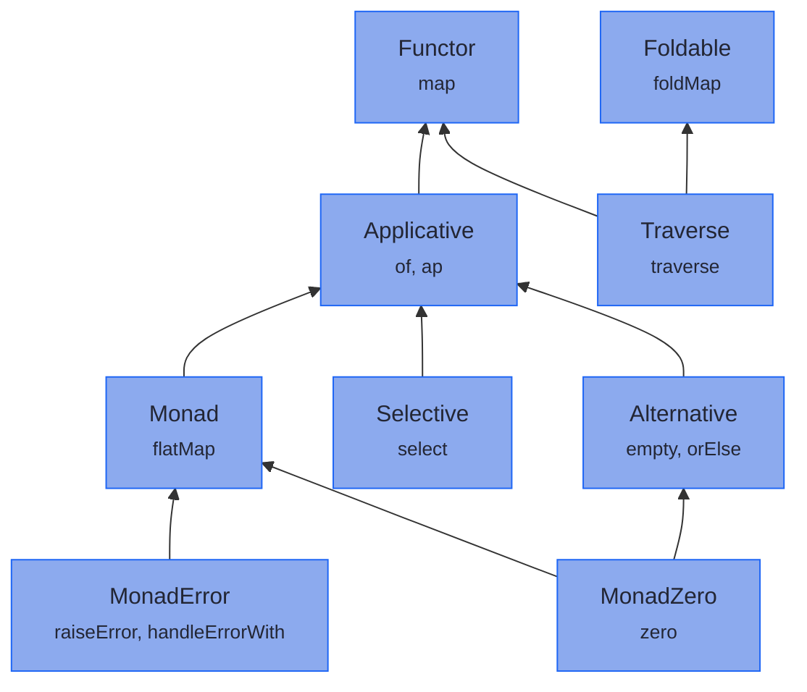

<!-- description: The type classes beyond Functor, Applicative, Monad and MonadError, with one hierarchy read from the library itself. -->

# Type Classes

<!-- source: Alfred North Whitehead, An Introduction to Mathematics (1911), Chapter V, "The Symbolism of Mathematics", p. 61; checked against Project Gutenberg eBook #41568 -->
> _"Civilization advances by extending the number of important operations which we can perform without thinking about them."_
>
> — Alfred North Whitehead, *An Introduction to Mathematics* (Chapter V)

---

This group adds operations you can perform on a container without thinking about which one it is: `foldMap`, `traverse`, `orElse`, `select`. Each needs the container to have an instance of the type class that declares it, and [the hierarchy](#the-hierarchy) shows which class that is.

The Ship pages in the [Chapter Contents](../hkts/foundations_intro.md#chapter-contents) teach the four type classes most code needs: `Functor`, `Applicative`, `Monad` and `MonadError`. The rest are here, with the `For` comprehensions that build on them. Read one when a task calls for it, such as folding a list into one value, validating every element with `traverse`, falling back with `orElse`, or mapping both sides of an `Either`. Until then you can skip the group.

---

## The hierarchy {#the-hierarchy}

Each arrow means *extends*, and each box lists the abstract methods its type class declares. A test in the examples module reads the boxes and arrows from `hkj-api` itself, so the diagram cannot show an `extends` the library does not have. An instance of a type class is an instance of every class it extends, so a `Monad<F>` can go wherever code asks for a `Functor<F>`.

`MonadReader`, `MonadState` and `MonadWriter` extend `Monad` too, and [MTL Capabilities](../transformers/mtl_capabilities.md) covers them. `Bifunctor` and `Profunctor` take a binary witness, which leaves two type arguments open, as [Type Arity](../hkts/type-arity.md) explains, and extend no other type class. `Semigroup` and `Monoid` take a plain type rather than a witness, and `Monoid` extends `Semigroup`.

---

## Pages in this group {#pages-in-this-group}

1. [Semigroup and Monoid](semigroup_and_monoid.md): Combining two values of one type, and the empty value a combination starts from
2. [Foldable and Traverse](foldable_and_traverse.md): Reducing a container to one value, and running a step on every element to get one result holding them all
3. [Natural Transformation](natural_transformation.md): Moving values from one container type to another, such as a `Maybe` to a `List`
4. [Selective](selective.md): Branching on an earlier result, with both branches given up front
5. [Alternative](alternative.md): `empty` and `orElse`, which `Maybe` reads as a fallback and `List` as both lists joined
6. [MonadZero](monad_zero.md): A `Monad` with an empty value, which lets a `For` comprehension filter
7. [Choosing Abstraction Levels](abstraction_levels.md): Whether a task needs `Applicative`, `Selective` or `Monad`
8. [Bifunctor](bifunctor.md): Mapping either or both type arguments of a type such as `Either` or `Tuple2`
9. [Profunctor](profunctor.md): Adapting what a function takes and what it returns
10. [Optics Integration](for_optics.md): Lenses, prisms, isos and traversals as steps in a `For` comprehension
11. [MTL & ForState Bridge](for_mtl.md): `MonadReader`, `MonadState` and `MonadWriter` steps in a `For` comprehension, and the bridge to `ForState`
12. [ForState Comprehension](forstate_comprehension.md): A comprehension that keeps its values in a named record rather than a tuple

---

**Previous:** [Adding Your Own Type](../hkts/extending-simulation.md)
**Next:** [Semigroup and Monoid](semigroup_and_monoid.md)
