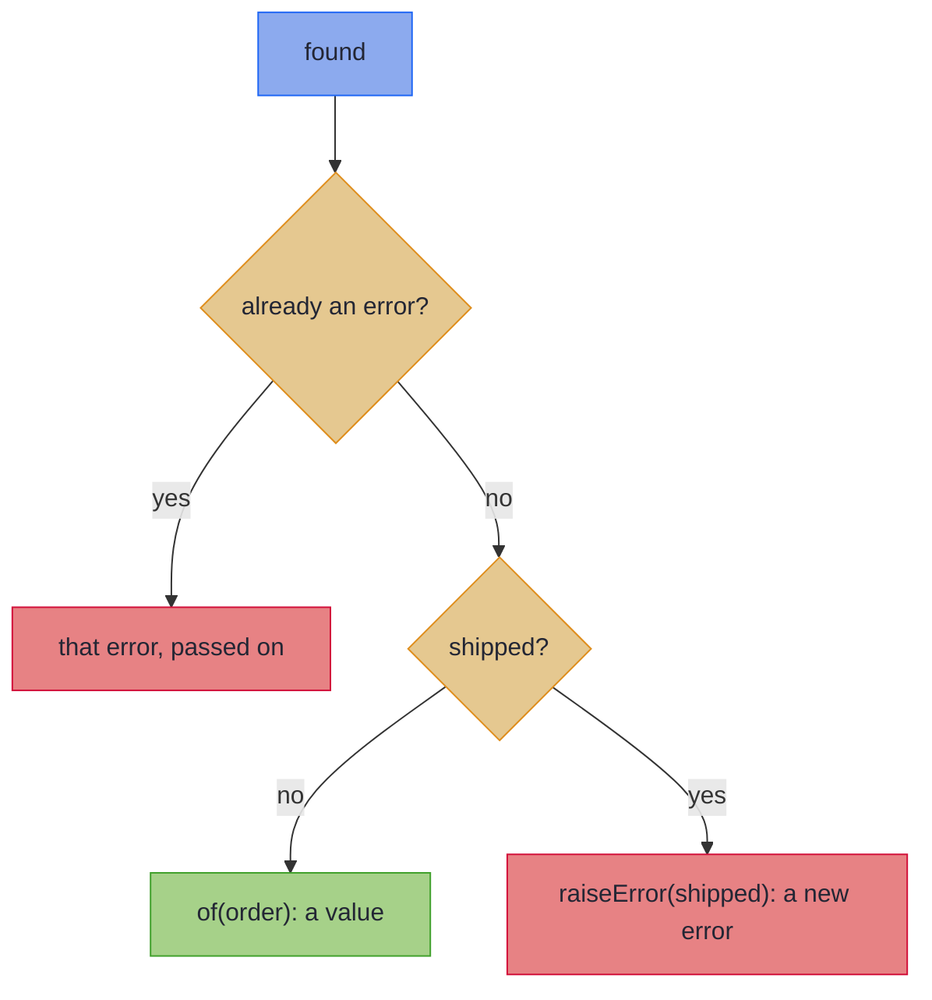

<!-- description: Raise an error as a value with MonadError, recover from it in one method for any container, and see each instance's error type and laws. -->

# MonadError: Handling Errors Gracefully

_Raise an error as a value, and recover from it, in any container whose instance has an error type._

<!-- source: F. Scott Fitzgerald, "The Crack-Up", Esquire, February 1936; text checked against Esquire's online reprint of the essay -->
> _"the test of a first-rate intelligence is the ability to hold two opposed ideas in the mind at the same time, and still retain the ability to function."_
>
> — F. Scott Fitzgerald, *The Crack-Up*

A chain that can fail holds two paths in mind at once: the one where every step succeeds, and the one where a step goes wrong. `MonadError` writes both in the same code.

~~~admonish info title="What You'll Learn"
- Say why a typed error travels where an exception cannot
- Raise an error as a value with `raiseError`, in one method for any container
- Name each instance's error type, and what `raiseError` builds in it
- Choose among `handleErrorWith`, `handleError`, `recover` and `recoverWith`, and say which builds its fallback first
- State the three laws that tie raising to handling
~~~

~~~admonish example title="See Example Code"
**The code on this page is [MonadErrorBook.java](https://github.com/higher-kinded-j/higher-kinded-j/blob/main/hkj-examples/src/main/java/org/higherkindedj/example/book/foundations/monaderror/MonadErrorBook.java)**: the page includes it, so the build compiles and runs it. [MonadErrorBookTest.java](https://github.com/higher-kinded-j/higher-kinded-j/blob/main/hkj-examples/src/test/java/org/higherkindedj/example/book/foundations/monaderror/MonadErrorBookTest.java) holds what the page says each instance does, and [FoundationsLawsBookTest.java](https://github.com/higher-kinded-j/higher-kinded-j/blob/main/hkj-examples/src/test/java/org/higherkindedj/example/book/foundations/FoundationsLawsBookTest.java) checks the laws.
~~~

---

## When an exception is not enough {#when-an-exception-is-not-enough}

An exception does one job well: a method throws, and a caller that can act catches. A few flat `try` blocks with early returns handle most code. The trouble starts when a failure has to travel through code that was not written for it. A checked exception cannot leave the lambda passed to `map`:

<!-- verify:rejects "unreported exception" -->
```java
List<Order> orders = ids.stream().map(id -> findOrThrow(id)).toList();
```

javac refuses it with "unreported exception OrderNotFoundException". An unchecked exception gets through, but then nothing in the signature says what can fail. A typed error is a value instead: it sits in the return type, and passes through `map` and `flatMap` as any value does. With `find` returning an `Either<String, Order>`, the same lambda compiles, and each missing order is a `Left` in the list:

<!-- verify -->
```java
List<Either<String, Order>> orders = ids.stream().map(id -> find(id)).toList();
```

You already raise and recover with values on one container:

<!-- verify -->
```java
CompletableFuture.failedFuture(new OrderNotFoundException(id));  // an error as a value
future.exceptionallyCompose(error -> fetchFromArchive(id));      // recover with another future
future.exceptionally(error -> placeholder);                       // recover with a plain value
```

`MonadError` names those three for any container: `raiseError`, `handleErrorWith` and `handleError`.

For one container, an [Effect Path](../effect/ch_intro.md) carries its error in its type, and recovers with its own methods, such as `EitherPath`'s `recover` and `recoverWith`, which take a function of the error. On `MonadError` the same two names take a fixed value, as [The same names on a Path](#the-same-names-on-a-path) shows. Application code stays on the Paths. This page is for a method written once for any container with an error type.

The code on this page uses these imports, with `Order` from the order records the [Optics](../optics/ch_intro.md) chapter introduces:

<!-- verify -->
```java
import static org.higherkindedj.hkt.either.EitherKindHelper.EITHER;
import static org.higherkindedj.hkt.instances.Witnesses.either;
import static org.higherkindedj.hkt.instances.Witnesses.maybe;
import static org.higherkindedj.hkt.instances.Witnesses.try_;
import static org.higherkindedj.hkt.maybe.MaybeKindHelper.MAYBE;
import static org.higherkindedj.hkt.trymonad.TryKindHelper.TRY;

import org.higherkindedj.example.book.optics.cast.Order;
import org.higherkindedj.example.book.optics.cast.OrderStatus;
import org.higherkindedj.hkt.Kind;
import org.higherkindedj.hkt.MonadError;
import org.higherkindedj.hkt.TypeArity;
import org.higherkindedj.hkt.Unit;
import org.higherkindedj.hkt.WitnessArity;
import org.higherkindedj.hkt.either.Either;
import org.higherkindedj.hkt.either.EitherKind;
import org.higherkindedj.hkt.instances.Instances;
import org.higherkindedj.hkt.maybe.Maybe;
import org.higherkindedj.hkt.maybe.MaybeKind;
import org.higherkindedj.hkt.trymonad.Try;
import org.higherkindedj.hkt.trymonad.TryKind;
```

## What a `MonadError` adds {#the-solution-raiseerror-and-handleerrorwith}

`MonadError<F, E>` extends [`Monad<F>`](monad.md) with two methods, where `E` is the instance's error type:

<!-- verify -->
```java
public interface MonadError<F extends WitnessArity<TypeArity.Unary>, E> extends Monad<F> {

  <A> Kind<F, A> raiseError(E error);

  <A> Kind<F, A> handleErrorWith(Kind<F, A> ma, Function<? super E, ? extends Kind<F, A>> handler);

  // abridged: handleError, recover and recoverWith are default methods
  // built on handleErrorWith
}
```

`raiseError` builds a failed value. Nothing is thrown, and every instance refuses a `null` error. `handleErrorWith` runs `handler` on a failure, and passes a success on unchanged. The handler gives back a container of its own, so a recovery can fail too.

## One method for any container {#one-method-for-any-container}

`refuseShipped` is written over `MonadError`, as `totalUnlessShipped` on [Working with Kind](../hkts/usage-guide.md) is, without the total. It takes the `MonadError` for `F` and the error to raise, so it never needs to know what an error is in `F`:

```java
{{#include ../../../hkj-examples/src/main/java/org/higherkindedj/example/book/foundations/monaderror/MonadErrorBook.java:generic}}
```



The diagram shows that only a shipped order becomes a new error. A caller's `handleErrorWith` can replace either error. Run it on an order that has shipped, with `Either`'s instance, then `Try`'s, then `Maybe`'s. `SHIPPED` is any `Order` whose status is `SHIPPED`:

```java
{{#include ../../../hkj-examples/src/main/java/org/higherkindedj/example/book/foundations/monaderror/MonadErrorBook.java:instances}}
```

The call is the same each time, and the error is the instance's: a `String` for this `Either`, a `Throwable` for `Try`, and [`Unit`](../hkts/core-concepts.md#unit) for `Maybe`. `Unit` is a type with one value, because `Nothing` carries no detail.

## What each instance does {#what-each-instance-does}

`MonadError` promises that `handleErrorWith` runs its handler on what `raiseError` built, and leaves a success alone. What an error is, and when the handler runs, is each instance's own:

| Instance | Its error type `E` | `raiseError(e)` gives | `handleErrorWith` runs the handler |
|---|---|---|---|
| `Either<L, A>` | `L` | `Left(e)` | On a `Left` |
| [`Validated<E, A>`](../monads/validated_monad.md) | `E` | `Invalid(e)` | On an `Invalid` |
| [`Try`](../monads/try_monad.md) | `Throwable` | `Failure(e)` | On a `Failure`. An exception the handler throws becomes a `Failure` too |
| `Maybe`, `Optional` | `Unit` | `Nothing`, or an empty `Optional` | On `Nothing` or an empty `Optional`, with `Unit.INSTANCE` |
| `CompletableFuture` | `Throwable` | A future that has failed with `e` | When the future fails, with the cause unwrapped from any `CompletionException` |
| `VTask` | `Throwable` | A task that fails with `e` when it runs | When the task fails, as it runs |

`IO`, `List`, `Writer`, `State` and `Reader` have no `MonadError`. An `IO` that fails throws its exception when it runs, and an `IOPath` recovers with its own `handleError`.

## Recovering {#recovering}

Four methods recover from an error, and `handleErrorWith` is the one the others are built on:

| Method | What it does | Built as |
|---|---|---|
| `handleErrorWith(ma, handler)` | Runs `handler` on the error, for a recovery that can itself fail | The instance's own |
| `handleError(ma, handler)` | Runs `handler` on the error, for a plain value | `handleErrorWith(ma, error -> of(handler.apply(error)))` |
| `recoverWith(ma, fallback)` | Swaps a failure for `fallback`, a container built before the call | `handleErrorWith(ma, error -> fallback)` |
| `recover(ma, value)` | Swaps a failure for `value` | `handleError(ma, error -> value)` |

`Store` holds one order, gives a `Left` with its own message for any other id, and counts its reads. `live` holds `ORDER`, `archive` holds `ARCHIVED`, and `MISSING` is an id neither holds. `handleErrorWith` reads the archive only when the live store fails. `handleError`'s handler gives a value of the source's own type, so `map` first turns the order into the report's `String`:

```java
{{#include ../../../hkj-examples/src/main/java/org/higherkindedj/example/book/foundations/monaderror/MonadErrorBook.java:recover}}
```


### Should you use `recoverWith` or `handleErrorWith`? {#constant-fallbacks-recover-and-recoverwith}

A ticket like this one: the order service reads each order from its live store, and falls back to the archive when the order is not there. The line is `monadError.recoverWith(live.find(id), archive.find(id))`. Every request now reads the archive too, because Java evaluates `archive.find(id)` before `recoverWith` is called, whether the live store finds the order or not. The archive starts throttling the service, and its read count climbs to match the live store's. The tests stub the archive and check only the result, which is correct; none of them counts the archive's reads.

The fix gives the archive read to a handler, which runs only on a failure. For an order the live store holds, `recoverWith` reads the archive once, and the handler never does:

```java
{{#include ../../../hkj-examples/src/main/java/org/higherkindedj/example/book/foundations/monaderror/MonadErrorBook.java:fallbacks}}
```

~~~admonish warning title="recoverWith builds its fallback first"
`recoverWith` and `recover` take a value, so Java builds it before the call, whether the source fails or not. Pass them a fallback that is already built, or cheap to build. When building it costs a read, a call or any other effect, use `handleErrorWith`, whose handler runs only on a failure.
~~~

The two shortcuts treat `null` differently, as [What the shortcuts do with null](#what-the-shortcuts-do-with-null) shows.

## Three laws {#three-laws}

A `MonadError` keeps the three [monad laws](monad.md#three-laws), and three more that tie raising to handling. Together they say that a handler sees exactly the error raised and never a success, and that no step runs on an error.

~~~admonish note title="Laws"
- **Handling a raised error is the handler.** `handleErrorWith(raiseError(e), handler)` equals `handler.apply(e)`.
- **A success is never handled.** `handleErrorWith(of(a), handler)` equals `of(a)`.
- **A raised error skips every step.** `flatMap(f, raiseError(e))` equals `raiseError(e)`.

Two containers are equal when they hold equal values, or equal errors, in the same shape. For a deferred container such as `VTask`, they are equal when running both gives equal results or the same error. The laws assume values and errors that are never `null`, and functions that never return one, and [Values, never null](../hkts/core-concepts.md#values-never-null) says what each type does with one.

Checking these three laws with an [`hkj-test`](../tooling/test_assertions.md#adding-the-dependency) helper is not supported yet. The test checks them by hand on `Either`, `Try` and `Maybe`, with an equality from `KindEquivalence.byEqualsAfter` that unwraps both sides and compares them with `equals`. Its first handler gives back the error it receives, so the first law fails if an instance hands the handler a different error. `ORDER` is any `Order`, and the test uses these imports, with JUnit's:

<!-- verify -->
```java
import static org.assertj.core.api.Assertions.assertThat;
import static org.higherkindedj.hkt.either.EitherKindHelper.EITHER;
import static org.higherkindedj.hkt.instances.Witnesses.either;
import static org.higherkindedj.hkt.instances.Witnesses.maybe;
import static org.higherkindedj.hkt.instances.Witnesses.try_;
import static org.higherkindedj.hkt.maybe.MaybeKindHelper.MAYBE;
import static org.higherkindedj.hkt.trymonad.TryKindHelper.TRY;

import java.util.function.BiPredicate;
import java.util.function.Function;
import org.higherkindedj.example.book.optics.cast.Customer;
import org.higherkindedj.example.book.optics.cast.Order;
import org.higherkindedj.hkt.Kind;
import org.higherkindedj.hkt.MonadError;
import org.higherkindedj.hkt.TypeArity;
import org.higherkindedj.hkt.Unit;
import org.higherkindedj.hkt.WitnessArity;
import org.higherkindedj.hkt.assertions.KindEquivalence;
import org.higherkindedj.hkt.either.EitherKind;
import org.higherkindedj.hkt.instances.Instances;
import org.higherkindedj.hkt.maybe.MaybeKind;
import org.higherkindedj.hkt.trymonad.TryKind;
```

```java
{{#include ../../../hkj-examples/src/test/java/org/higherkindedj/example/book/foundations/FoundationsLawsBookTest.java:monad_error_laws}}
```
~~~

## Things people get wrong {#things-people-get-wrong}

~~~admonish warning title="Common Misunderstandings"
- **"`raiseError` throws an exception."** It builds a value that holds the error. Nothing is thrown, and `flatMap` passes the error on without running its step.
- **"`handleErrorWith` and a try/catch are the same."** They look alike, and work differently. A `catch` runs when the call stack unwinds; `handleErrorWith` is a method call on a value, so it composes with `map` and `flatMap`.
- **"You have to use `Either`."** Any instance with a `MonadError` works: `Either`, `Validated`, `Try`, `Maybe`, `Optional`, `CompletableFuture`, `VTask`, and the `EitherT`, `MaybeT` and `OptionalT` transformers. An Effect Path recovers through its own methods.
- **"Recovery is for the end of the chain."** It can sit anywhere. A `handleErrorWith` between two `flatMap` calls retries one step before the chain goes on.
- **"`recoverWith` runs only on a failure."** It takes a value, so Java builds its fallback first: that is how the ticket's archive was read on every request.
~~~

~~~admonish tip title="You can ship now"
You can now raise an error as a value in a method written once for any container, as `refuseShipped` is, and name each instance's error type. You can recover with the right one of four methods, keeping a costly fallback in a handler, and state the three laws that tie raising to handling. The rest of this page is for which types have a `MonadError`, the different meaning of the same names on a Path, and what builds on `MonadError`.
~~~

---

## The fine print {#the-fine-print}

### Which types have a `MonadError` {#which-types-have-a-monaderror}

| Types | Their `MonadError` comes from |
|---|---|
| `Either`, `Try`, `Maybe`, `Optional`, `CompletableFuture`, `VTask` | `Instances.monadError(token)` |
| `Validated` | `Instances.validated(semigroup)` |
| `EitherT`, `MaybeT`, `OptionalT`, whose errors are `L`, `Unit` and `Unit` | `Instances.eitherT(outer)`, `Instances.maybeT(outer)` and `Instances.optionalT(outer)` |
| `IO`, `List`, `Writer`, `State`, `Reader` and the other transformers | Nowhere: they have none |

`Instances.monadError(token)` casts the token's `Monad`, and the compiler can check neither that cast nor `E`. [What the compiler checks](instances_facade.md#what-the-compiler-checks) says what fails, and when.

### The same names on a Path {#the-same-names-on-a-path}

An `EitherPath` recovers with methods that share two names with `MonadError`, and mean something else:

| What you want | On `MonadError` | On an `EitherPath` |
|---|---|---|
| A value from the error | `handleError(ma, error -> a)` | `path.recover(error -> a)` |
| Another container from the error | `handleErrorWith(ma, error -> mb)` | `path.recoverWith(error -> otherPath)` |
| A fixed value | `recover(ma, a)` | `path.recover(_ -> a)` |
| A fixed fallback, built only on a failure | `handleErrorWith(ma, _ -> mb)` | `path.orElse(() -> otherPath)` |
| A fallback already built | `recoverWith(ma, mb)` | `path.recoverWith(_ -> otherPath)` |

So on a Path, `recover` and `recoverWith` take a function of the error, which runs only on a failure. On `MonadError`, they take a fixed value, which Java builds first.

### What the shortcuts do with `null` {#what-the-shortcuts-do-with-null}

`recoverWith` refuses a `null` fallback, and a `null` source, at the call on every instance in the library, so a `null` fallback fails there and not later inside `handleErrorWith`. Each instance overrides `recoverWith` to check; an instance you write that keeps the default checks nothing. `recover` refuses a `null` source too, and leaves a `null` value to `of`:

| Instances | `recover(ma, null)` |
|---|---|
| `Maybe`, `Optional`, `MaybeT`, `OptionalT` | Gives `Nothing` or an empty `Optional` |
| `CompletableFuture` | Holds the `null` |
| `Either`, `Try`, `VTask`, `EitherT` | Refuses it at the call, whatever the source holds, because a success always holds a value |
| `Validated` | Refuses it only when the source is invalid |

### What builds on `MonadError` {#what-builds-on-monaderror}

- **`GenericPath` takes one.** `GenericPath.of(kind, monadError)` gives a Path over any `Kind` that can recover, with the Path meanings of `recover` and `recoverWith`, as [GenericPath](../effect/path_generic.md) shows.
- **Three transformers have one.** `EitherT`, `MaybeT` and `OptionalT` raise and recover in their own error type over any outer `Monad`, as [Monad Transformers](../transformers/ch_intro.md) shows.

---

~~~admonish tip title="See Also"
- [Monad](monad.md): the type class `MonadError` extends
- [Either](../monads/either_monad.md): the instance most code uses for a typed error
- [Try](../monads/try_monad.md): the instance whose error is a `Throwable`
- [EitherPath](../effect/path_either.md): recovery on a Path, for one container
- [One Line, Six Layers](../hkts/one_line_six_layers.md#two-encodings-one-algebra): `path.recover` beside `handleError`
~~~

~~~admonish tip title="Further Reading"
- **Typelevel**, [ApplicativeError and MonadError](https://typelevel.org/cats/typeclasses/applicativemonaderror.html): the same type class in Scala's Cats library
- **Mark Seemann**, [An Either monad](https://blog.ploeh.dk/2022/05/09/an-either-monad/): `Either` as a monad for errors, with examples in C#, F# and Haskell
~~~

~~~admonish info title="Hands-On Learning"
Practise error handling in [Tutorial 05: Monad Error Handling](https://github.com/higher-kinded-j/higher-kinded-j/blob/main/hkj-examples/src/test/java/org/higherkindedj/tutorial/coretypes/Tutorial05_MonadErrorHandling.java) (7 exercises).
~~~

---

**Previous:** [Monad](monad.md)
**Next:** [For Comprehension](for_comprehension.md)
