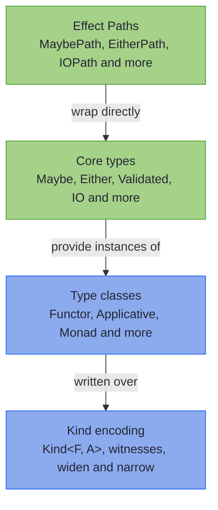

<!-- description: Write one Java method for Maybe, Either, List or any container with higher-kinded types, and learn the type classes and core types such as Validated. -->

# Foundations


<!-- source: Edsger W. Dijkstra, "The Humble Programmer", ACM Turing Lecture 1972, EWD340 -->
> _"The purpose of abstracting is not to be vague, but to create a new semantic level in which one can be absolutely precise."_
>
> — Edsger W. Dijkstra, *The Humble Programmer*

---

Dijkstra's new semantic level, in this chapter, is `Kind<F, A>`: a precise way to say "some container `F`, holding an `A`" without saying which container. Java lets you write a method for a `List`, and another for an `Optional`, but not one method for any container at all; `Kind` is how Higher-Kinded-J gets there. Application code rarely needs this level, since [Effect Paths](../effect/ch_intro.md) cover it, and [How to read this chapter](#how-to-read-this-chapter) sends you to the page you came for. Here is one method written at that level. It totals an order wherever the order happens to be:

```java
{{#include ../../../hkj-examples/src/main/java/org/higherkindedj/example/book/foundations/intro/FoundationsIntroBook.java:generic}}
```

The same method, run on three different containers:

```java
{{#include ../../../hkj-examples/src/main/java/org/higherkindedj/example/book/foundations/intro/FoundationsIntroBook.java:three}}
```

Nothing in `totals` knows about `Maybe`, `Either` or `List`. The `Functor` passed in does: it is the value that knows how to map inside its own container. `functor(maybe())` asks for the one that belongs to `Maybe`, with `functor` from `Instances` and `maybe` from `Witnesses`. The bound on `F` only says that `F` holds one type, as `Maybe` does; [Type Arity](type-arity.md) explains it. The `widen` and `narrow` calls move a value between its own type and the `Kind` view of it, whose `F` is a [witness type](core-concepts.md) standing for the container.

That is the whole of Foundations, in three layers:



In words: type classes are written over the `Kind` encoding, and the core types provide instances of them. Effect Paths such as `MaybePath` and `EitherPath` wrap the same core types and call them directly, without going through the type classes. `GenericPath` is the bridge the other way: it lifts any `Kind` and its `Monad` to the Path level.

~~~admonish tip title="Which level am I working at?"
- **Effect Paths** (`MaybePath`, `EitherPath`, `ValidationPath`): application code. Concrete types you call directly, with no witness, `widen` or `narrow` to write. Most code stays here, and the [Effect Paths](../effect/ch_intro.md) chapter teaches it.
- **Type classes over `Kind`** (`Functor<F>`, `Monad<F>`): one method for any container, as `totals` is. This chapter.
- **Your own `Kind`** (a witness, `widen` and `narrow` of your own): adding a type to the library, in [Extending the Simulation](extending-simulation.md).

When two effects must stack and no Path covers them, [Path or Transformer?](../transformers/when_to_drop_to_transformers.md) decides.
~~~

~~~admonish warning title="Before you start"
Your project builds and runs on **Java 25**. Higher-Kinded-J is built on it today, and parts of the library use preview features, which tie the build to that one release. Most of this chapter needs no preview flag: `Maybe`, `Either`, `Validated` and the type classes compile and run without one. `VTask`'s `Scope` and `Par`, and the parallel `VStream` operations, need `--enable-preview`, as [Prerequisites](../quickstart.md#prerequisites) explains. The [HKJ Gradle or Maven plugin](../tooling/gradle_plugin.md) sets the flags for you.
~~~

---

## How to read this chapter {#how-to-read-this-chapter}

You can ship with Effect Paths without reading this chapter. Start from what you came for:

| You want | Start at |
|---|---|
| One type explained, such as `Either`, `Validated` or `Maybe` | [Core Types](../monads/ch_intro.md), or [Supported Types](../monads/supported-types.md) to find the right one |
| Every error in a form or request reported at once | [ValidationPath](../effect/path_validation.md) in application code; [Validated](../monads/validated_monad.md) and [Accumulating Assembly](../monads/validated_assembly.md) for the type beneath it |
| The whole stack seen in one expression | [One Line, Six Layers](one_line_six_layers.md) |
| One method that works for every container, as `totals` does | The pages under **Ship** in the [Chapter Contents](#chapter-contents), read in order |
| A type of your own that joins the library | [Extending the Simulation](extending-simulation.md) |
| A comparison with Vavr, Cyclops or Arrow-Kt | [Foundations FAQ](faq.md) |
| The type class interfaces at a glance | [Functional API](../functional/functional_api.md) |
| The everyday API instead | [Effect Paths](../effect/ch_intro.md) |

~~~admonish info title="Hands-On Learning"
The [Foundations journey](../tutorials/coretypes/foundations_journey.md) practises the Ship pages as exercises, from `Kind` basics through Functor, Applicative and Monad.
~~~

---

## Chapter Contents

**Ship**, read in order:

1. [One Line, Six Layers](one_line_six_layers.md): The whole stack in one expression
2. [How the Encoding Works](core-concepts.md): Witness types, `Kind`, and widen and narrow
3. [Working with Kind](usage-guide.md): Writing generic code over `Kind`
4. [Obtaining Instances](../functional/instances_facade.md): Where a type class instance comes from
5. [Functor](../functional/functor.md): Mapping inside any container
6. [Applicative](../functional/applicative.md): Combining independent values
7. [Monad](../functional/monad.md): Sequencing steps that depend on each other
8. [MonadError](../functional/monad_error.md): Raising errors and recovering from them
9. [For Comprehension](../functional/for_comprehension.md): Chains of steps that read in order

**On demand**, when a task calls for it:

10. [Higher-Kinded Types](ch_intro.md): The encoding in depth, and adding your own type
11. [Type Classes](../functional/ch_intro.md): Monoid, Traverse, natural transformations and more
12. [Core Types](../monads/ch_intro.md): Either, Validated, IO, VTask and the rest

**Look it up**, when you hold a question:

13. [Supported Types](../monads/supported-types.md): Which type to choose, and what it supports
14. [Quick Reference](quick_reference.md): The everyday patterns at a glance
15. [Functional API](../functional/functional_api.md): The type class interfaces
16. [Foundations FAQ](faq.md): Design questions, runtime cost and comparisons
17. [Basic HKT Examples](hkt_basic_examples.md): The runnable examples, listed

---

**Next:** [One Line, Six Layers](one_line_six_layers.md)
