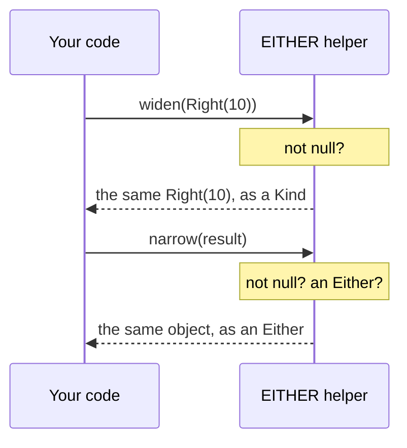
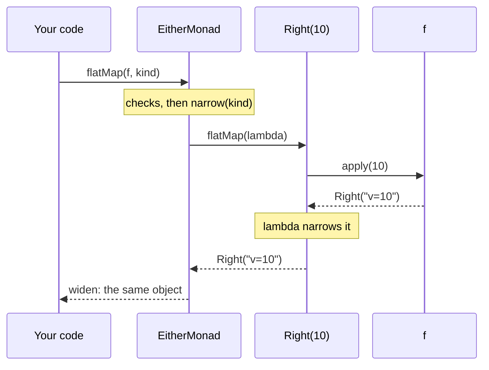

<!-- description: Follow one widen, flatMap and narrow through Higher-Kinded-J: how the call reaches its instance, what runs inside it, and what each step allocates. -->

# Lifting the Hood

_One round trip through the encoding, call by call, with what each step costs._

<!-- source: Leo Tolstoy, Anna Karenina (1878), Part One, Chapter 1, trans. Richard Pevear and Larissa Volokhonsky (2000) -->
> _"All happy families are alike; each unhappy family is unhappy in its own way."_
>
> — Leo Tolstoy, *Anna Karenina* (Part One, Chapter 1)

---

Library types widen alike: each is already a `Kind`, so `widen` hands back the same object. Each JDK type is wrapped in a holder of its own. This page follows one round trip through the encoding, call by call, and shows where that difference costs something.

~~~admonish info title="What You'll Learn"
- Trace what runs when you call `flatMap` on a `Kind`
- Say how the call reaches `EitherMonad`: through a value you pass, not a lookup at compile time
- Count what each step allocates, for a library type and for a JDK type
- Choose a library type when a holder's allocation matters
~~~

~~~admonish example title="See Example Code"
**The round trip is the `roundtrip` region of [EncodingBook.java](https://github.com/higher-kinded-j/higher-kinded-j/blob/main/hkj-examples/src/main/java/org/higherkindedj/example/book/foundations/encoding/EncodingBook.java)**, the code How the Encoding Works shows. [LiftingTheHoodBookTest.java](https://github.com/higher-kinded-j/higher-kinded-j/blob/main/hkj-examples/src/test/java/org/higherkindedj/example/book/foundations/hood/LiftingTheHoodBookTest.java) holds each claim this page makes, and reads the compiled class for the claim about the bytecode.
~~~

---

## The expression we are tracing {#the-expression-we-are-tracing}

The round trip from [How the Encoding Works](core-concepts.md#the-witness-and-kind) widens an `Either`, calls `flatMap` on it, and narrows the result:

```java
{{#include ../../../hkj-examples/src/main/java/org/higherkindedj/example/book/foundations/encoding/EncodingBook.java:roundtrip}}
```

Four calls matter: `Instances.monad`, `widen`, `flatMap` and `narrow`. The sections below take each in turn.

## How the call finds `EitherMonad` {#how-the-call-finds-eithermonad}

The instance is a value. `either()` returns a token that holds the one `EitherMonad`, and `Instances.monad(either())` hands that object back, typed as `Monad<EitherKind.Witness<String>>`. The witness type does not choose the instance. It makes javac check that `monad` and `kind` name the same container. [Obtaining Instances](../functional/instances_facade.md) covers the lookup.

`monad.flatMap(...)` is then an ordinary interface call. javac emits `invokeinterface Monad.flatMap`, and the JVM reaches `EitherMonad.flatMap` at run time, as it would for any interface method. While only one instance passes through a call site, the JIT usually inlines the call, so the interface costs little in a hot loop. The test reads the compiled class and finds that `invokeinterface`.

## `widen` and `narrow` {#widen-and-narrow}



In words: `widen` checks for `null` and returns its argument, because an `Either` already implements `Kind`. `narrow` checks for `null` and for an `Either`, then casts. Neither allocates. Given another container's `Kind`, `narrow` throws `KindUnwrapException`, as [When `narrow` throws](core-concepts.md#when-narrow-throws) explains.

Most of the library's own types work this way, among them `Maybe`, `Either`, `Validated`, `Try`, `Id` and `IO`. Five types widen into a holder instead: the JDK's `List`, `Optional`, `Stream` and `CompletableFuture`, which the library cannot change, and `Lazy`. `widen` and `narrow` stay the boundary for every type, since they read the same everywhere and check their input. That a library type is its own `Kind` is an internal guarantee, not an invitation to drop `widen` for a favoured few.

## Inside `flatMap` {#inside-flatmap}

`EitherMonad.flatMap` narrows the `Kind` it is given, and hands `Either.flatMap` a lambda that calls your function:



The diagram shows two narrows: one for the `Kind` you pass in, and one for the `Kind` your function returns. On a `Left`, `Either.flatMap` returns the same `Left` without calling the lambda. So your function never runs, and the `Kind` that comes back is the very `Left` that went in.

## What each step allocates {#what-each-step-allocates}

The same round trip, on a library type and on a JDK type:

| Step | `Either`, a library type | `Optional`, a JDK type |
|---|---|---|
| `widen` | Nothing: the same object comes back | One holder |
| `flatMap`'s own work | One lambda that captures your function | One lambda, and one holder for the result |
| Inside your function | What it builds: here a `String` and a `Right` | What it builds, and one holder when it widens its result |
| `narrow` | Nothing: a type check and a cast | Nothing: a type check and a field read |

So for a library type the machinery allocates one short-lived lambda per `flatMap`, and a JDK type adds a holder at each `widen`. The JIT can often remove short-lived objects that never leave the method, by escape analysis, but it cannot always. [Benchmarks & Performance](../benchmarks.md) has measured numbers.

That asymmetry is the tax for HKT-ifying a class the library cannot modify. The fix is not technical; it is to use library types (`Maybe`, `EitherPath`) when the cost matters.

## What this means in practice {#what-this-means-in-practice}

- **`widen` and `narrow` on a library type cost a check, not an object.** Write them wherever they make the code clearer.
- **On a JDK type, each `widen` allocates a holder.** In a tight loop, prefer `Maybe`, `Either` or `Try`. In a method that runs once per request, the holder does not show.
- **The instance is a value you pass.** A call site that sees one instance is usually inlined. One that sees many, as code generic over `F` can, pays for an ordinary interface call.

Effect Paths skip all of this. An `EitherPath` holds an `Either` and calls it directly, with no `Kind` and no instance in between, as [Two encodings, one algebra](one_line_six_layers.md#two-encodings-one-algebra) shows.

---

~~~admonish tip title="See Also"
- [How the Encoding Works](core-concepts.md): the pieces this page traces
- [Foundations FAQ](faq.md): the design questions this trace raises
- [Benchmarks & Performance](../benchmarks.md): measured numbers
~~~

---

**Previous:** [Type Arity](type-arity.md)
**Next:** [Extending the Simulation](extending-simulation.md)
