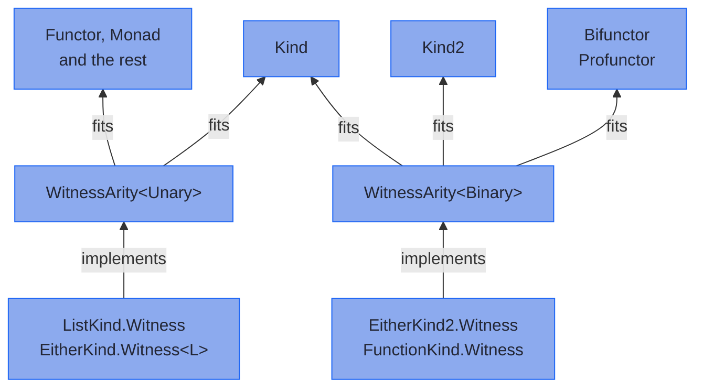

<!-- description: How a Higher-Kinded-J witness declares how many type arguments its container still needs, and why Functor takes a List but not a two-sided Either. -->

# Type Arity: Classifying Type Constructors

_How many type arguments a container still needs, and which type classes accept it._

<!-- source: Euclid, Elements, Book I, Definitions 1-2, trans. T. L. Heath (1908); checked against D. E. Joyce's online edition -->
> _"A point is that which has no part. A line is breadthless length."_
>
> — Euclid, *Elements* (Book I, Definitions 1 and 2, trans. T. L. Heath)

---

Euclid defines a point and a line by what each lacks. Arity defines a type constructor by what it still lacks: `String` nothing, `List` one type, `Either` two. Higher-Kinded-J writes that number into every witness, so javac can refuse a container whose shape a type class cannot use.

~~~admonish info title="What You'll Learn"
- Tell a witness, which names a container, from its arity, which counts the type arguments the container still needs
- Read the arity bounds on `Kind`, `Kind2` and the type classes
- Say why `Functor` takes `EitherKind.Witness<L>` but refuses `EitherKind2.Witness`
- Declare the arity of a witness for a type of your own
~~~

---

## Witness and `WitnessArity` {#witness-and-witnessarity}

Two ideas meet in every witness:

- **The witness answers "which container?"** `ListKind.Witness` stands for `List`, and `IOKind.Witness` for `IO`. It is an empty class that nothing instantiates.
- **`WitnessArity` answers "how many type arguments does it still need?"** Each witness implements `WitnessArity<TypeArity.Unary>` or `WitnessArity<TypeArity.Binary>`.

`TypeArity` is a sealed interface with exactly two cases, `Unary` and `Binary`. Here is a witness for a type of your own, declared unary:

<!-- verify -->
```java
public interface MyTypeKind<A> extends Kind<MyTypeKind.Witness, A> {
    final class Witness implements WitnessArity<TypeArity.Unary> {
        private Witness() {}
    }
}

public record MyType<A>(A value) implements MyTypeKind<A> {}
```

[Adding Your Own Type](extending-simulation.md) goes on from here to the helper and the instances.

## Unary and binary {#unary-and-binary}

The kind column uses the notation from [Why Higher-Kinded Types?](hkt_introduction.md#types-type-constructors-and-higher-kinds): `*` is a complete type, and each arrow takes one more type argument.

| Arity | What is missing | Example witnesses | Type classes that accept it |
|---|---|---|---|
| `Unary`, kind `* -> *` | One type argument, as in `List<_>` | `ListKind.Witness`, `MaybeKind.Witness`, `IOKind.Witness`, `EitherKind.Witness<L>` | `Functor`, `Applicative`, `Monad`, `MonadError`, `Traverse`, and every other type class over `Kind` but `Bifunctor` and `Profunctor` |
| `Binary`, kind `* -> * -> *` | Two type arguments, as in `Either<_, _>` | `EitherKind2.Witness`, `ValidatedKind2.Witness`, `Tuple2Kind2.Witness`, `FunctionKind.Witness` | `Bifunctor` and `Profunctor` |

`Either` has a witness of each arity. `EitherKind.Witness<L>` fixes the left type, which leaves one type argument missing, so `Functor`, `Monad` and `MonadError` take it. `EitherKind2.Witness` leaves both missing, for `Bifunctor`. [The Hierarchy](../functional/ch_intro.md#the-hierarchy) shows which type class extends which.

## How the bounds fit together {#how-the-bounds-fit-together}



In words: `Kind<F, A>` accepts a witness of either arity, and `Kind2<F, A, B>` only a binary one. Each type class narrows the bound further, as `Functor<F extends WitnessArity<TypeArity.Unary>>` and `Bifunctor<F extends WitnessArity<TypeArity.Binary>>` do. A class that implements no `WitnessArity` meets none of these bounds, so it cannot stand in for `F` at all.

## What the compiler refuses {#what-the-compiler-refuses}

A binary witness where a unary one is needed does not compile, and nor does a class that is not a witness:

<!-- verify:rejects "is not within bounds of type-variable" -->
```java
Functor<EitherKind2.Witness> functor;
```

<!-- verify:rejects "is not within bounds of type-variable" -->
```java
Kind<String, Integer> notAWitness;
```

javac answers each with the same message: the type argument `is not within bounds of type-variable F`. The check happens at compile time, and nothing at run time looks at a witness's arity.

The cure for `Either` is its other witness. Fix the left type, and the unary witness fits every unary type class, while the binary one serves `Bifunctor`:

<!-- verify -->
```java
// As a Monad: unary, with the left type fixed to String
Monad<EitherKind.Witness<String>> eitherMonad = Instances.monad(either());
Kind<EitherKind.Witness<String>, Integer> result =
    eitherMonad.flatMap(x -> eitherMonad.of(x + 1), eitherMonad.of(42));

// As a Bifunctor: binary, mapping both sides
Either<String, Integer> parsed = Either.right(42);
Bifunctor<EitherKind2.Witness> bifunctor = EitherBifunctor.INSTANCE;
Kind2<EitherKind2.Witness, Integer, String> mapped =
    bifunctor.bimap(String::length, Object::toString, EITHER.widen2(parsed));
```

---

**Previous:** [Why Higher-Kinded Types?](hkt_introduction.md)
**Next:** [Lifting the Hood](lifting_the_hood.md)
