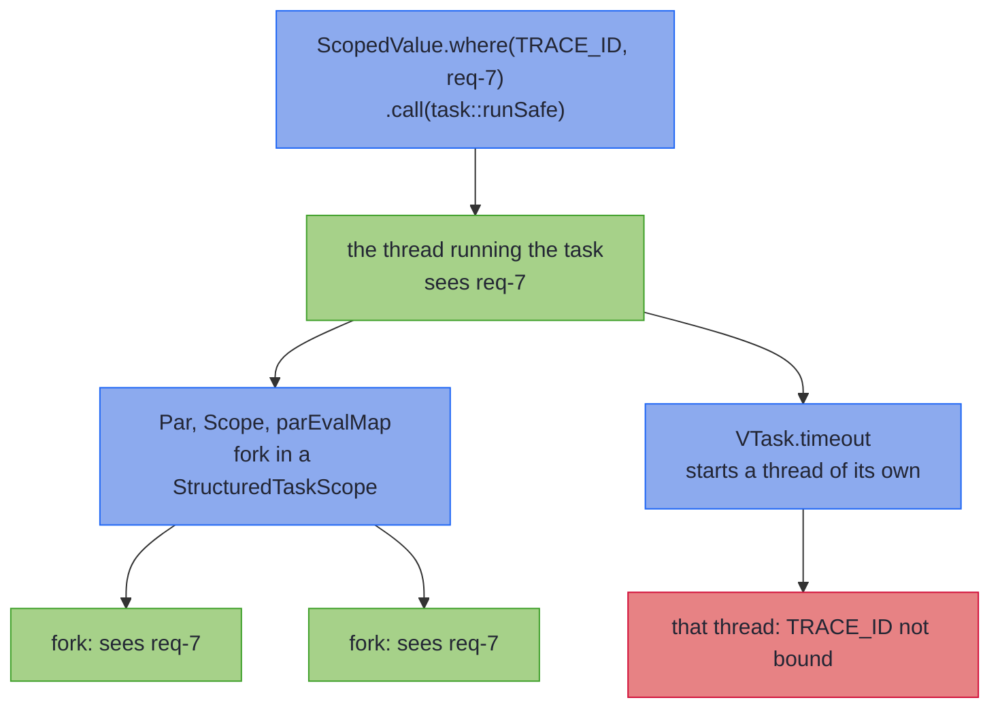

<!-- description: Read a request's trace id in Java with Context and ScopedValue: bind it around the run, see which forked threads inherit it, and default an unbound key. -->

# Context: Reading Scoped Values

_Read what the request bound, such as its trace id, without passing it through every call._

<!-- source: Matt Hooper (Richard Dreyfuss), Jaws (Universal Pictures, 1975), directed by Steven Spielberg, screenplay by Peter Benchley and Carl Gottlieb; the morgue scene, where Hooper rejects the ruling that Chrissie Watkins died in a boating accident; wording checked against the IMDb quotes page and the clip.cafe transcript of the scene -->
> _"This was no boat accident."_
>
> — Hooper, *Jaws*

Hooper will not accept the coroner's ruling: something did this, and he means to name it. A value read from a `ThreadLocal` was put there by something too, but the method's signature never says what. A method that returns a `Context<String, A>` says in its type that it reads a `String` the caller bound.

~~~admonish abstract title="Context at a glance"
| | |
|---|---|
| **Models** | A computation that reads a value bound to a `ScopedValue` when it runs |
| **Replaces** | A `ThreadLocal`, set at the start of a request and cleared at the end |
| **Effect Path** | None: `toVTask()` gives a [VTask](vtask_monad.md), and `Path.vtaskPath(task)` a [`VTaskPath`](../effect/path_vtask.md) |
{{#include ../../../hkj-examples/src/test/resources/golden/foundations-capabilities.md.golden:context_scoped}}
| **Choose it when** | The value belongs to the request, and the threads forked for it should see it; otherwise [Reader](reader_monad.md), which is given its environment when it runs, or compare every type in [Choosing a Type](supported-types.md#choosing-a-type) |
~~~

~~~admonish info title="What You'll Learn"
- Say what a `ScopedValue` changes about request context kept in a `ThreadLocal`
- Read a trace id with `Context.asks`, and bind it with `ScopedValue.where` around running the task, not building it
- Say which threads see a binding: those `Par` and `Scope` fork do, and the one `VTask.timeout` starts does not
- Read keys of different types together, and give a default for a key nobody bound
- Use `Context` in generic code through its `Monad` instance
~~~

~~~admonish example title="See Example Code"
**The code on this page is [ContextBook.java](https://github.com/higher-kinded-j/higher-kinded-j/blob/main/hkj-examples/src/main/java/org/higherkindedj/example/book/foundations/context/ContextBook.java)**: the page includes it, so the build compiles and runs it. [ContextBookTest.java](https://github.com/higher-kinded-j/higher-kinded-j/blob/main/hkj-examples/src/test/java/org/higherkindedj/example/book/foundations/context/ContextBookTest.java) holds what the page says each method does.
~~~

---

## From `ThreadLocal` to `ScopedValue` {#from-threadlocal-to-scopedvalue}

A request handler that keeps its trace id in a `ThreadLocal` must set it at the start and remember to clear it at the end. In between, any code it calls can set it to something else. [JEP 506](https://openjdk.org/jeps/506), which made `ScopedValue` final in Java 25, names three flaws of a `ThreadLocal`. The table sets each beside what a `ScopedValue`, bound for the length of one call, does instead:

| | `ThreadLocal` | `ScopedValue` |
|---|---|---|
| Changing the value | Any code that can reach it can `set` it, at any time | A nested call can bind a new value, and the outer value is back once that call returns |
| How long it lasts | Until something calls `remove`, or the thread ends | Until the call that bound it returns |
| Child threads | `InheritableThreadLocal` copies the values into each new thread, which costs every one storage of its own | The threads a `StructuredTaskScope` forks share the bindings of the thread that opened it |

`Context<R, A>` reads a `ScopedValue<R>` and gives an `A`. Like [Reader](reader_monad.md), it needs a value that no method passes it. Unlike `Reader`, it finds that value in the bindings of the thread that runs it. Calling `get()` on the `ScopedValue` reads the value too. What a `Context` adds is that the read shows in its type, waits until the context runs, and composes with `map`, `flatMap` and `recover`.

## Reading a trace id {#reading-a-trace-id}

The code on this page uses these imports, with `Order` from the order records the [Optics](../optics/ch_intro.md) chapter introduces:

<!-- verify -->
```java
import java.time.Duration;
import java.util.Locale;
import org.higherkindedj.example.book.optics.cast.Order;
import org.higherkindedj.hkt.context.Context;
import org.higherkindedj.hkt.context.RequestContext;
import org.higherkindedj.hkt.trymonad.Try;
import org.higherkindedj.hkt.vtask.Par;
import org.higherkindedj.hkt.vtask.VTask;
```

`RequestContext.TRACE_ID` is one of the keys the library defines, listed under [Pre-built keys](#pre-built-keys). It is a `public static final ScopedValue<String>`, made with `ScopedValue.newInstance()`, and you declare a key of your own the same way. `ScopedValue` is in `java.lang`, so it needs no import. `ORDER` is an order Ada has paid for, and an audit line about it reads the trace id:

```java
{{#include ../../../hkj-examples/src/main/java/org/higherkindedj/example/book/foundations/context/ContextBook.java:audit}}
```

`ScopedValue.where` binds a value, and the context runs inside the call that follows:

```java
{{#include ../../../hkj-examples/src/main/java/org/higherkindedj/example/book/foundations/context/ContextBook.java:bound}}
```

`line` is `"[req-7] payment taken for Ada"`. Building `paid` reads nothing, and the binding lasts only while `call` runs. Inside a nested `where`, the inner value hides the outer one until that call returns. A test binds whatever trace id it needs in the same way, with nothing to mock.

## Bind around the run {#bind-around-the-run}

`toVTask()` turns a context into a [VTask](vtask_monad.md): a task that runs only when something runs it, and that `Par` can fork. `runSafe()` runs a task and holds its outcome in a [Try](try_monad.md), a `Success` with the value or a `Failure` with the exception. A binding made while a task is built has ended before the task reads it:

```java
{{#include ../../../hkj-examples/src/main/java/org/higherkindedj/example/book/foundations/context/ContextBook.java:handlers}}
```

```java
{{#include ../../../hkj-examples/src/main/java/org/higherkindedj/example/book/foundations/context/ContextBook.java:handlers_outcome}}
```

`boundWhileBuilding` returns a task built inside a binding that has since ended. Running it fails with `NoSuchElementException`, which `ScopedValue.get` throws for a key that is not bound. Inside another binding of `TRACE_ID`, it would read that one instead, and nothing would warn you. Put the `where` at the edge of the application, around the call that runs the task, as `boundWhileRunning` does.

## Which threads see a binding {#which-threads-see-a-binding}

A binding belongs to the thread that runs the task, and to the threads a `StructuredTaskScope` forks from it. [`Par`](vtask_monad.md#parallel-composition-with-par) and [`Scope`](vtask_scope.md) open their scope on the thread that runs the task, so the tasks they fork see its bindings. `VTask.timeout` runs its task on a new virtual thread, which does not. `Par` and `Scope` are built on Java 25's structured concurrency API, a preview feature, so code that names them needs `--enable-preview`, as [On a `VTaskPath`](vtask_monad.md#on-a-vtaskpath) explains.

```java
{{#include ../../../hkj-examples/src/main/java/org/higherkindedj/example/book/foundations/context/ContextBook.java:forks}}
```



The diagram shows the binding reaching every thread forked by a structured scope opened on the running thread. It stops at a thread an operator starts by itself, even one that opens a scope of its own there. [`VStreamPar`](vstream_parallel.md) runs a stream's tasks at the same time, and its operators fall on both sides:

| Operator | Its tasks see the caller's bindings |
|---|---|
| `Par`: `map2`, `map3`, `zip`, `zip3`, `all`, `traverse`, `race` | Yes |
| `Scope`: `allSucceed`, `anySucceed`, `firstComplete`, `accumulating`, then `join`, with or without the scope's own `timeout` | Yes |
| `VStreamPar.parEvalMap` | Yes |
| `VTask.timeout`, `detachOnCancel` and `runAsync` | No: each runs its task on a thread of its own |
| `VStreamPar.parEvalMapUnordered` | No: it runs its tasks, and reads the source, on threads of its own |
| `VStreamPar.merge` of two or more streams | No: it reads each stream on a thread of its own |
| `VTaskPath.timeout` and `withTimeout`, and `Resilience.builder(task).withTimeout(duration)` | No: they run the task through `VTask.timeout` |
| `CircuitBreaker.protect`, and `VTaskPath.withCircuitBreaker` | No: each call runs under the breaker's `callTimeout`, through `VTask.timeout` |

To carry a value onto a thread that does not see it, read it on the thread that runs the task, then bind it again inside the task that `timeout` runs:

```java
{{#include ../../../hkj-examples/src/main/java/org/higherkindedj/example/book/foundations/context/ContextBook.java:carry}}
```

```java
{{#include ../../../hkj-examples/src/main/java/org/higherkindedj/example/book/foundations/context/ContextBook.java:carry_outcome}}
```

`timedWithTrace` carries `TRACE_ID` alone. A step that reads another key needs that key read and bound again in the same way.

## Several keys {#several-keys}

`R` in `Context<R, A>` is the type of the value a chain reads, and every step of a chain reads the same type. `TRACE_ID` and `CORRELATION_ID` are both `String` keys, so they share a chain. A step that reads `LOCALE`, a `Locale` key, does not join a chain that reads `String`, and javac reports that the type variable "has incompatible equality constraints String,Locale":

<!-- verify:rejects "has incompatible equality constraints" -->
```java
import java.util.Locale;
import org.higherkindedj.hkt.context.Context;
import org.higherkindedj.hkt.context.RequestContext;

Context<String, String> both =
    Context.ask(RequestContext.TRACE_ID)
        .flatMap(traceId -> Context.asks(RequestContext.LOCALE, Locale::toLanguageTag));
```

Turn each read into a `VTask` with `toVTask()`, and chain those:

```java
{{#include ../../../hkj-examples/src/main/java/org/higherkindedj/example/book/foundations/context/ContextBook.java:two_keys}}
```

`where` calls chain, binding several keys for one call:

```java
{{#include ../../../hkj-examples/src/main/java/org/higherkindedj/example/book/foundations/context/ContextBook.java:two_keys_outcome}}
```

## A key nobody bound {#a-key-nobody-bound}

Reading a key that is not bound fails. `run` throws the `NoSuchElementException`, and `runSafe()` on the task from `toVTask()` holds it as a `Failure`. `recover` gives a default in its place:

```java
{{#include ../../../hkj-examples/src/main/java/org/higherkindedj/example/book/foundations/context/ContextBook.java:unbound}}
```

`withDefault` is `"no trace"`. `toMaybe()` runs the context at once and gives `Nothing` for any failure. A key bound to `null` fails too: `ask` fails with a `NullPointerException` when it runs. Read a key that may hold `null` with `asks(key, Maybe::fromNullable)`, which gives [`Maybe`](maybe_monad.md)'s `Nothing` for it. `RequestContext.getTraceIdOrDefault(fallback)` reads the trace id directly, with a fallback.

## Pre-built keys {#pre-built-keys}

The library defines the keys a request usually carries, in two classes:

| Class | Keys | Helpers |
|---|---|---|
| `RequestContext` | `TRACE_ID`, `CORRELATION_ID`, `LOCALE`, `TENANT_ID`, `REQUEST_TIME`, `DEADLINE` | `generateTraceId()`, `getTraceIdOrDefault(fallback)` and the other defaults, `isDeadlineExceeded()` |
| `SecurityContext` | `PRINCIPAL`, `ROLES`, `PERMISSIONS`, `AUTH_TOKEN`, `SESSION_ID` | `Context` values such as `requireAuthenticated()`, `principalIfPresent()`, `hasRole(role)` and `requireRole(role)` |

[RequestContext Patterns](../effect/context_request.md) shows each request key in use, including [structured logging](../effect/context_request.md#mdc-integration-for-structured-logging) from scoped values. [SecurityContext Patterns](../effect/context_security.md) shows the security checks.

## Creating instances {#creating-instances}

`Context.ask(key)` reads a key, and `Context.asks(key, f)` reads it and applies `f`. `Context.succeed(value)` gives a value without reading anything. `Context.fail(error)` fails when it runs, though an `Error` is thrown at the call. It wraps a checked exception in a `ContextException`, so `run` declares none. `recover` and `recoverWith` are handed the original exception, while `runSafe()` on the task from `toVTask()` holds the `ContextException`. `Context.map2` and `map3` combine two or three contexts over one key type. A `Context` always gives a value, as [Values, never null](../hkts/core-concepts.md#values-never-null) sets out. `succeed(null)` throws at the call, and a step that returns `null` fails the run, with a message naming the function, such as `f must not return null`.

## Methods {#methods}

| Method | What it does |
|---|---|
| `Context.ask(key)`, `asks(key, f)` | Read the value bound to `key`, as it is or through `f` |
| `Context.succeed(value)`, `fail(error)` | Give `value`, or fail with `error`, reading nothing |
| `Context.map2(a, b, f)`, `map3(a, b, c, f)` | Combine contexts over one key type |
| `map(f)`, `flatMap(f)` | Change the result, or run a next step that reads the same key type |
| `recover(f)`, `recoverWith(f)`, `mapError(f)` | Replace a failure with a value or another context, or change the failure |
| `run()` | Reads the bindings of the current thread and gives the result, or throws |
| `toVTask()` | Gives a `VTask` that runs the context on the thread that runs it |
| `toMaybe()` | Runs the context at once, and gives `Nothing` for any failure |
| `asUnit()` | Keeps the computation and replaces the result with `Unit` |

## Working with Kind {#working-with-kind}

Generic code, written once for any container, takes `Context` through its `Monad` instance, from `Instances.monad(context())`. The key type is part of the witness, `ContextKind.Witness<R>`, so one instance serves contexts that read one key type. You widen a `Context` to pass it in, run the result with `CONTEXT.runContext` inside the binding, and `CONTEXT.narrow(kind)` gives the `Context` back. These are the extra imports:

<!-- verify -->
```java
import static org.higherkindedj.hkt.context.ContextKindHelper.CONTEXT;
import static org.higherkindedj.hkt.instances.Witnesses.context;

import org.higherkindedj.hkt.Kind;
import org.higherkindedj.hkt.Monad;
import org.higherkindedj.hkt.context.ContextKind;
import org.higherkindedj.hkt.instances.Instances;
```

```java
{{#include ../../../hkj-examples/src/main/java/org/higherkindedj/example/book/foundations/context/ContextBook.java:kind}}
```

`ran` is `"[req-7] payment taken for Ada; [req-7] receipt sent for Ada"`. The instance's `map2` joins the two reads, and nothing reads the trace id until `runContext` runs them. The `Monad` helpers, such as `peek` and `flatMapIfOrElse`, work on it too, as [Helpers built on `flatMap` and `map`](../functional/monad.md#helpers) shows. Widening allocates nothing: `Context` implements `ContextKind` itself, so `widen` checks for `null` and returns the same object.

## When to use `Context` {#when-to-use-context}

| You need | Use |
|---|---|
| A value the request binds, read deep in the call stack and by the threads forked for it | `Context` |
| One read, in code that already runs inside the binding | `RequestContext.TRACE_ID.get()`, or your own key's `get()` |
| One environment, given to the program when it runs | [Reader](reader_monad.md) |
| To choose between `Context` and `ConfigContext`, the Effect chapter's form of `Reader` | [Context vs ConfigContext](../effect/context_vs_config.md) |
| The trace id in a library that reads a `ThreadLocal`, such as a logging MDC | Copy the scoped values into it at the edge, as [Bridging to SLF4J MDC](../effect/context_request.md#bridging-to-slf4j-mdc) shows |

~~~admonish info title="Hands-On Learning"
Practise reading and binding scoped values in [Tutorial 01: Context Basics](https://github.com/higher-kinded-j/higher-kinded-j/blob/main/hkj-examples/src/test/java/org/higherkindedj/tutorial/context/Tutorial01_ContextBasics.java) (11 exercises).
~~~

---

**Previous:** [Reader](reader_monad.md)
**Next:** [State](state_monad.md)
