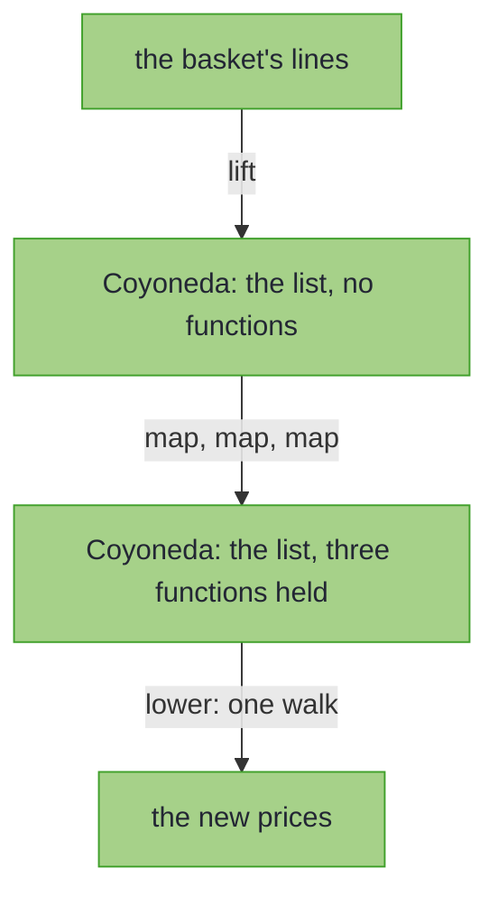

<!-- description: Hold every map in Java with Coyoneda: apply three maps to an order's lines in one walk, and give a warehouse's instruction set the Functor it lacks. -->

# Coyoneda: Maps Held for One Pass

_Hold every `map` for one pass, and give an instruction set the `Functor` it lacks._

<!-- source: Mark Twain, "The Late Benjamin Franklin" (written about 1870), collected in Sketches New and Old (1875); the maxim heads the sketch, signed "B. F."; text checked against Project Gutenberg eBook #3189 -->
> _"Never put off till to-morrow what you can do day after to-morrow just as well."_
>
> — Mark Twain, *The Late Benjamin Franklin*

Twain signs the maxim with Franklin's initials, in a sketch that mocks Franklin's maxims. A Coyoneda takes it as advice: every `map` is written down and put off. Only when you lower it is the work done, all of it in one pass.

~~~admonish abstract title="Coyoneda at a glance"
| | |
|---|---|
| **Models** | A value of `F` with the `map` calls made on it held back, to be applied in one pass |
| **Replaces** | A `Functor` written by hand for an instruction set, or a chain of `map` calls that each walk the structure |
| **Effect Path** | None |
{{#include ../../../hkj-examples/src/test/resources/golden/foundations-capabilities.md.golden:coyoneda}}
| **Choose it when** | An instruction set has no `Functor` of its own; otherwise use the `Functor` that [`@EffectAlgebra`](../effect/effect_handlers.md#defining-effects) generates, or compare every type in [Choosing a Type](supported-types.md#choosing-a-type) |
~~~

~~~admonish info title="What You'll Learn"
- Hold three maps on a list, and apply them in one walk
- Give an instruction set with no `Functor` one, so that a `Free` program can hold it
- Run that program with `Coyoneda.interpreter`, or one held value with `foldMap`
- Choose between Coyoneda and a `Functor` of the set's own, such as the one `@EffectAlgebra` generates
~~~

~~~admonish example title="See Example Code"
**The code on this page is [CoyonedaBook.java](https://github.com/higher-kinded-j/higher-kinded-j/blob/main/hkj-examples/src/main/java/org/higherkindedj/example/book/foundations/coyoneda/CoyonedaBook.java)**: the page includes it, so the build compiles and runs it. [CoyonedaBookTest.java](https://github.com/higher-kinded-j/higher-kinded-j/blob/main/hkj-examples/src/test/java/org/higherkindedj/example/book/foundations/coyoneda/CoyonedaBookTest.java) holds what the page says each method does.
~~~

~~~admonish tip title="Where Coyoneda fits"
An instruction set from [`@EffectAlgebra`](../effect/effect_handlers.md#defining-effects) gets a generated `Functor`, built on its records' `mapK`, which extends each record's continuation: the function from the instruction's result to what comes next. So it never needs Coyoneda. Coyoneda is for a set you write yourself whose records carry no continuation, and for holding many maps on a structure that is costly to walk.
~~~

---

## Three maps, one walk {#maps-held-for-one-pass}

A Java `Stream` applies each element's maps in one pass. `List`'s `map`, like the `map` of most types with a `Functor`, does not. It walks the list and builds a new one, so three maps in a row make three walks and two lists that are thrown away. Coyoneda gives any such type the stream's single pass. It holds the list, and each `map` adds its function to the ones it holds without applying anything. `lower` hands them all to the list's `Functor` as one `map`, which passes each element through the functions in turn:



The code on this page uses these imports:

<!-- verify -->
```java
import static org.higherkindedj.hkt.coyoneda.CoyonedaKindHelper.COYONEDA;
import static org.higherkindedj.hkt.id.IdKindHelper.ID;
import static org.higherkindedj.hkt.list.ListKindHelper.LIST;

import java.math.BigDecimal;
import java.math.RoundingMode;
import java.util.HashMap;
import java.util.List;
import java.util.Map;
import org.higherkindedj.example.book.optics.cast.LineItem;
import org.higherkindedj.hkt.Kind;
import org.higherkindedj.hkt.Natural;
import org.higherkindedj.hkt.TypeArity;
import org.higherkindedj.hkt.WitnessArity;
import org.higherkindedj.hkt.coyoneda.Coyoneda;
import org.higherkindedj.hkt.coyoneda.CoyonedaFunctor;
import org.higherkindedj.hkt.coyoneda.CoyonedaKind;
import org.higherkindedj.hkt.effect.FreePath;
import org.higherkindedj.hkt.effect.Path;
import org.higherkindedj.hkt.id.Id;
import org.higherkindedj.hkt.id.IdKind;
import org.higherkindedj.hkt.id.IdMonad;
import org.higherkindedj.hkt.list.ListKind;
import org.higherkindedj.hkt.list.ListMonad;
```

The list here stands in for a structure that is costly to walk, such as a large tree or a page of results from a remote store. The basket holds a lamp at 40.00 and four bulbs at 2.50 each, and `VAT` is 1.20, so each line's price with VAT is 48.00 for the lamp and 3.00 for a bulb:

```java
{{#include ../../../hkj-examples/src/main/java/org/higherkindedj/example/book/foundations/coyoneda/CoyonedaBook.java:fusion}}
```

Through `List`'s own `map`, the same three functions walk the list three times; through Coyoneda, once. The held functions are applied in a loop, so a chain of a hundred thousand maps is lowered without overflowing the stack.

## An instruction set with no Functor {#an-instruction-set-with-no-functor}

A [Free](free_monad.md) program needs a `Functor` for its instructions, to put the rest of the program after each one. `OrderOp`'s records carry a continuation `k`, so `@EffectAlgebra` builds that `Functor` from `mapK`. The warehouse's instruction set cannot have one, because each record fixes its own result type and carries nothing for a `map` to extend:

```java
{{#include ../../../hkj-examples/src/main/java/org/higherkindedj/example/book/foundations/coyoneda/CoyonedaBook.java:stock_op}}
```

Lifted into a Coyoneda, an instruction gets the `Functor` it lacks: `CoyonedaFunctor` holds each map instead of applying it. A `FreePath` over `CoyonedaKind.Witness<StockOp.Witness>` then holds the warehouse's instructions:

```java
{{#include ../../../hkj-examples/src/main/java/org/higherkindedj/example/book/foundations/coyoneda/CoyonedaBook.java:program}}
```

## Running a program over Coyoneda {#running-a-program-over-coyoneda}

The interpreter is written for `StockOp` alone, as a [`Natural`](../functional/natural_transformation.md) with a case for each record. Its warehouse holds three lamps and two bulbs:

```java
{{#include ../../../hkj-examples/src/main/java/org/higherkindedj/example/book/foundations/coyoneda/CoyonedaBook.java:warehouse}}
```

`Coyoneda.interpreter(warehouse, functor)` runs each instruction with it, and then applies the maps the Coyoneda held, with `Id`'s `Functor`:

```java
{{#include ../../../hkj-examples/src/main/java/org/higherkindedj/example/book/foundations/coyoneda/CoyonedaBook.java:run}}
```

The basket's second line wants four bulbs and the warehouse holds two, so nothing is set aside, and the warehouse's count is unchanged. One held value runs through an interpreter the same way, with `foldMap`:

```java
{{#include ../../../hkj-examples/src/main/java/org/higherkindedj/example/book/foundations/coyoneda/CoyonedaBook.java:one_value}}
```

## Why it is called Coyoneda {#the-yoneda-lemma}

Coyoneda is named for the co-Yoneda lemma: for a `Functor` `F`, a `Coyoneda<F, A>` and a `Kind<F, A>` hold the same information. `lift` and `lower` turn one into the other, and lowering a lifted list gives back the list. So holding the maps loses nothing: it only decides when they run.

## A held value is never null {#a-held-value-is-never-null}

`Coyoneda.lift(null)` and `Coyoneda.apply(null, f)` throw at the call. A held function runs only when you lower or interpret, through the target's own `map`, so a null it returns meets that type's rule, which [Values, never null](../hkts/core-concepts.md#values-never-null) sets out. [`Id`](identity.md), for one, keeps the null as its value.

## Creating instances {#creating-instances}

`Coyoneda.lift(fa)` holds a value with no functions, and `Coyoneda.apply(fx, f)` holds it with one. `COYONEDA.lift(fa)`, from `CoyonedaKindHelper`, gives the same, already widened to a `Kind` for a `Free` program.

## Methods {#methods}

| Method | What it does |
|---|---|
| `coyoneda.map(f)` | Hold one more function, applied after the others |
| `lower(functor)` | Apply the held functions with `F`'s own `Functor`, in one `map` |
| `foldMap(natural, functor)` | Run the held value through an interpreter into `G`, then apply the held functions with `G`'s `Functor` |
| `Coyoneda.interpreter(natural, functor)` | An interpreter for a program whose instructions are Coyonedas |
| `underlying()` | The value held, before any function |

## Working with Kind {#working-with-kind}

`COYONEDA.widen` and `COYONEDA.narrow`, from `CoyonedaKindHelper`, convert between a `Coyoneda` and its `Kind`. Its one instance, `CoyonedaFunctor`, works for any `F`, because its `map` only holds the function:

```java
{{#include ../../../hkj-examples/src/main/java/org/higherkindedj/example/book/foundations/coyoneda/CoyonedaBook.java:kind}}
```

Coyoneda has no `Applicative` or `Monad`: combining two held values needs `F`'s own.

## When to use `Coyoneda` {#when-to-use-coyoneda}

| You need | Use |
|---|---|
| A `Free` program over an instruction set whose records carry no continuation | Coyoneda |
| A `Free` program over an `@EffectAlgebra` instruction set | Its generated `Functor`, with no Coyoneda |
| Many maps on a structure that is costly to walk | Coyoneda, lowered once |
| A few maps on a `List` or an `Optional` | Their own `map` |
| A pipeline over a Java `Stream` | The stream, which already applies each element's maps in one pass |

~~~admonish info title="Hands-On Learning"
Practise lifting, mapping and lowering in [Tutorial 09: Coyoneda](https://github.com/higher-kinded-j/higher-kinded-j/blob/main/hkj-examples/src/test/java/org/higherkindedj/tutorial/coretypes/Tutorial09_Coyoneda.java) (5 exercises), from the [Advanced Patterns](../tutorials/coretypes/advanced_journey.md) journey.
~~~

---

**Previous:** [EitherF](eitherf.md)
**Next:** [Const](const_type.md)
