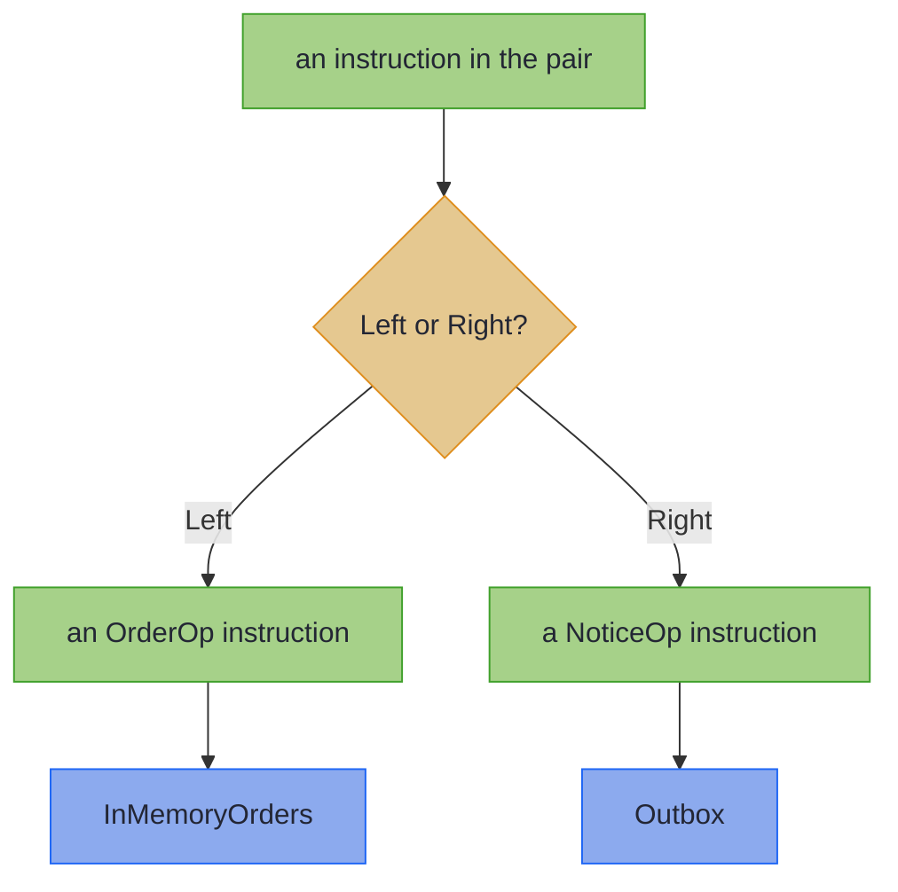

<!-- description: Join two instruction sets in one Java program with EitherF: an order program that cancels and tells the customer, run by one interpreter per set. -->

# EitherF: Composing Effect Vocabularies

_One program, two instruction sets, and each instruction sent to the interpreter for its own set._

<!-- source: E. M. Forster, Howards End (1910), Chapter XXII; text checked against Project Gutenberg eBook #2946 -->
> _"Only connect! That was the whole of her sermon."_
>
> — E. M. Forster, *Howards End* (Chapter XXII)

Margaret Schlegel's sermon is meant for Henry Wilcox, who keeps the two halves of his life apart. Two instruction sets kept apart cannot share a program either. `EitherF` connects them: one program uses both, and each instruction still reaches the interpreter for its own set.

~~~admonish abstract title="EitherF at a glance"
| | |
|---|---|
| **Models** | One instruction from either of two instruction sets |
| **Replaces** | One interface grown to hold every service's operations, or a dispatcher written by hand |
| **Effect Path** | None: a program over the pair is a [`FreePath`](../glossary/effect-paths.md#freepath) |
{{#include ../../../hkj-examples/src/test/resources/golden/foundations-capabilities.md.golden:eitherf}}
| **Choose it when** | One program needs instructions from two or more sets, which [`@ComposeEffects`](../effect/effect_handlers.md#composing-effects) joins for you; otherwise [Free](free_monad.md) over one set, or compare every type in [Choosing a Type](supported-types.md#choosing-a-type) |
~~~

~~~admonish info title="What You'll Learn"
- Join two instruction sets so that one program can use both
- Run the program with an interpreter for each set, combined into one
- Read what `@ComposeEffects` generates: an `Inject` for each set and the pair's `Functor`
- Move a program written for one set into the pair without changing it
- Nest a third and a fourth instruction set
~~~

~~~admonish example title="See Example Code"
**The code on this page is [EitherFBook.java](https://github.com/higher-kinded-j/higher-kinded-j/blob/main/hkj-examples/src/main/java/org/higherkindedj/example/book/foundations/eitherf/EitherFBook.java)**, with [OrderEffects.java](https://github.com/higher-kinded-j/higher-kinded-j/blob/main/hkj-examples/src/main/java/org/higherkindedj/example/book/foundations/eitherf/OrderEffects.java): the page includes them, so the build compiles and runs them. [EitherFBookTest.java](https://github.com/higher-kinded-j/higher-kinded-j/blob/main/hkj-examples/src/test/java/org/higherkindedj/example/book/foundations/eitherf/EitherFBookTest.java) holds what the page says each method does.
~~~

~~~admonish tip title="Where EitherF fits"
For most code, `EitherF` is an implementation detail. [`@ComposeEffects`](../effect/effect_handlers.md#composing-effects) generates what joins the sets, and the [Payment Processing](../examples/payment_processing.md) example composes four of them. Knowing what that code is made of helps when you read a type error, or join sets by hand.
~~~

---

## Two instruction sets, one program {#two-instruction-sets-one-program}

The order service's [Free](free_monad.md) program prices a line and cancels the order when the line costs too much. Now it must also tell the customer why. Notices are a concern of their own, with their own interpreter: an outbox in a test, a mail service when the service runs. They are a second instruction set beside `OrderOp`:

```java
{{#include ../../../hkj-examples/src/main/java/org/higherkindedj/example/book/foundations/NoticeOp.java:notice_op}}
```

A `Free<OrderOpKind.Witness, A>` holds `OrderOp` instructions only, and a program over `NoticeOp` has another type, so `via` cannot chain one onto the other. Adding a `Send` record to `OrderOp` would mix the two concerns, and every `OrderOp` interpreter would have to handle notices. The code on this page uses these imports:

<!-- verify -->
```java
import static org.higherkindedj.example.book.foundations.NoticeOpKindHelper.NOTICE_OP;
import static org.higherkindedj.hkt.eitherf.EitherFKindHelper.EITHERF;
import static org.higherkindedj.hkt.id.IdKindHelper.ID;
import static org.higherkindedj.hkt.instances.Witnesses.id;

import java.math.BigDecimal;
import java.util.ArrayList;
import java.util.List;
import java.util.Map;
import java.util.UUID;
import java.util.function.Function;
import org.higherkindedj.example.book.foundations.NoticeOp;
import org.higherkindedj.example.book.foundations.NoticeOpFunctor;
import org.higherkindedj.example.book.foundations.NoticeOpInterpreter;
import org.higherkindedj.example.book.foundations.NoticeOpKind;
import org.higherkindedj.example.book.foundations.NoticeOpOps;
import org.higherkindedj.example.book.foundations.OrderOp;
import org.higherkindedj.example.book.foundations.OrderOpFunctor;
import org.higherkindedj.example.book.foundations.OrderOpInterpreter;
import org.higherkindedj.example.book.foundations.OrderOpKind;
import org.higherkindedj.example.book.foundations.OrderOpOps;
import org.higherkindedj.hkt.Kind;
import org.higherkindedj.hkt.Natural;
import org.higherkindedj.hkt.Unit;
import org.higherkindedj.hkt.effect.FreePath;
import org.higherkindedj.hkt.effect.Path;
import org.higherkindedj.hkt.eitherf.EitherF;
import org.higherkindedj.hkt.eitherf.EitherFFunctor;
import org.higherkindedj.hkt.eitherf.EitherFKind;
import org.higherkindedj.hkt.eitherf.Interpreters;
import org.higherkindedj.hkt.free.Free;
import org.higherkindedj.hkt.id.Id;
import org.higherkindedj.hkt.id.IdKind;
import org.higherkindedj.hkt.inject.Inject;
import org.higherkindedj.hkt.inject.InjectInstances;
import org.higherkindedj.hkt.instances.Instances;
```

## An instruction from either set {#an-instruction-from-either-set}

`Either<L, R>` holds a value that is an `L` or an `R`. `EitherF<F, G, A>` holds an instruction that is from the set `F` or the set `G`, each giving an `A`: `Left` wraps an instruction from `F`, and `Right` one from `G`. The `F` in the name says it holds a type constructor's value, as `Kind<F, A>` does. A program over the pair holds instructions from both sets, and running it sends each to the interpreter for its side:



## Joining the sets {#joining-the-sets}

`@ComposeEffects` on a record that names the sets generates what the pair needs:

```java
{{#include ../../../hkj-examples/src/main/java/org/higherkindedj/example/book/foundations/eitherf/OrderEffects.java:compose_effects}}
```

The generated `OrderEffectsSupport`, in the record's own package, wires the pair. Its `functor` gives the pair's `Functor`, which `Free` needs, and its `injectOrders` and `injectNotices` say which side each set takes. Each set's own `@EffectAlgebra` generates a `boundTo`, which gives that set's constructors bound to its side. The pair's witness is `EitherFKind.Witness<OrderOpKind.Witness, NoticeOpKind.Witness>`:

```java
{{#include ../../../hkj-examples/src/main/java/org/higherkindedj/example/book/foundations/eitherf/EitherFBook.java:wiring}}
```

`ORDERS.priceOf` and `NOTICES.send` give `Free` programs over the pair, so `via` chains them. The program cancels the order and tells the customer, or does neither:

```java
{{#include ../../../hkj-examples/src/main/java/org/higherkindedj/example/book/foundations/eitherf/EitherFBook.java:program}}
```

## One interpreter for the pair {#one-interpreter-for-the-pair}

Each set keeps an interpreter of its own, written as [on the Free page](free_monad.md#one-program-two-interpreters). `InMemoryOrders` prices from a catalogue that holds a `LAMP` at 40.00, and records each cancellation. `Outbox` keeps each notice instead of sending it:

```java
{{#include ../../../hkj-examples/src/main/java/org/higherkindedj/example/book/foundations/eitherf/EitherFBook.java:interpreters}}
```

`Interpreters.combine` joins them into one interpreter for the pair, which hands a `Left` to the first and a `Right` to the second. `LIMIT` is 30.00:

```java
{{#include ../../../hkj-examples/src/main/java/org/higherkindedj/example/book/foundations/eitherf/EitherFBook.java:run}}
```

Within the limit, as for a `BULB`, the program cancels nothing and sends nothing.

## What the generated code is {#what-the-generated-code-is}

An `Inject<F, G>` puts an instruction from the set `F` into the larger set `G`. `OrderEffectsSupport`'s two are the library's `injectLeft` and `injectRight`. Written by hand, they draw the [HKJ checker](../tooling/compile_checks.md)'s `migration-nudge` warning, which points you to `@ComposeEffects`:

```java
{{#include ../../../hkj-examples/src/main/java/org/higherkindedj/example/book/foundations/eitherf/EitherFBook.java:by_hand}}
```

An injected instruction is an `EitherF`, as [Working with Kind](#working-with-kind) shows.

## Three sets and more {#three-sets-and-more}

A pair holds two sets. A third nests on the right, and so does a fourth, which is as many as `@ComposeEffects` and `Interpreters.combine` take:

<pre class="hkj-ascii-diagram" role="img" aria-label="How EitherF nests as sets are added. Two sets are EitherF of F and G. Three are EitherF of F and an EitherF of G and H. Four nest once more on the right.">
Two sets:    EitherF&lt;F, G&gt;
Three sets:  EitherF&lt;F, EitherF&lt;G, H&gt;&gt;
Four sets:   EitherF&lt;F, EitherF&lt;G, EitherF&lt;H, I&gt;&gt;&gt;
</pre>

`InjectInstances.injectRightThen(inner)` reaches into the nesting: `injectRightThen(injectLeft())` puts an instruction from `G` into the three-set nesting, as a `Right` holding a `Left`. `@ComposeEffects` writes each of these for you.

## Moving a program into the pair {#moving-a-program-into-the-pair}

A program written for `OrderOp` alone, before notices existed, joins the pair with `Free.translate`, which passes each instruction through a [natural transformation](../functional/natural_transformation.md). An `Inject`'s method is one:

```java
{{#include ../../../hkj-examples/src/main/java/org/higherkindedj/example/book/foundations/eitherf/EitherFBook.java:translate}}
```

Each bound constructor works the same way: `ORDERS.priceOf` builds the `OrderOp` program and translates it into the pair.

## An instruction is never null {#an-instruction-is-never-null}

`EitherF.left(null)` and `EitherF.right(null)` throw at the call, so an instruction in the pair always holds one from a set. Its result follows the rule of the `Free` program that holds it: [a program always gives a value](free_monad.md#a-program-always-gives-a-value).

## Creating instances {#creating-instances}

`@ComposeEffects` generates the `Inject`s and the `Functor`, and each set's generated `boundTo` gives its constructors in the pair. By hand, `InjectInstances.injectLeft()`, `injectRight()` and `injectRightThen(inner)` give the `Inject`s, `EitherFFunctor.of(left, right)` the `Functor`, and `EitherF.left(fa)` and `EitherF.right(ga)` an instruction.

## Methods {#methods}

| Method | What it does |
|---|---|
| `EitherF.left(fa)`, `EitherF.right(ga)` | Hold an instruction from the left set, or from the right one |
| `eitherF.fold(onLeft, onRight)` | Act on the instruction from whichever side holds it |
| `inject.inject(fa)` | Put an instruction from one set into a larger one |
| `Interpreters.combine(f, g)`, up to four | Join one interpreter per set into one for the nesting |
| `EitherFFunctor.of(left, right)` | The pair's `Functor`, built from each set's |
| `Free.translate(program, natural, functor)` | Move a program to another instruction set |
| `XOps.boundTo(inject, functor)` | A set's generated constructors, building programs in the larger set |

## Working with Kind {#working-with-kind}

An `EitherF` is already its own `Kind`, so `EITHERF.widen` and `EITHERF.narrow`, from `EitherFKindHelper`, are casts. An injected instruction narrows to one, and `fold` says which side holds it:

```java
{{#include ../../../hkj-examples/src/main/java/org/higherkindedj/example/book/foundations/eitherf/EitherFBook.java:by_kind}}
```

Its only instance is `EitherFFunctor`, which maps through the instruction on whichever side holds it, using that set's `Functor`. That is all a `Free` program needs of its instruction set: `EitherF` has no `Applicative` or `Monad`, because the program is the monad.

## When to use `EitherF` {#when-to-use-eitherf}

| You need | Use |
|---|---|
| One program over two or more instruction sets | `@ComposeEffects`, which generates the `EitherF` nesting |
| To read a type error in that program, or to join sets by hand | This page's `Inject`, `EitherF` and `Interpreters.combine` |
| One instruction set | [Free](free_monad.md) on its own |
| Two services called directly, run one way | A direct call to each |

~~~admonish info title="Hands-On Learning"
Practise joining instruction sets in [Tutorial 04: Combining Effects with EitherF](https://github.com/higher-kinded-j/higher-kinded-j/blob/main/hkj-examples/src/test/java/org/higherkindedj/tutorial/effecthandlers/Tutorial04_CombiningEffects.java) (3 exercises), from the [Effect Handlers](../tutorials/effecthandlers/ch_intro.md) journey.
~~~

**Benchmarks:** `FreeEffectBenchmark` measures what dispatching through `EitherF` and `Interpreters.combine` costs beside a program over one instruction set. [Benchmarks & Performance](../benchmarks.md) says how to run it.

---

**Previous:** [Free Applicative](free_applicative.md)
**Next:** [Coyoneda](coyoneda.md)
