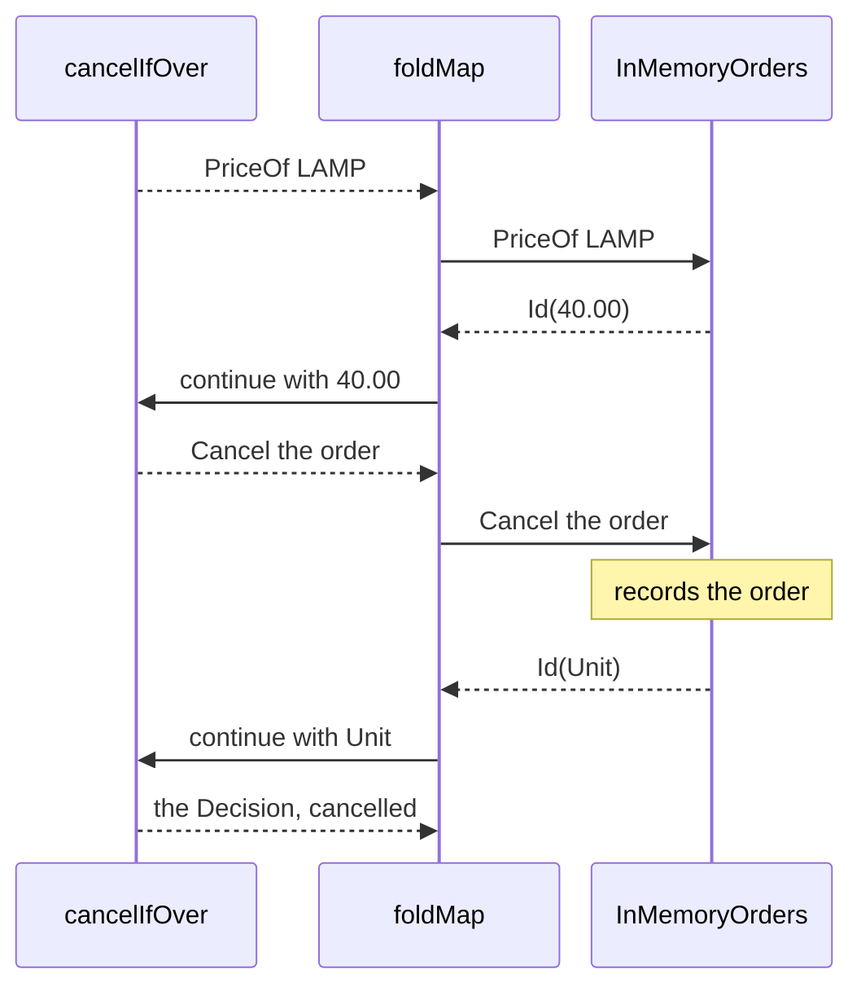

<!-- description: Hold a program as data in Java with Free: an order program that cancels the order when a line costs too much, run against an in-memory store and audited into a Writer. -->

# Free: Programs as Data

_Write the program once, as instructions, and choose what each one does when you run it._

<!-- source: Tom Stoppard, Rosencrantz and Guildenstern Are Dead (1966, published by Faber and Faber 1967), Act One, the Player answering Guildenstern's question about what his tragedians perform; wording checked against Wikiquote's page for the play, which reads "give you" and opens "But" with a capital; LitCharts' summary of Act One places the exchange -->
> _"We can do you blood and love without the rhetoric, and we can do you blood and rhetoric without the love, and we can do you all three concurrent or consecutive. But we can't give you love and rhetoric without the blood. Blood is compulsory."_
>
> — The Player, *Rosencrantz and Guildenstern Are Dead*

The Player's troupe will stage whatever the patrons ask for, consecutive or concurrent, but nothing happens until the night. A `Free` program is what was asked for, written down once, and each interpreter gives one night's performance of it.

~~~admonish abstract title="Free at a glance"
| | |
|---|---|
| **Models** | A program held as data: instructions that an interpreter runs later, in a monad it chooses |
| **Replaces** | Calls to an injected service, made directly from business code |
| **Effect Path** | [`FreePath`](../glossary/effect-paths.md#freepath) |
{{#include ../../../hkj-examples/src/test/resources/golden/foundations-capabilities.md.golden:free_monad}}
| **Choose it when** | One program must run in several ways, such as live, in a test and as an audit; otherwise call the service, see [Free Applicative](free_applicative.md) for a program you can inspect whole, or compare every type in [Choosing a Type](supported-types.md#choosing-a-type) |
~~~

~~~admonish info title="What You'll Learn"
- Build an order program from instructions held as data, with nothing run yet
- Run the same program against an in-memory store and as an audit, by choosing the interpreter
- Predict what `foldMap` keeps of each instruction's value, and what still deepens the stack
- Inspect a program before it runs, and explain why only its first instruction shows
- Choose between `Free` and Tagless Final
~~~

~~~admonish example title="See Example Code"
**The code on this page is [FreeBook.java](https://github.com/higher-kinded-j/higher-kinded-j/blob/main/hkj-examples/src/main/java/org/higherkindedj/example/book/foundations/free/FreeBook.java)**: the page includes it, so the build compiles and runs it. [FreeBookTest.java](https://github.com/higher-kinded-j/higher-kinded-j/blob/main/hkj-examples/src/test/java/org/higherkindedj/example/book/foundations/free/FreeBookTest.java) holds what the page says each method does.
~~~

~~~admonish tip title="Where Free fits"
Most code never builds a `Free` by hand. [`@EffectAlgebra`](../effect/effect_handlers.md#defining-effects) generates the constructors and the interpreter base class for an instruction set, [`@ComposeEffects`](../effect/effect_handlers.md#composing-effects) combines several, and the [Effect Handlers](../effect/effect_handlers_intro.md) chapter shows the whole pattern. This page shows what those programs are made of.
~~~

---

## Instructions held as data {#instructions-held-as-data}

An order program prices a line, and cancels the order when the line costs more than a limit. Call an injected `OrderService` and a test can pass a fake, but each call runs the moment it is made, and nothing can look at the program first. A `Free` program holds the steps as instructions instead, which an interpreter runs later: a live interpreter calls the service, a test interpreter works against memory, and an audit interpreter records what it was asked. The instructions are the `OrderOp` records from [Applicative, Selective or Monad?](../functional/abstraction_levels.md):

```java
{{#include ../../../hkj-examples/src/main/java/org/higherkindedj/example/book/foundations/OrderOp.java:order_op}}
```

Each record carries a continuation `k`, from the instruction's result to whatever the program does next. `@EffectAlgebra` generates the rest: `OrderOpKind` and `OrderOpKindHelper`, its encoding as a `Kind`; `OrderOpOps`, with a `Free` constructor for each record; a `Functor`; and `OrderOpInterpreter`, the base class an interpreter extends. The code on this page uses these imports:

<!-- verify -->
```java
import static org.higherkindedj.hkt.free.FreeKindHelper.FREE;
import static org.higherkindedj.hkt.id.IdKindHelper.ID;
import static org.higherkindedj.hkt.instances.Witnesses.id;
import static org.higherkindedj.hkt.writer.WriterKindHelper.WRITER;

import java.math.BigDecimal;
import java.util.ArrayList;
import java.util.List;
import java.util.UUID;
import java.util.function.Function;
import org.higherkindedj.example.book.foundations.AuditEntry;
import org.higherkindedj.example.book.foundations.OrderOp;
import org.higherkindedj.example.book.foundations.OrderOpFunctor;
import org.higherkindedj.example.book.foundations.OrderOpInterpreter;
import org.higherkindedj.example.book.foundations.OrderOpKind;
import org.higherkindedj.example.book.foundations.OrderOpOps;
import org.higherkindedj.hkt.Functor;
import org.higherkindedj.hkt.Kind;
import org.higherkindedj.hkt.Monoids;
import org.higherkindedj.hkt.Unit;
import org.higherkindedj.hkt.effect.FreePath;
import org.higherkindedj.hkt.effect.Path;
import org.higherkindedj.hkt.free.Free;
import org.higherkindedj.hkt.free.FreeFactory;
import org.higherkindedj.hkt.free.FreeKind;
import org.higherkindedj.hkt.free.FreeMonad;
import org.higherkindedj.hkt.free.ProgramAnalyser;
import org.higherkindedj.hkt.free.ProgramAnalysis;
import org.higherkindedj.hkt.id.Id;
import org.higherkindedj.hkt.id.IdKind;
import org.higherkindedj.hkt.instances.Instances;
import org.higherkindedj.hkt.writer.Writer;
import org.higherkindedj.hkt.writer.WriterKind;
```

`Path.free` puts each generated constructor on a `FreePath`:

```java
{{#include ../../../hkj-examples/src/main/java/org/higherkindedj/example/book/foundations/free/FreeBook.java:steps}}
```

The program chains them with `via`. The second step needs the price, so which step it is depends on what the first gives:

```java
{{#include ../../../hkj-examples/src/main/java/org/higherkindedj/example/book/foundations/free/FreeBook.java:program}}
```

Nothing has been priced or cancelled. `cancelIfOver` gives a description of the two steps, which runs only when an interpreter runs it, and the same description can run many times.

## One program, two interpreters {#one-program-two-interpreters}

An interpreter says what each instruction does, in a monad it chooses. It extends `OrderOpInterpreter<M>`, which is a [`Natural`](../functional/natural_transformation.md) from `OrderOp` to `M`, with one method for each record, and each method hands its result to the record's `k`. This one runs in [`Id`](identity.md), against a catalogue and a list of cancelled orders. Its `CATALOGUE` prices a `LAMP` at 40.00 and a `BULB` at 2.50:

```java
{{#include ../../../hkj-examples/src/main/java/org/higherkindedj/example/book/foundations/free/FreeBook.java:in_memory}}
```

`foldMap` runs the program with it. `LIMIT` is 30.00, so the lamp's line cancels the order:

```java
{{#include ../../../hkj-examples/src/main/java/org/higherkindedj/example/book/foundations/free/FreeBook.java:run}}
```

`foldMap` takes one instruction at a time. The interpreter runs it, and the program's continuation, given the result, says what comes next:



A second interpreter, `AuditedOrders`, cancels nothing. It records each instruction as an entry in a [Writer](writer_monad.md)'s audit log:

```java
{{#include ../../../hkj-examples/src/main/java/org/higherkindedj/example/book/foundations/free/FreeBook.java:audited}}
```

```java
{{#include ../../../hkj-examples/src/main/java/org/higherkindedj/example/book/foundations/free/FreeBook.java:audit_run}}
```

`Free.foldMap` also takes a raw `Function` from instruction to target. Prefer a `Natural`, such as a generated interpreter, which states that each instruction's result type comes through unchanged.

## What `foldMap` keeps {#what-foldmap-keeps}

`foldMap` hands each instruction's whole value to the target monad. The audit's log holds both entries because the `Writer` keeps every entry it is given, and in the same way a `List` target keeps every result, and an `EitherOrBoth` every warning. A deep program runs in `Id`, `Either`, `Writer`, `EitherOrBoth`, `State` or `IO` without overflowing the stack.

Two things still deepen the stack. An instruction that gives several results, such as a `List` of two, runs the rest of the program once for each. A `Reader` nests one call for each instruction when you run it.

## A program always gives a value {#a-program-always-gives-a-value}

`Free.pure(null)` and `Path.freePure(null, functor)` throw at the call, and a `map` function that returns `null` fails the program when it is interpreted. [A Task Always Gives a Value](vtask_monad.md#a-task-always-gives-a-value) sets out the rule every lazy type follows.

## What can be seen before it runs {#what-can-be-seen-before-it-runs}

A program held as data can be inspected before it runs. `ProgramAnalyser` counts what it can see:

```java
{{#include ../../../hkj-examples/src/main/java/org/higherkindedj/example/book/foundations/free/FreeBook.java:inspect}}
```

Only the first instruction shows. The cancel waits inside the function that `via` was given, and no analysis can see into a function without running it. A program whose steps do not depend on one another can be seen whole: [Free Applicative](free_applicative.md) holds one, and [Applicative, Selective or Monad?](../functional/abstraction_levels.md) prices the same `OrderOp` instructions that way. [Program Analysis](../effect/effect_handlers.md#program-analysis) lists what `ProgramAnalyser` counts.

## `Free` or Tagless Final {#free-or-tagless-final}

Tagless Final reaches the same goals, several interpreters and tests without a live service, without building programs as data. The program is a method written against an interface of operations, generic over the monad, and each interpreter implements the interface.

| | `Free` | Tagless Final |
|---|---|---|
| A program is | A value, which you can hold, pass around and run more than once | A method, which runs when it is called with an interpreter |
| Seen before it runs | Up to the first instruction whose result the rest needs | By running it with an interpreter that records instead of acting |
| Cost per step | Higher: each instruction is interpreted | Lower: each call runs directly |
| Code to write | An instruction set, which `@EffectAlgebra` encodes, and each interpreter | An interface, and each implementation |

Choose `Free` when the program itself must be a value: to pass it around, or to move it into a larger instruction set with [EitherF](eitherf.md). It also runs a deeply recursive program in a strict target such as `Id`, where `foldMap`'s loop keeps the stack flat. Choose Tagless Final when only the interpreters matter.

## Creating instances {#creating-instances}

A generated constructor such as `OrderOpOps.priceOf(sku, k)` lifts one instruction into a `Free`, and `Free.liftF(fa, functor)` lifts any. `Free.pure(value)` holds a result with no instruction. `Path.free(free, functor)`, `Path.freeLift(fa, functor)` and `Path.freePure(value, functor)` start a `FreePath`. An instruction set without a `Functor` of its own can take one from [Coyoneda](coyoneda.md).

## Methods {#methods}

| Method | What it does |
|---|---|
| `freePath.via(f)`, `map(f)` | Chain the next step on the result, or change the result |
| `zipWith(other, f)` | Combine two programs' results |
| `handleError(type, handler)` | Recover a failure of that type in the target monad, when the target is a `MonadError` |
| `recover(f)` | Recover any `Throwable` failure the same way |
| `foldMap(interpreter, monad)` | Run the program, giving a `GenericPath` in the target monad |
| `toFree()` | Gives the `Free` |
| `free.foldMap(interpreter, monad)` | Run a `Free`, giving a `Kind` in the target monad |
| `Free.translate(free, natural, functor)` | Move a program to another instruction set, as the [EitherF](eitherf.md) page shows |

## Working with Kind {#working-with-kind}

A `Free` is already its own `Kind`, so `FREE.widen` and `FREE.narrow`, from `FreeKindHelper`, are casts. Generic code takes it through a `FreeMonad`, built with `new FreeMonad<>()`, whose `map` and `flatMap` build the program as `Free`'s own do:

```java
{{#include ../../../hkj-examples/src/main/java/org/higherkindedj/example/book/foundations/free/FreeBook.java:kind}}
```

`Free.pure` at the start of a chain gives Java nothing to infer the instruction type from, so javac refuses this, with "no instance(s) of type variable(s) B exist":

<!-- verify:rejects "no instance(s) of type variable(s) B exist" -->
```java
Free<OrderOpKind.Witness, BigDecimal> fee =
    Free.pure(new BigDecimal("40.00")).map(price -> price.multiply(new BigDecimal("0.10")));
```

A `FreeFactory` fixes the instruction type once:

```java
{{#include ../../../hkj-examples/src/main/java/org/higherkindedj/example/book/foundations/free/FreeBook.java:factory}}
```

A `FreePath` needs no factory, since `Path.freePure(value, functor)` takes the instruction type from its `Functor`.

## When to use `Free` {#when-to-use-free}

| You need | Use |
|---|---|
| One program run live, in tests and as an audit | `Free`, through [`@EffectAlgebra`](../effect/effect_handlers.md) |
| A program inspected whole before it runs | [Free Applicative](free_applicative.md) |
| Several instruction sets in one program | [EitherF](eitherf.md), or `@ComposeEffects` |
| One side effect, run one way | [IO](io_monad.md), or a direct call |
| A hot loop | Direct code: each instruction costs an interpretation |

~~~admonish info title="Hands-On Learning"
Practise the pattern in [Tutorial 01: Effect Algebra Basics](https://github.com/higher-kinded-j/higher-kinded-j/blob/main/hkj-examples/src/test/java/org/higherkindedj/tutorial/effecthandlers/Tutorial01_EffectAlgebraBasics.java) (5 exercises) and [Tutorial 02: Multiple Interpreters](https://github.com/higher-kinded-j/higher-kinded-j/blob/main/hkj-examples/src/test/java/org/higherkindedj/tutorial/effecthandlers/Tutorial02_MultipleInterpreters.java) (3 exercises), from the [Effect Handlers](../tutorials/effecthandlers/ch_intro.md) journey.
~~~

**Benchmarks:** `FreeBenchmark` measures building and interpreting `Free` programs, and `FreeEffectBenchmark` the cost of composing several instruction sets. [Benchmarks & Performance](../benchmarks.md) says how to run them.

---

**Previous:** [Trampoline](trampoline_monad.md)
**Next:** [Free Applicative](free_applicative.md)
