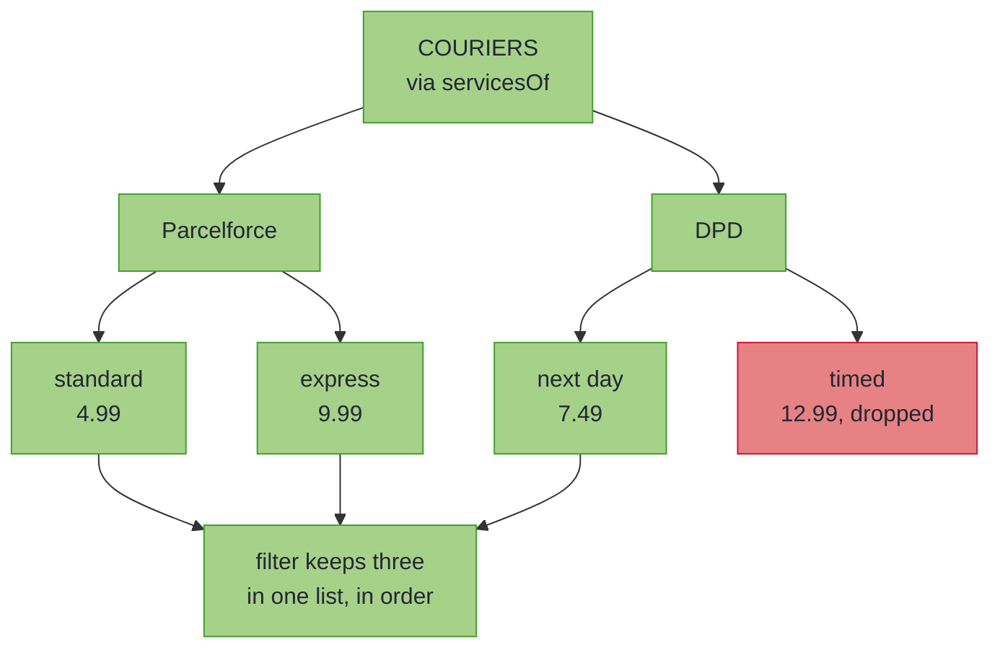

<!-- description: Compute with several results in Java with List: every way to ship an order within a budget, every variant of a product, and pairing by position. -->

# List: Every Result of Every Branch

_Each step can give several results, and the list keeps them all, in order._

~~~admonish abstract title="List at a glance"
| | |
|---|---|
| **Models** | A computation with several results, such as every shipping option or every product variant |
| **Replaces** | Nothing: it is Java's own type |
| **Effect Path** | [`NonDetPath`](../glossary/effect-paths.md#nondetpath) for every combination, or [`ListPath`](../glossary/effect-paths.md#listpath), whose `zipWith` pairs by position |
{{#include ../../../hkj-examples/src/test/resources/golden/foundations-capabilities.md.golden:list_monad}}
| **Choose it when** | Nested loops build every combination, and you keep them all in memory; otherwise [Stream](stream_monad.md), which makes each element as it is read and can be read only once, or compare every type in [Choosing a Type](supported-types.md#choosing-a-type) |
~~~

~~~admonish info title="What You'll Learn"
- Find every way to ship an order by letting each courier branch into its services
- Drop a branch by giving no results for it, and filter what is left
- Choose between every combination, from `NonDetPath`, and pairing by position, from `ListPath`
- Predict what `of`, `map` and `flatMap` do with `null`, on a Path and in generic code
- Use `List` in generic code through its `MonadZero` instance
~~~

~~~admonish example title="See Example Code"
**The code on this page is [ListBook.java](https://github.com/higher-kinded-j/higher-kinded-j/blob/main/hkj-examples/src/main/java/org/higherkindedj/example/book/foundations/list/ListBook.java)**: the page includes it, so the build compiles and runs it. [ListBookTest.java](https://github.com/higher-kinded-j/higher-kinded-j/blob/main/hkj-examples/src/test/java/org/higherkindedj/example/book/foundations/list/ListBookTest.java) holds what the page says each method does.
~~~

---

## Every way to ship an order {#every-way-to-ship-an-order}

An order can go with either of two couriers, and each courier offers several services. To find every service within a budget, plain Java nests a loop over the services inside a loop over the couriers, and adds each match to a list. With streams it is `COURIERS.stream().flatMap(courier -> servicesOf(courier).stream())`, then a filter. A list used as a computation does the same: each step gives a list of results, and the next step runs once for each of them. Its Path adds a `zipWith` that gives every combination, and conversions to the other Paths.

~~~admonish warning title="Two Paths over a list"
`Path.list(list)` gives a `NonDetPath`, short for non-deterministic: it keeps every possible result. `Path.listPath(list)` gives a `ListPath`. Their `map` and `via` agree. Only `zipWith` and `zipWith3` differ: a `NonDetPath` gives every combination, and a `ListPath` pairs by position. Start with `NonDetPath`, which matches the `List` instance's `ap`.
~~~

The code on this page uses these imports:

<!-- verify -->
```java
import java.math.BigDecimal;
import java.util.List;
import org.higherkindedj.hkt.effect.NonDetPath;
import org.higherkindedj.hkt.effect.Path;
```

Each courier's services, with their prices:

```java
{{#include ../../../hkj-examples/src/main/java/org/higherkindedj/example/book/foundations/list/ListBook.java:services}}
```

`Path.list(list)` gives a `NonDetPath`. Its `via` runs the next step for each element and joins every result into one list, and `filter` keeps those that pass:

```java
{{#include ../../../hkj-examples/src/main/java/org/higherkindedj/example/book/foundations/list/ListBook.java:options}}
```

```java
{{#include ../../../hkj-examples/src/main/java/org/higherkindedj/example/book/foundations/list/ListBook.java:options_run}}
```

## Each result branches {#each-result-branches}

`via` gives the next step each result in turn, and keeps the results in order: all of the first courier's services, then all of the second's.



Each courier branches into its services, `filter` drops the one over the budget, and the rest are joined into one list, in order. A step that gives an empty list, such as `Path.listEmpty()`, drops its branch the same way, since it adds nothing to the result.

## Every combination, or position by position {#every-combination-or-position-by-position}

`zipWith` combines two lists, and the two Paths combine them differently. On a `NonDetPath` it pairs each element of the first list with each element of the second, so two colours and two shades give four variants:

```java
{{#include ../../../hkj-examples/src/main/java/org/higherkindedj/example/book/foundations/list/ListBook.java:variants}}
```

On a `ListPath`, from `Path.listPath(list)`, it pairs the elements by position, and the shorter list sets the length:

```java
{{#include ../../../hkj-examples/src/main/java/org/higherkindedj/example/book/foundations/list/ListBook.java:by_position}}
```

`SHADE`, the third line, has no day, so it drops out. `zipWith3` differs between the two Paths in the same way.

## A list holds what a Java list holds {#a-list-holds-what-a-java-list-holds}

The Paths refuse `null`. `Path.list` and `Path.listPath` throw `NullPointerException` for a list that holds one, and so do `map` and `via` when their function returns `null`. The instance over `Kind` follows Java's `List`, which holds `null` if you put one there. Its `map` keeps a `null` that a function returns, and its `of(null)` gives an empty list, as `Optional`'s and `Stream`'s do. A `flatMap` function must return a list, and one that returns `null` throws `KindUnwrapException`. [Where null is read or held](../hkts/core-concepts.md#where-null-is-read-or-held) sets out the rules for each type.

## Creating instances {#creating-instances}

`Path.list(list)` and `Path.list(a, b, c)` start a `NonDetPath`, `Path.listPure(value)` one with a single element, and `Path.listEmpty()` an empty one. `Path.listPath(...)`, `Path.listPathPure(value)`, `Path.listPathEmpty()` and `Path.listPathRange(from, to)` start a `ListPath`. `toNonDetPath()` turns a `ListPath` into a `NonDetPath`, and `toListPath()` turns a `NonDetPath` back into a `ListPath`.

## Methods {#methods}

| Method | What it does |
|---|---|
| `nonDetPath.via(f)`, `listPath.via(f)` | Run `f` for each element, and join every result into one list |
| `map(f)`, `filter(p)` | Change each element, or keep those that pass |
| `nonDetPath.zipWith(other, f)`, `zipWith3(b, c, f)` | Combine every element with every element of the others |
| `listPath.zipWith(other, f)`, `zipWith3(b, c, f)` | Combine elements by position, up to the shortest list |
| `take(n)`, `drop(n)`, `takeWhile(p)`, `dropWhile(p)` | Keep or skip a prefix |
| `foldLeft(initial, f)`, `foldMap(monoid, f)` | Fold the elements into one value |
| `headOption()`, `lastOption()`, `get(index)`, `size()`, `isEmpty()` | Read the list |
| `run()` | Gives the `List` |

## Working with Kind {#working-with-kind}

Generic code, written once for any container, takes `List` through its [`MonadZero`](../functional/monad_zero.md) instance, from `Instances.monadZero(list())`. Its `flatMap` is `via`, and its `ap` applies every function to every value, as a `NonDetPath`'s `zipWith` does. `zero()` is the empty list, and the [`Alternative`](../functional/alternative.md) from `Instances.alternative(list())` joins two lists with `orElse`. These are the extra imports:

<!-- verify -->
```java
import static org.higherkindedj.hkt.instances.Witnesses.list;
import static org.higherkindedj.hkt.list.ListKindHelper.LIST;

import java.util.function.Function;
import org.higherkindedj.hkt.Kind;
import org.higherkindedj.hkt.MonadZero;
import org.higherkindedj.hkt.instances.Instances;
import org.higherkindedj.hkt.list.ListKind;
```

```java
{{#include ../../../hkj-examples/src/main/java/org/higherkindedj/example/book/foundations/list/ListBook.java:kind}}
```

`List` is a JDK type, so `widen` wraps it in a small holder, and `narrow` gives back the same list. `ListTraverse.INSTANCE` traverses a list with any `Applicative`, as [Foldable and Traverse](../functional/foldable_and_traverse.md) shows.

## When to use `List` {#when-to-use-list}

| You need | Use |
|---|---|
| Every result of several branching choices | `List`, or [`NonDetPath`](../glossary/effect-paths.md#nondetpath) |
| Two lists paired element by element | `ListPath`'s [`zipWith`](#every-combination-or-position-by-position) |
| A long or endless sequence, read once as it is produced | [Stream](stream_monad.md), or [VStream](vstream.md) when producing an element does I/O |
| A list that must hold at least one element | [NonEmptyList](nonemptylist_monad.md) |
| A loop over one list in one method | A `for` loop, or `stream()`: nothing else needs the structure |

~~~admonish info title="Hands-On Learning"
Practise `List`'s `map` in Exercise 3 of [Tutorial 02: Functor Mapping](https://github.com/higher-kinded-j/higher-kinded-j/blob/main/hkj-examples/src/test/java/org/higherkindedj/tutorial/coretypes/Tutorial02_FunctorMapping.java) (7 exercises), and its `flatMap` in Exercise 6 of [Tutorial 04: Monad Chaining](https://github.com/higher-kinded-j/higher-kinded-j/blob/main/hkj-examples/src/test/java/org/higherkindedj/tutorial/coretypes/Tutorial04_MonadChaining.java) (8 exercises).
~~~

---

**Previous:** [Writer](writer_monad.md)
**Next:** [Stream](stream_monad.md)
