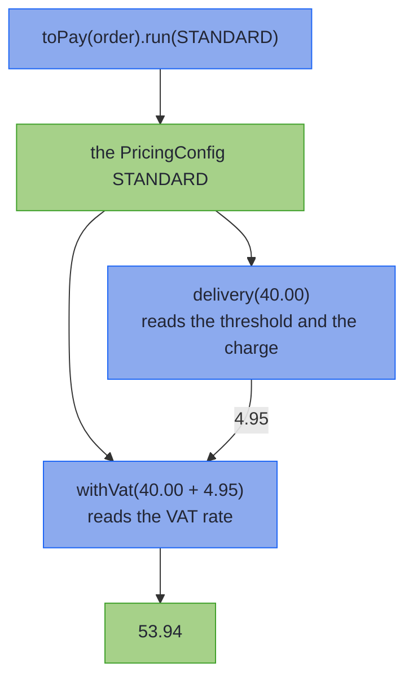

<!-- description: Read configuration in Java with Reader: price an order from settings no method takes, run it against two configurations, and adapt it with ReaderPath.local. -->

# Reader: Reading a Shared Environment

_Write each step against the configuration, and supply it once, when the program runs._

~~~admonish abstract title="Reader at a glance"
| | |
|---|---|
| **Models** | A result worked out from an environment, such as settings, given when it runs |
| **Replaces** | Settings injected into a service, or passed down through every method that needs them |
| **Effect Path** | [`ReaderPath`](../effect/advanced_effects.md#readerpath-the-environment-you-inherit) |
{{#include ../../../hkj-examples/src/test/resources/golden/foundations-capabilities.md.golden:reader_monad}}
| **Choose it when** | You pass the environment to `run` yourself; otherwise [Context](context_scoped.md), which reads what the caller bound to a `ScopedValue`, or compare every type in [Choosing a Type](supported-types.md#choosing-a-type) |
~~~

~~~admonish info title="What You'll Learn"
- Price an order from a `PricingConfig` that no method takes as a parameter
- Say what each step of a `Reader` chain receives, and when
- Run one reader against two configurations, so a test needs no mock
- Change the configuration for one part of a computation with `ReaderPath.local`
- Use `Reader` in generic code through its `Monad` instance
~~~

~~~admonish example title="See Example Code"
**The code on this page is [ReaderBook.java](https://github.com/higher-kinded-j/higher-kinded-j/blob/main/hkj-examples/src/main/java/org/higherkindedj/example/book/foundations/reader/ReaderBook.java)**: the page includes it, so the build compiles and runs it. [ReaderBookTest.java](https://github.com/higher-kinded-j/higher-kinded-j/blob/main/hkj-examples/src/test/java/org/higherkindedj/example/book/foundations/reader/ReaderBookTest.java) holds what the page says each method does.
~~~

---

## Pricing from one configuration {#pricing-from-one-configuration}

What an order costs depends on settings: the VAT rate, the delivery charge, and the order value from which delivery is free. Pass those settings to every method that prices something and they spread through each signature on the way down. Inject them into a service's constructor instead, and the service prices everything with the settings it was built with. A `Reader<R, A>` is a function from an environment `R` to a result `A`. `Function.andThen` already gives you its `map`. What a `Reader` adds is `flatMap`, which hands the next step the previous result and the same environment. So the settings go in once, when you run the reader, and each run can be given different ones.

The code on this page uses these imports, with `Order` from the order records the [Optics](../optics/ch_intro.md) chapter introduces, and `PricingConfig` from this chapter's examples:

<!-- verify -->
```java
import java.math.BigDecimal;
import java.math.RoundingMode;
import org.higherkindedj.example.book.foundations.PricingConfig;
import org.higherkindedj.example.book.optics.cast.Order;
import org.higherkindedj.hkt.effect.Path;
import org.higherkindedj.hkt.effect.ReaderPath;
import org.higherkindedj.hkt.reader.Reader;
```

`PricingConfig` is a record of the examples' own:

```java
{{#include ../../../hkj-examples/src/main/java/org/higherkindedj/example/book/foundations/PricingConfig.java:pricing_config}}
```

Delivery is charged on an order under the threshold, and VAT is added to the whole:

```java
{{#include ../../../hkj-examples/src/main/java/org/higherkindedj/example/book/foundations/reader/ReaderBook.java:pricing}}
```

`toPay` describes the price without a configuration to hand. `STANDARD` charges VAT at 20%, and 4.95 for delivery on an order under 50.00. `SALE` is the same, with free delivery from 30.00. `LAMP_ORDER` is one lamp at 40.00. Run the reader with one configuration, then with the other:

```java
{{#include ../../../hkj-examples/src/main/java/org/higherkindedj/example/book/foundations/reader/ReaderBook.java:run}}
```

The lamp costs 40.00, under the usual threshold of 50.00, so the usual price adds the 4.95 delivery charge before VAT: (40.00 + 4.95) × 1.20 = 53.94. The sale's threshold is 30.00, so the same reader charges no delivery: 40.00 × 1.20 = 48.00. A test prices against whatever configuration it builds, with no mock to set up.

## Each step is given the configuration {#each-step-is-given-the-configuration}

`flatMap` runs the first reader, passes its result to the next step, and runs that step with the same environment. Nothing reads the configuration until `run` is called, and a reader keeps no result: each `run` calls its functions again, with the environment it is given.



The configuration goes to every step, while each result goes only to the step after it. `Reader.ask()` gives the environment itself, for a step that needs the whole of it.

## On a `ReaderPath` {#on-a-readerpath}

Application code holds a reader on a `ReaderPath`, its Effect Path, and `Path.reader(reader)` gives you one. It chains with `via`, combines with `zipWith`, and adds `local`, which runs a reader against a configuration changed for that reader alone. A quote can then show what a member pays, with delivery free whatever the order costs:

```java
{{#include ../../../hkj-examples/src/main/java/org/higherkindedj/example/book/foundations/reader/ReaderBook.java:quote}}
```

```java
{{#include ../../../hkj-examples/src/main/java/org/higherkindedj/example/book/foundations/reader/ReaderBook.java:quote_outcome}}
```

`quoted` is `"53.94, or 48.00 for members"`. The standard configuration is passed once: `usual` reads it as it is, and `members` reads it through `forMembers`. `local` also adapts a reader written for a part of a larger environment, such as a `PricingConfig` inside the application's settings. `magnify` does the same from a `Getter` or a `FocusPath`, as [Local Environment Modification](../effect/advanced_effects.md#local-environment-modification) shows.

## Creating instances {#creating-instances}

`Reader.of(function)` wraps a function of the environment, `Reader.ask()` gives the environment itself, and `Reader.constant(value)` gives a value whatever the environment holds. `Reader.unit()` gives [`Unit`](../hkts/core-concepts.md#unit), and `Reader.fromConsumer(action)` runs an action with the environment and gives `Unit`. On a Path, `Path.reader(reader)`, `Path.ask()`, `Path.asks(function)` and `Path.readerPure(value)` start a `ReaderPath`. A `Reader` from these factories always gives a value, as [Values, never null](../hkts/core-concepts.md#values-never-null) sets out. `constant(null)` throws at the call, and a function given to `of` or `map` that returns `null` fails the reader when it runs. `Reader` is a functional interface, so a lambda written as one directly has no such check: build a reader with `Reader.of`.

## Methods {#methods}

| Method | What it does |
|---|---|
| `Reader.of(function)` | Wraps a function of the environment |
| `Reader.ask()` | Gives the environment itself |
| `Reader.constant(value)` | Gives `value`, whatever the environment |
| `Reader.unit()` | Gives `Unit`, whatever the environment |
| `Reader.fromConsumer(action)` | Runs `action` with the environment, and gives `Unit` |
| `map(f)` | Builds a reader whose result is changed by `f` |
| `flatMap(f)` | Builds a reader that runs the next step on this one's result, with the same environment |
| `asUnit()` | Keeps the computation and replaces the result with `Unit` |
| `run(environment)` | Runs the reader with `environment` and gives its result |
| `readerPath.via(f)`, `zipWith(other, f)` | Chain or combine `ReaderPath` steps over one environment |
| `readerPath.local(f)` | Runs the path against the environment `f` gives |
| `readerPath.magnify(getter)` | Runs the path against the part of a larger environment the `Getter` or `FocusPath` reads |
| `readerPath.toReader()` | Gives the `Reader` the path holds |

## Working with Kind {#working-with-kind}

Generic code, written once for any container, takes `Reader` through its `Monad` instance, from `Instances.monad(reader())`. The environment type is part of the witness, `ReaderKind.Witness<R>`, so one instance serves readers of one environment type. You widen a `Reader` to pass it in, run the result with `READER.runReader`, and `READER.narrow(kind)` gives the `Reader` back. These are the extra imports:

<!-- verify -->
```java
import static org.higherkindedj.hkt.instances.Witnesses.reader;
import static org.higherkindedj.hkt.reader.ReaderKindHelper.READER;

import org.higherkindedj.hkt.Kind;
import org.higherkindedj.hkt.Monad;
import org.higherkindedj.hkt.instances.Instances;
import org.higherkindedj.hkt.reader.ReaderKind;
```

```java
{{#include ../../../hkj-examples/src/main/java/org/higherkindedj/example/book/foundations/reader/ReaderBook.java:kind}}
```

`ran` is `"pay 53.94"`. Widening allocates nothing: `Reader` implements `ReaderKind` itself, so `widen` checks for `null` and returns the same object. `Reader` has a `Selective` instance too, `ReaderSelective.instance()`, an object of its own, and *Reader at a glance*, at the head of the page, lists it. Code that reads an environment through any monad, not only `Reader`, takes a `MonadReader`, as [Reading settings with `MonadReader`](../functional/for_mtl.md#reading-configuration-with-monadreader) shows.

## When to use `Reader` {#when-to-use-reader}

| You need | Use |
|---|---|
| Steps that read one environment, supplied once when the program runs | `Reader`, or [ReaderPath](../effect/advanced_effects.md#readerpath-the-environment-you-inherit) |
| A value the request binds, which threads forked for that request should see | [Context](context_scoped.md) |
| An environment, together with failure or asynchronous work | [ConfigContext](../effect/effect_contexts_config.md), or [ReaderT](../transformers/readert_transformer.md) |
| Steps that each change a value the next step reads | [State](state_monad.md) |
| One or two methods that need the setting | A parameter: a reader earns its place when many steps share the environment |

~~~admonish info title="Hands-On Learning"
Practise threading configuration with `Reader`, in Exercise 3 of [Tutorial 07: Real World](https://github.com/higher-kinded-j/higher-kinded-j/blob/main/hkj-examples/src/test/java/org/higherkindedj/tutorial/coretypes/Tutorial07_RealWorld.java) (6 exercises), and `magnify` in Exercise 5 of [Tutorial 05: Optic-Polymorphic Zoom and Magnify](https://github.com/higher-kinded-j/higher-kinded-j/blob/main/hkj-examples/src/test/java/org/higherkindedj/tutorial/expression/Tutorial05_ZoomAndMagnify.java) (6 exercises).
~~~

---

**Previous:** [Advanced Features](vstream_advanced.md)
**Next:** [Context](context_scoped.md)
