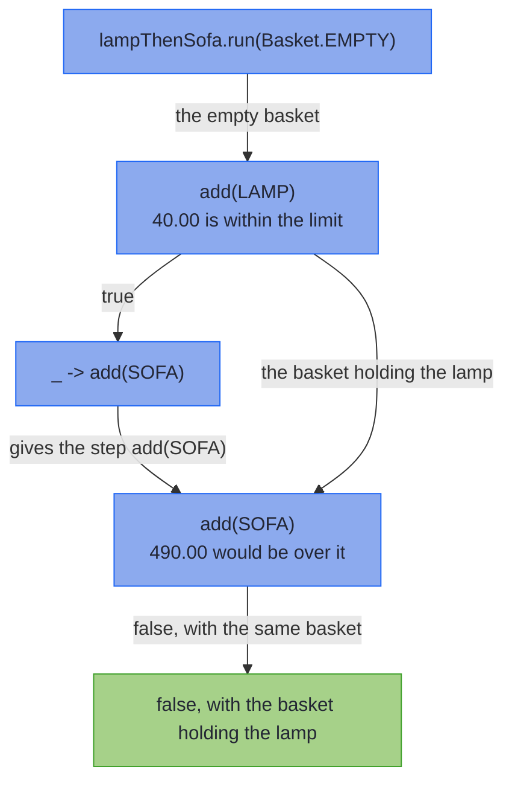

<!-- description: Update a value step by step in Java with State: add to a basket within a limit, run the steps from any basket, and sequence a bank account's month. -->

# State: Updating a Value Step by Step

_Each step is handed the state, and returns its result with the state it leaves for the next step._

<!-- source: Rich Hickey, "Simple Made Easy", a keynote at Strange Loop, 20 September 2011, given again at QCon London 2012; the slide title "State is Never Simple", whose first bullet is "Complects value and time", checked against the QCon London 2012 slide deck (RichHickey_SimpleMadeEasy.pdf), and set here in sentence case -->
> _"State is never simple."_
>
> — Rich Hickey, *Simple Made Easy*

Hickey's charge is against the variable, which braids a value together with time: whoever reads it must know what changed it, and when. A `State` keeps no variable. Each step is handed one state and gives the next, and the order of the steps is the only time there is.

~~~admonish abstract title="State at a glance"
| | |
|---|---|
| **Models** | A computation that is handed a state, such as a basket, and gives a result with the state it leaves |
| **Replaces** | A field that each method changes, or methods that take a value and return a pair of the result and the new value |
| **Effect Path** | [`WithStatePath`](../effect/advanced_effects.md#withstatepath-computation-with-memory) |
{{#include ../../../hkj-examples/src/test/resources/golden/foundations-capabilities.md.golden:state_monad}}
| **Choose it when** | Each step works from what the steps before it left; otherwise [Reader](reader_monad.md), whose environment no step changes, or compare every type in [Choosing a Type](supported-types.md#choosing-a-type) |
~~~

~~~admonish info title="What You'll Learn"
- Add to a basket with steps that each give a result and the basket they leave
- Say what each step of a `State` chain is handed, and what it hands on
- Run the same steps from any basket, so a test starts from whatever basket it builds
- Combine steps on a `WithStatePath`, and sequence a month of banking with `For`
- Use `State` in generic code through its `Monad` instance
~~~

~~~admonish example title="See Example Code"
**The code on this page is [StateBook.java](https://github.com/higher-kinded-j/higher-kinded-j/blob/main/hkj-examples/src/main/java/org/higherkindedj/example/book/foundations/state/StateBook.java) and [BankBook.java](https://github.com/higher-kinded-j/higher-kinded-j/blob/main/hkj-examples/src/main/java/org/higherkindedj/example/book/foundations/state/BankBook.java)**: the page includes them, so the build compiles and runs them. [StateBookTest.java](https://github.com/higher-kinded-j/higher-kinded-j/blob/main/hkj-examples/src/test/java/org/higherkindedj/example/book/foundations/state/StateBookTest.java) and [BankBookTest.java](https://github.com/higher-kinded-j/higher-kinded-j/blob/main/hkj-examples/src/test/java/org/higherkindedj/example/book/foundations/state/BankBookTest.java) hold what the page says each method does.
~~~

---

## Adding to a basket {#adding-to-a-basket}

A customer's basket changes as they shop, and some steps report something too: whether a line went in, or what the basket comes to. Keep the basket in a field, and every method that changes it shares that field. A method's result then depends on what ran before it, which its signature never says. Pass the basket in and return a pair instead, and every caller must unpack the pair and hand the new basket to the next call. A `State<S, A>` is that function, from a state `S` to a result `A` and the next state, with the handing on done for you.

The code on this page uses these imports, with `LineItem` from the order records the [Optics](../optics/ch_intro.md) chapter introduces, and `Basket` from this chapter's examples:

<!-- verify -->
```java
import java.math.BigDecimal;
import java.util.List;
import java.util.stream.Stream;
import org.higherkindedj.example.book.foundations.Basket;
import org.higherkindedj.example.book.optics.cast.LineItem;
import org.higherkindedj.hkt.effect.Path;
import org.higherkindedj.hkt.effect.WithStatePath;
import org.higherkindedj.hkt.state.State;
import org.higherkindedj.hkt.state.StateTuple;
```

`Basket` is a record of the examples' own:

```java
{{#include ../../../hkj-examples/src/main/java/org/higherkindedj/example/book/foundations/Basket.java:basket}}
```

`Basket.add` gives a new basket, and leaves the one it was called on as it was. `State` makes no copy of the state it hands on. Keep the state an immutable value, as `Basket` is, since a step that changed it in place would change the caller's object too.

The step `add` puts a line in the basket if the total stays within `LIMIT`, which is 100.00, and gives `true`. Otherwise it gives `false`, and hands on the basket it was given. A `StateTuple` holds a step's result and the state it leaves:

```java
{{#include ../../../hkj-examples/src/main/java/org/higherkindedj/example/book/foundations/state/StateBook.java:add}}
```

`LAMP` is one lamp at 40.00, `SOFA` one sofa at 450.00, and `BULBS` four bulbs at 2.50 each. Add the lamp, then the sofa:

```java
{{#include ../../../hkj-examples/src/main/java/org/higherkindedj/example/book/foundations/state/StateBook.java:run}}
```

The lamp goes in. The sofa would take the basket to 490.00, so `add(SOFA)` gives `false` and leaves the basket holding only the lamp. A `State` holds no basket of its own, so run the same steps from a basket of bulbs and they start from that one. The lamp joins the bulbs, the sofa is refused again, and the basket comes to 50.00. A test builds the basket it needs and runs the steps from it.

## Each step is handed the basket {#each-step-is-handed-the-basket}

Nothing runs until `run` is called. Then `flatMap` runs `add(LAMP)` on the basket it was given, and passes the result to `_ -> add(SOFA)`. The step that function returns runs on the basket `add(LAMP)` left.



The basket goes from each step straight to the next, while each result goes to the function that picks the step after it. Each `run` starts again from the basket it is given, so running a `State` twice does its work twice.

## A step for each line {#a-step-for-each-line}

A loop can build the chain. Each `flatMap` is handed the refusals so far, and the step it returns runs on the basket the steps before it left. `map` adds the line's SKU to the refusals when `add` gives `false`:

```java
{{#include ../../../hkj-examples/src/main/java/org/higherkindedj/example/book/foundations/state/StateBook.java:add_all}}
```

```java
{{#include ../../../hkj-examples/src/main/java/org/higherkindedj/example/book/foundations/state/StateBook.java:add_all_outcome}}
```

A long list makes a long chain. `run` works through the chain in a loop, not a stack frame for each step, so a chain of 100,000 steps runs on an ordinary thread. That holds for `map` as well as `flatMap`, and for the `WithStatePath` methods the next section shows.

## On a `WithStatePath` {#on-a-withstatepath}

Application code holds a `State` on a `WithStatePath`, its Effect Path, and `Path.state(state)` gives you one. It chains with `via`, runs one path after another with `then`, and combines with `zipWith`, which runs the second path on the state the first one left. Checkout reads the total from the basket the trip leaves:

```java
{{#include ../../../hkj-examples/src/main/java/org/higherkindedj/example/book/foundations/state/StateBook.java:checkout}}
```

```java
{{#include ../../../hkj-examples/src/main/java/org/higherkindedj/example/book/foundations/state/StateBook.java:checkout_outcome}}
```

`receipt` is `"pay 50.00, refused [SOFA]"`. `evalState` gives only the result, `execState` only the final state, and `run` the `StateTuple` with both.

## A State always gives a value {#a-state-always-gives-a-value}

A `StateTuple` always holds a result and a state, so `State.pure(null)`, `State.set(null)` and a `StateTuple` built with `null` throw at the call. A function given to `map` or `inspect` that returns `null` fails the run with `f must not return null`, and one given to `modify` fails it with `StateTuple.construction state cannot be null`. A step with nothing to report gives [`Unit`](../hkts/core-concepts.md#unit), as `set` and `modify` do. `State.of` does not check what your function returns, so it must never return `null`. [Values, never null](../hkts/core-concepts.md#values-never-null) sets out the rule every type follows.

## Creating instances {#creating-instances}

`State.of(function)` wraps a function from a state to a `StateTuple`, and `State.pure(value)` gives a value and leaves the state as it is. `State.get()` gives the state itself, and `State.inspect(f)` gives what `f` reads from it. `State.set(state)` replaces it, and `State.modify(f)` changes it, and both give `Unit`. `new StateTuple<>(value, state)` takes the result first, but `StateTuple.of(state, value)` takes the state first. On a Path, `Path.state(state)`, `Path.statePure(value)`, `Path.getState()`, `Path.setState(state)` and `Path.modifyState(f)` start a `WithStatePath`, and `WithStatePath.inspect(f)` starts one that reads part of the state.

## Methods {#methods}

| Method | What it does |
|---|---|
| `State.of(function)` | Wraps a function from a state to a `StateTuple` |
| `State.pure(value)` | Gives `value`, and leaves the state as it is |
| `State.get()` | Gives the state |
| `State.inspect(f)` | Gives what `f` reads from the state |
| `State.set(state)` | Replaces the state, and gives `Unit` |
| `State.modify(f)` | Changes the state with `f`, and gives `Unit` |
| `map(f)` | Builds a `State` whose result is changed by `f` |
| `flatMap(f)` | Builds a `State` that runs the step `f` picks from this one's result, on the state this one left |
| `run(state)` | Runs from `state`, and gives the `StateTuple` of the result and the final state |
| `withStatePath.via(f)`, `then(next)`, `zipWith(other, f)` | Chain, sequence or combine `WithStatePath` steps over one state |
| `withStatePath.evalState(state)`, `execState(state)`, `run(state)` | Give the result, the final state, or both |
| `withStatePath.toState()` | Gives the `State` the path holds |

## Working with Kind {#working-with-kind}

Generic code, written once for any container, takes `State` through its `Monad` instance, from `Instances.monad(state())`. The state type is part of the witness, `StateKind.Witness<S>`, so one instance serves steps over one state type. You widen a `State` to pass it in, and run the result with `STATE.runState`, `STATE.evalState` or `STATE.execState`. `STATE.narrow(kind)` gives the `State` back. These are the extra imports, with those the bank account in the next section uses:

<!-- verify -->
```java
import static org.higherkindedj.hkt.instances.Witnesses.state;
import static org.higherkindedj.hkt.state.StateKindHelper.STATE;

import java.util.Objects;
import org.higherkindedj.hkt.Kind;
import org.higherkindedj.hkt.Monad;
import org.higherkindedj.hkt.Unit;
import org.higherkindedj.hkt.expression.For;
import org.higherkindedj.hkt.instances.Instances;
import org.higherkindedj.hkt.state.StateKind;
```

```java
{{#include ../../../hkj-examples/src/main/java/org/higherkindedj/example/book/foundations/state/StateBook.java:kind}}
```

`ran` is `"added"`. Widening allocates nothing: every `State` is already a `StateKind`, so `widen` checks for `null` and returns the same object. `STATE.get()`, `STATE.set(state)`, `STATE.modify(f)` and `STATE.inspect(f)` build a widened step directly. Code that changes a state through any monad, not only `State`, takes a `MonadState`, as [Changing a basket with `MonadState`](../functional/for_mtl.md#threading-state-with-monadstate) shows. [ForState](../functional/forstate_comprehension.md) names each step's result, and updates the state through optics.

### A month in a bank account {#a-month-in-a-bank-account}

What the `Monad` instance adds is [`For`](../functional/for_comprehension.md), which lists a chain of steps in order rather than nesting them. A bank account shows it. An `Account` holds its balance and every transaction so far, with the refused ones:

```java
{{#include ../../../hkj-examples/src/main/java/org/higherkindedj/example/book/foundations/state/BankBook.java:account}}
```

A deposit only changes the account, so it is a `State.modify`, and gives `Unit`. A withdrawal also says whether it was paid:

```java
{{#include ../../../hkj-examples/src/main/java/org/higherkindedj/example/book/foundations/state/BankBook.java:steps}}
```

`For` sequences the month over the `State` monad, so each step is widened with `STATE.widen`. Each `from` is given the results so far, and the step it returns runs on the account the step before it left. `yield` sees every step's result:

```java
{{#include ../../../hkj-examples/src/main/java/org/higherkindedj/example/book/foundations/state/BankBook.java:month}}
```

```java
{{#include ../../../hkj-examples/src/main/java/org/higherkindedj/example/book/foundations/state/BankBook.java:run}}
```

`report` is `"bill paid: true, groceries paid: true, cinema paid: false"`. The salary takes the opening 100.00 to 120.00, and the bill and the groceries take it to 0.00. The cinema is refused and recorded as refused, so the history holds five transactions: the opening balance, the salary, two payments and the refusal. The account records no time, so the same month gives the same history on every run. A transaction that needs a time can read it from a [`TimeSource`](io_monad.md#reading-the-clock) passed to the step, which a test fixes.

## When to use `State` {#when-to-use-state}

| You need | Use |
|---|---|
| Steps that each work from what the step before them left | `State`, or [WithStatePath](../effect/advanced_effects.md#withstatepath-computation-with-memory) |
| Steps that read one environment, which no step changes | [Reader](reader_monad.md) |
| A log that steps add to, and read only at the end | [Writer](writer_monad.md) |
| State together with failure or asynchronous work | [StateT](../transformers/statet_transformer.md), or [MutableContext](../effect/effect_contexts_mutable.md) |
| A loop inside one method that updates a local variable | The local variable: nothing outside the method sees it change |

~~~admonish info title="Hands-On Learning"
Practise `MonadState` in Exercises 5 to 8 of [Tutorial 04: Polymorphic Capabilities](https://github.com/higher-kinded-j/higher-kinded-j/blob/main/hkj-examples/src/test/java/org/higherkindedj/tutorial/transformers/Tutorial04_PolymorphicCapabilities.java) (14 exercises), and state updated through optics in [Tutorial 01: ForState Basics](https://github.com/higher-kinded-j/higher-kinded-j/blob/main/hkj-examples/src/test/java/org/higherkindedj/tutorial/expression/Tutorial01_ForStateBasics.java) (13 exercises).
~~~

---

**Previous:** [Context](context_scoped.md)
**Next:** [Writer](writer_monad.md)
