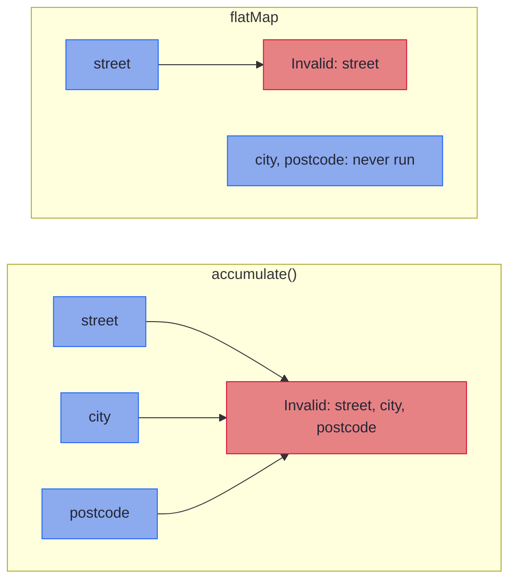

<!-- description: Validate every field of a Java request with Validated and accumulate all the errors in one reply, not only the first. -->

# Validated: Accumulating Errors

_Check every field of a request, and report all the errors in one reply._

<!-- source: William Shakespeare, Hamlet, Act IV, Scene V (Claudius); text checked against Project Gutenberg eBook #1524 -->
> _"When sorrows come, they come not single spies, / But in battalions."_
>
> — William Shakespeare, *Hamlet* (IV.v)

A form's mistakes come the same way, and a fail-fast check reports them one spy at a time. `Validated` reports the battalion.

~~~admonish abstract title="Validated at a glance"
| | |
|---|---|
| **Models** | A valid value, or every error the checks found |
| **Replaces** | Error messages collected in a `List`, or Bean Validation's `Set<ConstraintViolation>` |
| **Effect Path** | [`ValidationPath`](../effect/path_validation.md) |
{{#include ../../../hkj-examples/src/test/resources/golden/foundations-capabilities.md.golden:validated_monad}}
| **Choose it when** | The caller wants every error from checks that do not depend on one another; otherwise [Either](either_monad.md), or compare every type in [Choosing a Type](supported-types.md#choosing-a-type) |
~~~

~~~admonish info title="What You'll Learn"
- Report every failed check of a request in one result, instead of one per submit
- Join independent checks with `Validated.accumulate()`, and follow them with a check that needs their result
- Say why generic code gets every error from `Validated`'s `map2` but only the first from its `flatMap`
- Keep the same checks on a `ValidationPath`, and know which of its methods stop at the first error
- Choose between `Validated`, `ValidationPath` and Accumulating Assembly
~~~

~~~admonish example title="See Example Code"
**The code on this page is [ValidatedBook.java](https://github.com/higher-kinded-j/higher-kinded-j/blob/main/hkj-examples/src/main/java/org/higherkindedj/example/book/foundations/validated/ValidatedBook.java)**: the page includes it, so the build compiles and runs it. [ValidatedBookTest.java](https://github.com/higher-kinded-j/higher-kinded-j/blob/main/hkj-examples/src/test/java/org/higherkindedj/example/book/foundations/validated/ValidatedBookTest.java) holds what the page says each method does.
~~~

---

## The problem: death by a thousand submits {#the-problem-death-by-a-thousand-submits}

A customer types a delivery address at checkout and makes three mistakes: no street, no city, and a postcode of `XYZ`. They press Submit, and the page says **"street is required"**. They fill in the street and submit again, to see **"city is required"**. A third submit finally shows **"postcode XYZ is not a UK postcode"**.

Three round-trips. Three frustrations. Three errors that were all knowable from the very first submission.

The code on this page uses these imports, with `Address` from the order records the [Optics](../optics/ch_intro.md) chapter introduces:

<!-- verify -->
```java
import org.higherkindedj.example.book.optics.cast.Address;
import org.higherkindedj.hkt.nonemptylist.NonEmptyList;
import org.higherkindedj.hkt.validated.Validated;
```

Each check returns a `Validated` rather than throwing. A `Valid` holds the checked value, and an `Invalid` holds the errors in a [`NonEmptyList`](nonemptylist_monad.md), since an invalid result always has at least one:

```java
{{#include ../../../hkj-examples/src/main/java/org/higherkindedj/example/book/foundations/validated/ValidatedBook.java:checks}}
```

`POSTCODE` is a `Pattern` for the shape of a UK postcode.

Joined with `flatMap`, each check runs only when the one before it has passed, so the address takes three submits:

```java
{{#include ../../../hkj-examples/src/main/java/org/higherkindedj/example/book/foundations/validated/ValidatedBook.java:one_at_a_time}}
```

```java
{{#include ../../../hkj-examples/src/main/java/org/higherkindedj/example/book/foundations/validated/ValidatedBook.java:submits}}
```

## Every error in one reply {#every-error-in-one-reply}

The three checks do not need one another's results, so none has to wait for another. Passed to `Validated.accumulate()` as arguments, every check runs, where `flatMap` put the later checks inside functions it might never call. `accumulate()` builds the address only when every check passed, and otherwise keeps every error, in the order of the checks:

```java
{{#include ../../../hkj-examples/src/main/java/org/higherkindedj/example/book/foundations/validated/ValidatedBook.java:accumulate}}
```

```java
{{#include ../../../hkj-examples/src/main/java/org/higherkindedj/example/book/foundations/validated/ValidatedBook.java:one_reply}}
```



The diagram shows the same three checks joined two ways. With `flatMap`, the first failure ends the run; with `accumulate()`, every check runs and every error is kept. Bean Validation also reports every violation, but of an object that already exists. A `Validated` builds the address only when every check passes, and its list of errors can never be empty. For a record with many fields, or errors that name the field they belong to, [Accumulating Assembly](validated_assembly.md) builds the record with `Validated.fields()`.

## When one check needs another {#when-one-check-needs-another}

Some checks need the value the others built. Whether the courier delivers to an address can only be asked of a whole address, so that check follows `accumulate()` with `flatMap`:

```java
{{#include ../../../hkj-examples/src/main/java/org/higherkindedj/example/book/foundations/validated/ValidatedBook.java:dependent}}
```

`COURIER_AREAS` holds the postcode areas the courier serves, such as `LS1`.

```java
{{#include ../../../hkj-examples/src/main/java/org/higherkindedj/example/book/foundations/validated/ValidatedBook.java:delivery}}
```

An address with blank fields never reaches the courier check, so the reply holds only the fields' errors. Independent checks accumulate, and a check that needs their result follows them. [Applicative, Selective or Monad?](../functional/abstraction_levels.md) makes the same choice for any container.

## On a `ValidationPath` {#on-a-validationpath}

Application code can hold the same checks on a [`ValidationPath`](../effect/path_validation.md). `Path.accumulate()` keeps every error, as `Validated.accumulate()` does, and `via` chains a check that needs the value. These are the extra imports:

<!-- verify -->
```java
import org.higherkindedj.hkt.effect.Path;
import org.higherkindedj.hkt.effect.ValidationPath;
```

```java
{{#include ../../../hkj-examples/src/main/java/org/higherkindedj/example/book/foundations/validated/ValidatedBook.java:path}}
```

```java
{{#include ../../../hkj-examples/src/main/java/org/higherkindedj/example/book/foundations/validated/ValidatedBook.java:path_outcome}}
```

Two of a `ValidationPath`'s methods for joining Paths stop at the first error: `zipWith` and `zipWith3`. `zipWithAccum`, `zipWith3Accum`, `andAlso` and `andThen` keep every error.

## Methods {#methods}

| Method | What it does |
|---|---|
| `Validated.valid(value)`, `Validated.invalid(error)` | Build a valid value or an error |
| `Validated.validNel(value)`, `Validated.invalidNel(error)` | The same, with the error in a `NonEmptyList` |
| `Validated.validateThat(condition, error)` | Gives `Valid(Unit)` when the condition holds, and the error otherwise; the error may also come from a `Supplier` |
| `Validated.accumulate()` | Joins independent checks over `NonEmptyList` errors, keeping every error |
| `Validated.fields()` | The same, naming the field each error belongs to, as [Accumulating Assembly](validated_assembly.md) shows |
| `isValid()`, `isInvalid()` | Say which case it holds |
| `map(f)`, `mapError(f)`, `bimap(onError, onValid)` | Change the value, the error, or whichever it holds |
| `flatMap(f)` | Runs a check that needs the value; an `Invalid` passes through, so its errors are the only ones kept |
| `ap(function, semigroup)` | Applies a validated function, joining both errors with the semigroup when both are invalid |
| `fold(onInvalid, onValid)` | Turns either case into one result |
| `orElse(other)`, `orElseGet(supplier)` | Return the value, or a fallback |
| `orElseThrow(supplier)` | Returns the value, or throws the supplied exception |
| `get()`, `getError()` | Return the value or the error, or throw `NoSuchElementException` |
| `ifValid(action)`, `ifInvalid(action)` | Run an action for the case it holds |
| `asUnit()` | Replaces a valid value with `Unit`, and keeps an error |
| `toEither()` | Gives an `Either` holding the same value or error |

## Working with Kind {#working-with-kind}

Generic code takes `Validated` through its instance, from `Instances.validated(semigroup)`. The semigroup is how the instance joins two errors; `NonEmptyList.semigroup()` appends one list to the other. The instance's `map2` to `map5` keep every error, and its `handleErrorWith` can replace the errors with a fallback. These are the extra imports:

<!-- verify -->
```java
import static org.higherkindedj.hkt.validated.ValidatedKindHelper.VALIDATED;

import org.higherkindedj.hkt.Kind;
import org.higherkindedj.hkt.MonadError;
import org.higherkindedj.hkt.instances.Instances;
import org.higherkindedj.hkt.validated.ValidatedKind;
```

```java
{{#include ../../../hkj-examples/src/main/java/org/higherkindedj/example/book/foundations/validated/ValidatedBook.java:kind}}
```

`PICKUP_POINT` is an `Address` where an order can be collected instead. The postcode passed, so the reply holds the street's and the city's errors. `Validated` has instances of other type classes too, such as `Traverse` and `Bifunctor`, each an object of its own, and *Validated at a glance*, at the head of the page, lists them.

The instance's `map2` to `map5` keep every error, while its `flatMap`, and the `flatMap2` built on it, stop at the first, so generic code gets a different answer from each. [Where `Validated` bends a rule](../functional/applicative.md#where-validated-bends-a-rule) says why the two differ.

## When to use `Validated` {#when-to-use-validated}

| You need | Use |
|---|---|
| Every error from checks that do not depend on one another | `Validated`, with `accumulate()` |
| A record built from many checked fields, each error naming its field | [Accumulating Assembly](validated_assembly.md) |
| The same checks as a fluent chain in application code | [ValidationPath](../effect/path_validation.md) |
| The first error only, or a run of steps that each need the last one's value | [Either](either_monad.md) |
| A success that can carry warnings beside it | [EitherOrBoth](either_or_both_monad.md) |

~~~admonish info title="Hands-On Learning"
Practise accumulating errors with `map3`, beside `Either` and `Maybe`, in [Tutorial 06: Concrete Types](https://github.com/higher-kinded-j/higher-kinded-j/blob/main/hkj-examples/src/test/java/org/higherkindedj/tutorial/coretypes/Tutorial06_ConcreteTypes.java) (7 exercises).
~~~

---

**Previous:** [Either](either_monad.md)
**Next:** [Accumulating Assembly](validated_assembly.md)
