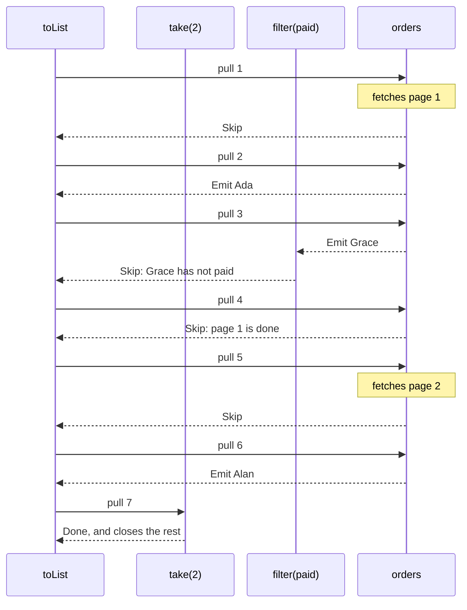

<!-- description: Lazy pull-based streams in Java with VStream: read a paged API one page at a time, transform elements with tasks, recover a failed element. -->

# VStream: Lazy Pull-Based Streams

_A sequence of elements, each produced by a task only when you ask for it._

<!-- source: Dan Powell, the archivist in Archive 81, the podcast by Marc Sollinger and Daniel Powell (Dead Signals, 2016); the wording has not been checked against a transcript -->
> _"Tape after tape. You don't get the whole story at once. You pull the next one, press play, and hope you're ready for what comes out."_
>
> — Dan Powell, *Archive 81*

Dan Powell's archive is a pull-based stream: no tape plays itself, and nothing moves until he reaches for the next one. A `VStream` works the same way. Each element comes from a task, which runs only when you pull it, and which may block or fail.

~~~admonish abstract title="VStream at a glance"
| | |
|---|---|
| **Models** | A sequence of elements, each produced by a task only when the consumer pulls it |
| **Replaces** | A loop over a paged or blocking source, or a Java `Stream` or `Iterator` built over one |
| **Effect Path** | [`VStreamPath`](../effect/path_vstream.md) |
{{#include ../../../hkj-examples/src/test/resources/golden/foundations-capabilities.md.golden:vstream}}
| **Choose it when** | Elements arrive one at a time from work that may block or fail; otherwise [List](list_monad.md), or compare every type in [Choosing a Type](supported-types.md#choosing-a-type) |
~~~

~~~admonish info title="What You'll Learn"
- Read a paged source one page at a time, fetching a page only when the stream reaches it
- Say what a pull gives back, and why a stream answers some pulls with a `Skip`
- Transform elements with functions and with tasks, and collect them with a terminal operation
- Give a value in place of a failed element, or keep what was read when the source fails
- Say which thread runs a pull, and where virtual threads come in
~~~

~~~admonish example title="See Example Code"
**The code on this page is [VStreamBook.java](https://github.com/higher-kinded-j/higher-kinded-j/blob/main/hkj-examples/src/main/java/org/higherkindedj/example/book/foundations/vstream/VStreamBook.java)**: the page includes it, so the build compiles and runs it. [VStreamBookTest.java](https://github.com/higher-kinded-j/higher-kinded-j/blob/main/hkj-examples/src/test/java/org/higherkindedj/example/book/foundations/vstream/VStreamBookTest.java) holds what the page says each method does.
~~~

---

## Reading a feed one page at a time {#reading-a-feed-one-page-at-a-time}

An order service hands out its orders a page at a time, and each page is a call that blocks and may throw an `IOException`. In plain Java you would write a loop that fetches the next page until one comes back empty. A Java `Stream` or `Iterator` built over that loop is lazy too, but it can be read only once. The lambdas you pass to its `map` and `filter` cannot throw the feed's `IOException`. Nothing in it can give a value in place of one failed element, or keep what was read when the feed fails. A `VStream<A>` describes the sequence instead. It produces nothing until a terminal operation runs it, and you can run it as often as you like.

The code on this page uses these imports, with `Order` from the order records the [Optics](../optics/ch_intro.md) chapter introduces:

<!-- verify -->
```java
import java.io.IOException;
import java.math.BigDecimal;
import java.util.List;
import java.util.Optional;
import org.higherkindedj.example.book.foundations.OrderPage;
import org.higherkindedj.example.book.optics.cast.Order;
import org.higherkindedj.hkt.vstream.VStream;
import org.higherkindedj.hkt.vtask.VTask;
```

The feed gives an `OrderPage`, and a courier quotes for delivering an order:

```java
{{#include ../../../hkj-examples/src/main/java/org/higherkindedj/example/book/foundations/OrderPage.java:order_page}}
```

```java
{{#include ../../../hkj-examples/src/main/java/org/higherkindedj/example/book/foundations/vstream/VStreamBook.java:services}}
```

`VStream.unfold` builds a stream from a state, here the next page number, and a function giving a task for each state. The task gives a `VStream.Seed`, holding the element and the next state, or `Optional.empty()` to end. `flatMap` turns each page into its orders:

```java
{{#include ../../../hkj-examples/src/main/java/org/higherkindedj/example/book/foundations/vstream/VStreamBook.java:orders}}
```

`ORDERS` holds six orders, four of them paid. `PagedFeed` serves them two to a page, and records each page it is asked for. Taking the first two paid customers reads two pages, and the third is never fetched:

```java
{{#include ../../../hkj-examples/src/main/java/org/higherkindedj/example/book/foundations/vstream/VStreamBook.java:first_paid}}
```

Building `paidCustomers` fetches nothing. Each run reads the feed again from the first page. `fetched()` keeps every page asked for, so the last list holds the first run's pages 1 and 2, then the second run's pages 1 to 4, where the empty page 4 ends the stream.

## What a pull gives {#what-a-pull-gives}

`VStream` is a functional interface whose one abstract method, `pull()`, returns a `VTask<Step<A>>`. Running that task gives one of three steps:

| Step | Means |
|---|---|
| `Emit(value, tail)` | Here is an element, never null, and `tail` is the rest of the stream |
| `Skip(tail)` | No element this time; pull `tail` next |
| `Done()` | The stream has ended |

A terminal operation is a loop that pulls, keeps each emitted value, and moves on to the tail. This is the loop that `take(2).toList()` runs over the feed:



Each arrow ends at the operator that answers it. `orders` is the `unfold` and `flatMap`, and `map` is left out, since it passes every step straight on. Page 2 is fetched only when pull 5 reaches it, and page 3 never is. When `filter` rejects Grace, it answers `Skip` rather than pulling again itself, and `flatMap` answers `Skip` as it starts or finishes each page. The loop in `toList` does the pulling again, so however many orders a filter rejects, the stack does not grow. On the pull after its second element, `take` answers `Done` and closes the rest of the stream, so a finaliser upstream, such as a `bracket`'s release, runs.

## Creating a stream {#creating-a-stream}

| Factory | Gives |
|---|---|
| `VStream.of(a, b, …)`, `fromList(list)` | The elements given; `fromList` reads the list when pulled, without copying it |
| `range(from, to)` | The integers from `from` up to, not including, `to` |
| `iterate(seed, f)`, `generate(supplier)`, `repeat(value)` | A stream without end, which `take` or `takeWhile` limits |
| `unfold(state, f)` | An element and the next state from a task, until it gives `Optional.empty()` |
| `fromIterator(iterator)`, `fromStream(stream)` | The elements of an iterator or a Java `Stream`, which a run uses up: a later run carries on where the last one stopped |
| `defer(supplier)` | A stream built afresh each time it runs |
| `empty()`, `fail(error)` | A stream that ends at once, or fails at its first pull |
| `bracket(acquire, use, release)` | A stream that holds a resource while it is read, as [Resource-Safe Streaming](vstream_resources.md) shows |

A stream never holds a null element. `VStream.of(null)` throws at the call, and a null in a list, iterator or Java `Stream` fails the stream when that element is pulled, naming the factory, as in `VStream.fromList element cannot be null`. A function given to `map`, `zipWith` or `recover` that returns null fails it too, closing what the stream opened. [A Task Always Gives a Value](vtask_monad.md#a-task-always-gives-a-value) sets out the rule every lazy type follows.

## Shaping a stream {#shaping-a-stream}

`map` changes each element with a function, and `mapTask` with a task, which may block or fail. Here a courier quotes for each paid order:

```java
{{#include ../../../hkj-examples/src/main/java/org/higherkindedj/example/book/foundations/vstream/VStreamBook.java:quotes}}
```

Every operator is lazy: `shippingQuotes` asks the courier nothing until the stream runs, and then only for the orders a pull reaches. `COURIER` quotes 4.99 for every order, so `fold` adds four quotes:

```java
{{#include ../../../hkj-examples/src/main/java/org/higherkindedj/example/book/foundations/vstream/VStreamBook.java:quotes_outcome}}
```

The other operators are lazy in the same way:

| Operator | Gives |
|---|---|
| `filter(p)` | The elements that match `p` |
| `take(n)`, `takeWhile(p)` | The first `n` elements, or those before the first that fails `p`; the rest is then closed |
| `drop(n)`, `dropWhile(p)` | The elements after the first `n`, or from the first that fails `p` |
| `distinct()` | Each element once |
| `flatMap(f)`, `via(f)` | The elements of the stream `f` gives for each element, one stream after another |
| `concat(other)` | This stream's elements, then `other`'s, which is not pulled until this one ends |
| `zipWith(other, f)` | `f` of each pair, stopping at the shorter stream, so the other may be endless |
| `interleave(other)` | An element from each stream in turn |
| `chunk(size)` | Batches of up to `size` elements, as [Parallel Operations](vstream_parallel.md#chunking-operations) shows |

~~~admonish warning title="An endless stream needs a limit"
`iterate`, `generate` and `repeat` never end, so `toList`, `fold` and `count` on one never return. Limit it first with `take` or `takeWhile`. `exists` and `find` stop at the first match, so they end on an endless stream too, provided a match comes.
~~~

## Running a stream {#running-a-stream}

A terminal operation gives a `VTask`, and nothing is read until that task runs:

| Operation | Gives |
|---|---|
| `toList()` | Every element |
| `fold(identity, op)`, `foldLeft(initial, f)` | One value built from every element |
| `headOption()`, `lastOption()`, `find(p)` | The first, the last, or the first matching element, as an `Optional` |
| `count()`, `exists(p)`, `forAll(p)` | How many elements, or whether one or all of them match |
| `forEach(action)` | `Unit`, after running `action` on each element |
| `drain()` | `Unit`, after reading every element |
| `runSafe()` | Every element, or the failure, in a [Try](try_monad.md) |

The pulls run on the thread that runs the terminal operation's task. `runAsync()` starts reading at once, on a virtual thread of its own, and gives a `CompletableFuture` of every element:

```java
{{#include ../../../hkj-examples/src/main/java/org/higherkindedj/example/book/foundations/vstream/VStreamBook.java:threads}}
```

`VStreamPar` runs the tasks for several elements at the same time, each on a virtual thread, as [Parallel Operations](vstream_parallel.md) shows.

## When an element fails {#when-an-element-fails}

`PATCHY_COURIER` quotes as `COURIER` does, except for Edsger, whose address it does not serve. A failed task fails the stream at that element, and `runSafe()` holds the exception the task threw. `recover` gives a value in its place, and the stream carries on with the next order. This is the extra import:

<!-- verify -->
```java
import org.higherkindedj.hkt.trymonad.Try;
```

```java
{{#include ../../../hkj-examples/src/main/java/org/higherkindedj/example/book/foundations/vstream/VStreamBook.java:failures}}
```

`run()` throws the failure instead, wrapping a checked one as [Running a task](vtask_monad.md#running-a-task) describes.

When the source itself fails, there is nothing to carry on with. A feed that goes down at page 2 fails the stream there. `recoverWith` puts another stream in place of the rest, here an empty one, so the orders read before the outage are kept:

```java
{{#include ../../../hkj-examples/src/main/java/org/higherkindedj/example/book/foundations/vstream/VStreamBook.java:outage}}
```

| Operator | When a pull fails |
|---|---|
| `recover(f)` | Gives `f`'s value. After a failed `mapTask` task, the stream carries on with the next element; after any other failure, it ends |
| `recoverWith(f)` | Reads the stream `f` gives in place of the rest |
| `mapError(f)` | Fails with the exception `f` gives instead |
| `onError(action)` | Runs `action`, then fails as before |

Each acts on a failure at whichever element it happens, not only the first. `recoverWith`, and `recover` when it ends the stream, close the stream they stop reading, so a finaliser upstream runs.

~~~admonish warning title="Put recover straight after its mapTask"
When `recover` carries on after a failed `mapTask` task, it resumes from that task's next element. An operator between the two, other than `mapError` or `onError`, is left out of the rest of the stream. In `mapTask(quote).filter(cheap).recover(f)`, the quotes after the failure skip the `filter`.
~~~

## Methods {#methods}

| Method | What it does |
|---|---|
| `VStream.of`, `fromList`, `range`, `iterate`, `unfold`, `defer` | Describe a stream; nothing is read until it runs |
| `map(f)`, `mapTask(f)`, `flatMap(f)`, `via(f)` | Change each element with a function or a task, or put a stream in its place |
| `filter(p)`, `take(n)`, `takeWhile(p)`, `drop(n)`, `dropWhile(p)`, `distinct()` | Choose which elements go on |
| `concat(other)`, `zipWith(other, f)`, `interleave(other)` | Combine two streams |
| `recover(f)`, `recoverWith(f)`, `mapError(f)`, `onError(action)` | Handle a failed pull |
| `onFinalize(task)`, `bracket(acquire, use, release)` | Run cleanup however the stream ends |
| `toList()`, `fold`, `headOption()`, `find(p)`, `exists(p)`, `count()`, `forEach(action)`, `runSafe()` | Give a `VTask` that runs the stream |
| `runAsync()` | Start running the stream on a virtual thread, giving a `CompletableFuture` |
| `pull()` | Give a task for the next step |
| `VSTREAM.widen(stream)`, `VSTREAM.narrow(kind)` | Move a stream in and out of `Kind` |

## Working with Kind {#working-with-kind}

Generic code, written once for any container, takes `VStream` through its instances. `Instances.monad(vstream())` gives a `VStreamMonad`, whose `flatMap` puts a stream in place of each element. These are the extra imports:

<!-- verify -->
```java
import static org.higherkindedj.hkt.instances.Witnesses.vstream;
import static org.higherkindedj.hkt.vstream.VStreamKindHelper.VSTREAM;

import org.higherkindedj.hkt.Kind;
import org.higherkindedj.hkt.Monad;
import org.higherkindedj.hkt.instances.Instances;
import org.higherkindedj.hkt.vstream.VStreamKind;
```

```java
{{#include ../../../hkj-examples/src/main/java/org/higherkindedj/example/book/foundations/vstream/VStreamBook.java:kind}}
```

Widening allocates nothing: `VStream` implements `VStreamKind` itself, so `widen` hands back the same stream, and `narrow` checks it is one. [HKT and Type Classes](vstream_hkt.md) covers the other instances, and what `ap` and `orElse` mean for a stream.

## When to use `VStream` {#choosing-the-right-streaming-tool}

| You need | Use |
|---|---|
| Elements one at a time from work that blocks or fails, such as a paged API | `VStream`, on a [`VStreamPath`](../effect/path_vstream.md) in application code |
| The tasks for several elements at the same time | [Parallel Operations](vstream_parallel.md) |
| A connection or file held open while the stream is read | [Resource-Safe Streaming](vstream_resources.md) |
| Values already in memory | [List](list_monad.md), or a Java [Stream](stream_monad.md) for a pipeline read once |
| Values that cannot fail, in a pipeline you run more than once | `StreamPath`, in the [Effect Path cheatsheet](../cheatsheet.md) |
| Elements from a `Flow.Publisher`, or handed to one | [Advanced Features](vstream_advanced.md) |
| One value from work that may block | [VTask](vtask_monad.md) |

~~~admonish info title="Hands-On Learning"
Practise `VStream` in [TutorialVStream](https://github.com/higher-kinded-j/higher-kinded-j/blob/main/hkj-examples/src/test/java/org/higherkindedj/tutorial/concurrency/TutorialVStream.java) (11 exercises).
~~~

**Benchmarks:** `VStreamBenchmark` measures building streams, their operators and terminal operations, and compares them with Java's `Stream`. [Performance](vstream_performance.md) reads its results, and [Benchmarks](../benchmarks.md) says how to run it.

---

**Previous:** [Resource Management](vtask_resource.md)
**Next:** [HKT and Type Classes](vstream_hkt.md)
