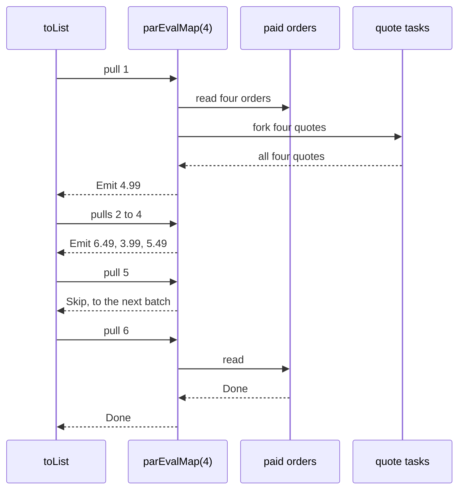

<!-- description: Run several VStream elements' tasks at once with VStreamPar: in order or as each completes, in batches, or merged from several streams. -->

# Parallel Operations: Several Elements at Once

_Run the tasks for several elements at the same time, batch elements for a bulk call, and merge streams._

~~~admonish info title="What You'll Learn"
- Run several elements' tasks at once, up to a limit you set, keeping their order or taking each result as it arrives
- Say how far each operation reads ahead of the consumer, and which thread reads the source
- Choose a concurrency, and keep going when one element's task fails
- Batch elements for a call that takes several at a time
- Merge streams read at the same time
~~~

~~~admonish example title="See Example Code"
**The code on this page is [VStreamParBook.java](https://github.com/higher-kinded-j/higher-kinded-j/blob/main/hkj-examples/src/main/java/org/higherkindedj/example/book/foundations/vstream/VStreamParBook.java)**: the page includes it, so the build compiles and runs it. [VStreamParBookTest.java](https://github.com/higher-kinded-j/higher-kinded-j/blob/main/hkj-examples/src/test/java/org/higherkindedj/example/book/foundations/vstream/VStreamParBookTest.java) holds what the page says each operation does.
~~~

---

## Several quotes at once {#several-quotes-at-once}

`mapTask` runs one element's task at a time, so four courier quotes that each take a second take four seconds. `VStreamPar` runs several at once, each on a virtual thread.

~~~admonish warning title="A preview API"
`VStreamPar` is built on `StructuredTaskScope`, a preview feature in Java 25, so code that names it needs `--enable-preview` to compile and to run. `VStreamPath`'s `parEvalMap` and `parEvalMapUnordered` compile without it and need it when they run, as the [VTask](vtask_monad.md#on-a-vtaskpath) page explains for `VTaskPath`. The [HKJ Gradle plugin](../tooling/gradle_plugin.md) adds it by default.
~~~

The code on this page uses the order feed and the `Courier` from the [VStream](vstream.md#reading-a-feed-one-page-at-a-time) page, with these imports:

<!-- verify -->
```java
import java.io.IOException;
import java.math.BigDecimal;
import java.util.List;
import java.util.Map;
import org.higherkindedj.hkt.effect.Path;
import org.higherkindedj.hkt.trymonad.Try;
import org.higherkindedj.hkt.vstream.VStream;
import org.higherkindedj.hkt.vstream.VStreamPar;
import org.higherkindedj.hkt.vtask.VTask;
```

The paid orders are the stream to quote for, and `ZONED_COURIER` quotes by where each customer lives, so each quote shows which order it belongs to:

```java
{{#include ../../../hkj-examples/src/main/java/org/higherkindedj/example/book/foundations/vstream/VStreamParBook.java:paid}}
```

```java
{{#include ../../../hkj-examples/src/main/java/org/higherkindedj/example/book/foundations/vstream/VStreamParBook.java:zoned}}
```

`parEvalMap(stream, concurrency, f)` asks for up to `concurrency` quotes at once, and gives them in the orders' order:

```java
{{#include ../../../hkj-examples/src/main/java/org/higherkindedj/example/book/foundations/vstream/VStreamParBook.java:in_order}}
```

It works a batch at a time. A pull reads up to `concurrency` elements from the source, forks a task for each, and waits for every task in the batch. It answers that pull with the first result, and answers the pulls after it from the rest of the batch:



The arrows to the right are pulls and forks, and the dashed arrows back are what each gives. A batch's results wait for its slowest task. The source is read again only after every result of the batch has been taken. Pull 5 gives a `Skip` to the next batch, as [What a pull gives](vstream.md#what-a-pull-gives) describes, and pull 6 reads the source and finds its end.

The source is read on the thread that pulls, and each task runs on a virtual thread of its own, which sees the caller's `ScopedValue` bindings. A `concurrency` of 1 runs the tasks one at a time, as `mapTask` does, but each on a virtual thread.

## In order, or as each arrives {#in-order-or-as-each-arrives}

When the order of the results does not matter, `parEvalMapUnordered` gives each one as its task completes, so a slow quote holds back only itself:

```java
{{#include ../../../hkj-examples/src/main/java/org/higherkindedj/example/book/foundations/vstream/VStreamParBook.java:as_they_arrive}}
```

The quotes arrive in whatever order the courier answers, so the example sorts them to show they are all there.

| | `parEvalMap` | `parEvalMapUnordered` |
|---|---|---|
| Order of the results | The elements' order | The order the tasks complete |
| A slow task holds back | Its whole batch, and the next | Only its own result |
| Reads ahead of the consumer | A batch of up to `concurrency` elements | Up to `concurrency` elements whose results are not yet pulled |
| Reads the source on | The thread that pulls | A virtual thread of its own |
| Tasks see the caller's `ScopedValue` bindings | Yes | No |

`parEvalMapUnordered` starts the next element's task each time you take a result. If you stop reading part-way without closing the stream, its thread is left waiting, so close it; `take` and the other operations that stop early close it for you.

`parEvalFlatMap(stream, concurrency, f)` builds the stream `f` gives for each element, up to `concurrency` at once through `parEvalMap`, then reads those streams one after another, in order.

## Choosing a concurrency {#choosing-a-concurrency}

For tasks that wait on I/O, such as calls to another service, set `concurrency` to the number of calls that service accepts at once. Virtual threads make the waiting cheap, so the service's limit is the one that counts. For tasks that compute, more than `Runtime.getRuntime().availableProcessors()` gains nothing, since that is how many virtual threads run at once by default. Each stage of a pipeline takes its own `concurrency`, so a stage that downloads can run eight at once and the stage that uploads after it two.

## When a task fails {#when-a-task-fails}

A task that fails cancels the tasks still running, and the stream fails with the task's own exception. `PATCHY_COURIER`, from [When an element fails](vstream.md#when-an-element-fails), quotes 4.99 for every order but cannot quote for Edsger, and `FLAT_RATE` is 9.99:

```java
{{#include ../../../hkj-examples/src/main/java/org/higherkindedj/example/book/foundations/vstream/VStreamParBook.java:failures}}
```

~~~admonish warning title="recover after a parallel operation ends the stream"
When one of its own tasks fails, a `recover` after `parEvalMap` or `parEvalMapUnordered` gives one value in place of the failure, then ends the stream. `parEvalMap` loses the rest of the batch, and `parEvalMapUnordered` the tasks still running. To keep every other quote, recover inside each element's task, with `VTask.recover` or `recoverWith`, as `recoveredInside` does.
~~~

A failed element from further up is handed on instead. When a `mapTask` task fails before the parallel operation, its element passes through as a failure, so a `recover` after the parallel operation gives a value in its place and the stream goes on. `parEvalMap`, `parEvalMapUnordered` and `parEvalFlatMap` all do this, while a merge of several streams ends there. Any other failure further up, such as a `map` that throws, also ends the stream, after the elements read before it.

## Chunking operations {#chunking-operations}

`chunk(size)` groups elements into batches of up to `size`, and `chunkWhile` starts a new batch wherever a test fails between neighbours:

```java
{{#include ../../../hkj-examples/src/main/java/org/higherkindedj/example/book/foundations/vstream/VStreamParBook.java:chunks}}
```

Each batch is a [`NonEmptyList`](nonemptylist_monad.md), since a chunk is given only once it holds an element, so `head()` and `reduce` on it always have a value. The last chunk may be shorter, and an empty stream gives no chunks. A `size` larger than the stream, even `Integer.MAX_VALUE`, gives one chunk of every element, without reserving room for the rest. A `parEvalMap` `concurrency` that large reads the whole stream as one batch in the same way.

A batch suits a call that takes several elements at once, such as a warehouse that packs a list of orders:

```java
{{#include ../../../hkj-examples/src/main/java/org/higherkindedj/example/book/foundations/vstream/VStreamParBook.java:warehouse}}
```

`chunk` followed by `parEvalMap` makes one call for each batch, with up to `concurrency` calls at once. The warehouse's `pack` blocks and can throw, so each call runs as a task. `mapChunked(size, f)` suits a function that cannot fail and does not block: it applies `f` to each batch and flattens the lists it gives:

```java
{{#include ../../../hkj-examples/src/main/java/org/higherkindedj/example/book/foundations/vstream/VStreamParBook.java:packed}}
```

## Merging streams {#merge-concurrent-multi-source-consumption}

`VStreamPar.merge` reads several streams at the same time, each on a virtual thread of its own, and gives each element as it arrives from any of them. The sources' threads do not see the caller's `ScopedValue` bindings:

```java
{{#include ../../../hkj-examples/src/main/java/org/higherkindedj/example/book/foundations/vstream/VStreamParBook.java:merged}}
```

The order depends on which feed answers first, so the example sorts the names. When the consumer stops early, with `take(n)` or `headOption()` for example, the merge is closed. It interrupts any source still being read and waits for the sources' threads to stop. Then it closes each source that had not finished, so each source's finalisers run. A source failing stops the merge in the same way. A source finaliser that fails while the merge closes is dropped, since the merge has already stopped.

~~~admonish warning title="merge reads ahead without a limit"
A merge of several streams reads each source as fast as the source gives elements, and holds the elements you have not pulled yet without a limit. A fast endless source and a slow consumer fill memory. Bound an endless source with `take` or `takeWhile` before merging it, or merge sources you read to the end. A merge of one stream is that stream, so it reads no further ahead than that stream does.
~~~

## How far each operation reads ahead {#how-far-each-operation-reads-ahead}

A `VStream` is read by pulling, so a consumer that stops pulling stops the reading. Each operation reads only so far ahead of it:

| Operation | Reads ahead of the consumer |
|---|---|
| `parEvalMap`, `parEvalFlatMap` | One batch of up to `concurrency` elements, at a pull |
| `parEvalMapUnordered` | Up to `concurrency` elements whose results are not yet pulled |
| `chunk(size)`, `mapChunked(size, f)` | One batch of up to `size` elements |
| `merge` of several streams | Every element its sources give, without a limit |

Those bounds are why a `VStream` needs no backpressure protocol, the signal by which a consumer tells a producer how much it can take, of the kind Project Reactor's streams use. When the consumer is slow, the operation waits, and a waiting virtual thread holds no platform thread. A merge of several streams is the exception, as its warning says.

## On a `VStreamPath` {#on-a-vstreampath}

[`VStreamPath`](../effect/path_vstream.md) has `parEvalMap`, `parEvalMapUnordered`, `chunk` and `mapChunked` too:

```java
{{#include ../../../hkj-examples/src/main/java/org/higherkindedj/example/book/foundations/vstream/VStreamParBook.java:path}}
```

## Collecting the results {#collecting-the-results}

`toList()` collects what a parallel operation gives, as each example on this page does. The work runs in parallel inside the tasks `parEvalMap`'s function returns; collecting is reading the stream, one pull at a time, so it cannot be parallel itself.

`VStreamPar.parCollect(stream, batchSize)`, `VStreamPath.parCollect` and `PathOps.parCollectVStream` are deprecated for removal in 0.7.0. Each gives what `toList()` gives. The [0.7.0 deprecation recipe](../tooling/openrewrite.md#070-deprecation-migration) rewrites each call to `toList()`, and marks any call it cannot rewrite safely.

## Methods {#methods}

| Method | What it does |
|---|---|
| `VStreamPar.parEvalMap(stream, concurrency, f)` | Runs up to `concurrency` tasks at once, a batch at a time, and keeps the elements' order |
| `VStreamPar.parEvalMapUnordered(stream, concurrency, f)` | Runs up to `concurrency` tasks at once, and gives each result as its task completes |
| `VStreamPar.parEvalFlatMap(stream, concurrency, f)` | Builds up to `concurrency` of `f`'s streams at once, and reads them in order |
| `VStreamPar.merge(streams)`, `VStreamPar.merge(first, second)` | Reads every stream at once, and gives each element as it arrives |
| `stream.chunk(size)`, `stream.chunkWhile(test)` | Batches of up to `size` elements, or of neighbours that pass the test |
| `stream.mapChunked(size, f)` | Applies `f` to each batch, and flattens the lists it gives |

## When to use parallel operations {#when-to-use-them}

| You need | Use |
|---|---|
| A task for each element, several at once, results in order | `parEvalMap` |
| The same, each result as soon as it is ready | `parEvalMapUnordered` |
| One call for several elements | `chunk`, then `parEvalMap` |
| Elements from several sources as they arrive | `merge`, with endless sources bounded |
| One task at a time, on the caller's thread | `mapTask`, on the [VStream](vstream.md#shaping-a-stream) page |
| A few independent tasks, not a stream | [Structured Concurrency](vtask_scope.md) |

~~~admonish info title="Hands-On Learning"
Practise parallel streams in [TutorialVStreamParallel](https://github.com/higher-kinded-j/higher-kinded-j/blob/main/hkj-examples/src/test/java/org/higherkindedj/tutorial/concurrency/TutorialVStreamParallel.java) (8 exercises).
~~~

**Benchmarks:** `VStreamBenchmark` measures `parEvalMap`, `parEvalMapUnordered` and the chunking operations. [Performance](vstream_performance.md) says what it measures and how to run it, and [Benchmarks](../benchmarks.md) covers every benchmark.

---

**Previous:** [HKT and Type Classes](vstream_hkt.md)
**Next:** [Performance](vstream_performance.md)
