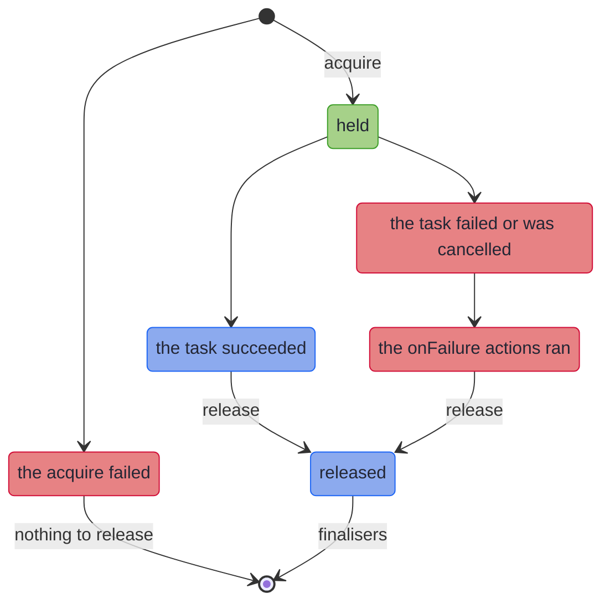

<!-- description: Bracket pattern for Java VTasks with Resource: acquire, use and release a connection however the task ends, like try-with-resources, and roll back on failure. -->

# Resource: Acquire, Use and Release

_Acquire something, use it, and release it however the work ends._

<!-- source: Seamus Heaney, "Scaffolding", in Death of a Naturalist (Faber and Faber, 1966); line checked against the text on poets.org -->
> _"And yet all this comes down when the job's done"_
>
> — Seamus Heaney, *Scaffolding*

A `Resource` is that scaffolding: put up before the work, and taken down after it, even when the job fails.

~~~admonish info title="What You'll Learn"
- Describe how to acquire and release something, and use it in a `VTask` that releases it when the task is done
- Say what is reported when the use fails, the release fails, or both do
- Compose resources that release in reverse order, and use one `Resource` many times
- Add finalisers, and an action that runs only when the use fails, such as a rollback
- Hold a resource while a `Scope`'s tasks use it
~~~

~~~admonish example title="See Example Code"
**The code on this page is [ResourceBook.java](https://github.com/higher-kinded-j/higher-kinded-j/blob/main/hkj-examples/src/main/java/org/higherkindedj/example/book/foundations/resource/ResourceBook.java)**: the page includes it, so the build compiles and runs it. [ResourceBookTest.java](https://github.com/higher-kinded-j/higher-kinded-j/blob/main/hkj-examples/src/test/java/org/higherkindedj/example/book/foundations/resource/ResourceBookTest.java) holds what the page says each method does.
~~~

---

## Acquire, use, release {#acquire-use-release}

Java's try-with-resources closes a resource when its block ends. A [`VTask`](vtask_monad.md) describes work that runs later, so a `try` around building one closes the resource before the work has started. A `Resource<A>` describes how to acquire an `A` and how to release it. `use` gives a `VTask` that, each time it runs, acquires, runs the task you give it, and releases what it acquired, whether that task succeeded, failed or was cancelled. This is the acquire-use-release, or bracket, pattern.

The code on this page uses these imports, with `Order` from the order records the [Optics](../optics/ch_intro.md) chapter introduces:

<!-- verify -->
```java
import java.util.ArrayList;
import java.util.List;
import java.util.concurrent.CopyOnWriteArrayList;
import java.util.concurrent.atomic.AtomicInteger;
import org.higherkindedj.example.book.optics.cast.Order;
import org.higherkindedj.hkt.vtask.Resource;
import org.higherkindedj.hkt.vtask.VTask;
```

Booking a courier happens on a session, which is opened first and must be closed after. `Session` stands in for one, and logs what happens to it:

```java
{{#include ../../../hkj-examples/src/main/java/org/higherkindedj/example/book/foundations/resource/ResourceBook.java:session}}
```

`ORDER` is a paid order:

```java
{{#include ../../../hkj-examples/src/main/java/org/higherkindedj/example/book/foundations/resource/ResourceBook.java:use}}
```

Building the task opens nothing. Each run opens a session, books on it, and closes it, so running `booking` again opens `session-2`. `useSync(f)` does the same with a plain function rather than one that gives a task.



The diagram shows that every way out of a held resource passes through its release, after the [`onFailure` actions](#onfailure-callback) when the task fails, and before the [finalisers](#finalizer-behaviour). If the acquire fails, nothing is held, so neither the release, the `onFailure` actions nor the finalisers run.

### Creating a resource {#factory-methods}

| Factory | What it describes | For |
|---|---|---|
| `Resource.fromAutoCloseable(acquire)` | An `AutoCloseable`, closed after each use | Connections, sessions, streams, channels |
| `Resource.make(acquire, release)` | An acquire and a release of your own | Locks, handles, anything without `close()` |
| `Resource.pure(value)` | A value with nothing to release | Configuration, or a constant in a composition |

The acquire is a `Callable`, so it may throw a checked exception. A `Resource` never holds null: `pure(null)` throws at the call, and an acquire or a `map` function that returns null fails the use with a `NullPointerException`. Hold a value that may be absent as a `Maybe`, and acquire it with `make`.

## When the use fails {#exception-safety}

The session is closed whatever happens to the booking. These are the extra imports:

<!-- verify -->
```java
import java.io.IOException;
import org.higherkindedj.hkt.trymonad.Try;
```

```java
{{#include ../../../hkj-examples/src/main/java/org/higherkindedj/example/book/foundations/resource/ResourceBook.java:failure}}
```

When the release throws as well, the use's failure is still the one reported, and the release's exception is suppressed onto it, as try-with-resources does. After a successful use, a release that throws fails the use with its own exception, so a writer whose final flush fails does not report success.

For `fromAutoCloseable`, the release is `close()`, which may throw a checked exception. The task that `use` returns reports it as it reports any checked failure: `run()` throws it wrapped in a `VTaskExecutionException`, and `runSafe()` holds it unwrapped.

A cancelled use is a failed one, so its resource is released too. The release runs with the thread's interrupt status cleared, so a cancellation does not cut a blocking release short, and the status is restored afterwards.

## Composing resources {#composing-resources}

`and` holds two resources at once, acquiring them in order and releasing them in reverse. `flatMap` acquires a second resource from the first, as try-with-resources nests a statement inside its connection, and releases the second first. Releasing in reverse means a resource that depends on another is released before the one it depends on. If a later acquire fails, the ones already held are released before the failure is reported. These are the extra imports:

<!-- verify -->
```java
import org.higherkindedj.hkt.vtask.Par;
```

```java
{{#include ../../../hkj-examples/src/main/java/org/higherkindedj/example/book/foundations/resource/ResourceBook.java:compose}}
```

`and` gives a `Par.Tuple2`, a preview class, so code that calls `and` needs `--enable-preview`, whether or not it names `Par`, as the [VTask](vtask_monad.md#on-a-vtaskpath) page explains. `and(second, third)` holds three at once, as a `Par.Tuple3`. A `Resource` composed with `flatMap` or `and` reports a failed release as a `RuntimeException`, whose cause is the exception from the outermost release that threw.

`map(f)` changes the value a resource gives, and its release still receives the value the acquire returned. `map` takes a plain `Function`, so a checked exception has to be handled inside `f`.

## Using one resource many times {#using-one-resource-many-times}

A `Resource` holds nothing itself. Each `use` acquires its own resource and releases exactly that one. So build a `Resource` once and use it wherever it is needed: once per request, on several threads at once, or one use nested inside another. This holds however the `Resource` was composed:

```java
{{#include ../../../hkj-examples/src/main/java/org/higherkindedj/example/book/foundations/resource/ResourceBook.java:many_uses}}
```

The nested use opens a second session, and each use closes the one it opened, innermost first. The use sees each session's id, and the release still closes the `Session` itself.

## Finalisers {#finalizer-behaviour}

`withFinalizer(action)` adds an action that runs after the release:

```java
{{#include ../../../hkj-examples/src/main/java/org/higherkindedj/example/book/foundations/resource/ResourceBook.java:finalisers}}
```

Finalisers run in the order they were added, and each runs even when the release, or an earlier finaliser, throws. When the release and a finaliser both throw, the release's exception is reported, with the finaliser's suppressed onto it.

## Rolling back on failure {#onfailure-callback}

`onFailure(action)` adds an action that runs when the use fails, before the release. It receives the acquired resource, so it can undo partial work, such as rolling back a transaction. When the use succeeds, only the release runs:

```java
{{#include ../../../hkj-examples/src/main/java/org/higherkindedj/example/book/foundations/resource/ResourceBook.java:on_failure}}
```

The first use succeeds, so it only closes `tx-1`. The second fails, so `tx-2` is rolled back and then closed. The use fails when the function given to `use` throws, or the task it returns fails. A cancelled task fails too. A step composed after `onFailure` counts as well, when it fails while the resource is held:

- **`map`'s or `flatMap`'s function throws.**
- **The next acquire in `flatMap` or `and` fails.**

The action runs before its `Resource`'s release and before the finalisers added to it. Actions added one after another run most recently added first. If an action throws, the release still runs, and the use's failure is still the one reported.

## With a `Scope` {#with-a-scope}

A resource can be held while a [`Scope`](vtask_scope.md)'s tasks use it, and is released once the scope has joined them all. This is the extra import:

<!-- verify -->
```java
import org.higherkindedj.hkt.vtask.Scope;
```

```java
{{#include ../../../hkj-examples/src/main/java/org/higherkindedj/example/book/foundations/resource/ResourceBook.java:with_scope}}
```

A resource the tasks share must be safe to use from several threads at once, as the session's log is here. Add an `onFailure` rollback, as in [Rolling back on failure](#onfailure-callback), and this shape runs a transaction's steps at the same time. When one step fails, the scope cancels the others, the rollback runs, then the release.

## Methods {#methods}

| Method | What it does |
|---|---|
| `Resource.fromAutoCloseable(acquire)`, `make(acquire, release)`, `pure(value)` | Describe a resource, acquiring nothing |
| `use(f)` | Gives a `VTask` that acquires, runs the task `f` gives for the resource, and releases |
| `useSync(f)` | The same, where `f` gives a plain value rather than a task |
| `map(f)` | Changes the value the resource gives |
| `flatMap(f)`, `and(other)`, `and(second, third)` | Hold resources together, releasing them in reverse order |
| `withFinalizer(action)` | Runs `action` after the release |
| `onFailure(action)` | Runs `action` on the resource when the use fails, before the release |

## When to use `Resource` {#when-to-use-resource}

| You need | Use |
|---|---|
| Something acquired and released around a `VTask`, however it ends | `Resource` |
| A resource used within one block of ordinary code | Java's try-with-resources |
| Cleanup after a task, with nothing to acquire | [`guarantee`](../effect/capabilities.md#effectful-io) on a `VTaskPath` |
| The same around an `IO` | [`bracket` or `withResource`](../effect/path_io.md) on an `IOPath` |
| A release that sees whether a typed result succeeded | [`bracketOutcome`](../effect/path_vresult.md) on a `VResultPath` |

~~~admonish info title="Hands-On Learning"
Practise `Resource` in [TutorialResource](https://github.com/higher-kinded-j/higher-kinded-j/blob/main/hkj-examples/src/test/java/org/higherkindedj/tutorial/concurrency/TutorialResource.java) (10 exercises), part of the [Scope & Resource journey](../tutorials/concurrency/scope_resource_journey.md).
~~~

---

**Previous:** [Structured Concurrency](vtask_scope.md)
**Next:** [VStream](vstream.md)
