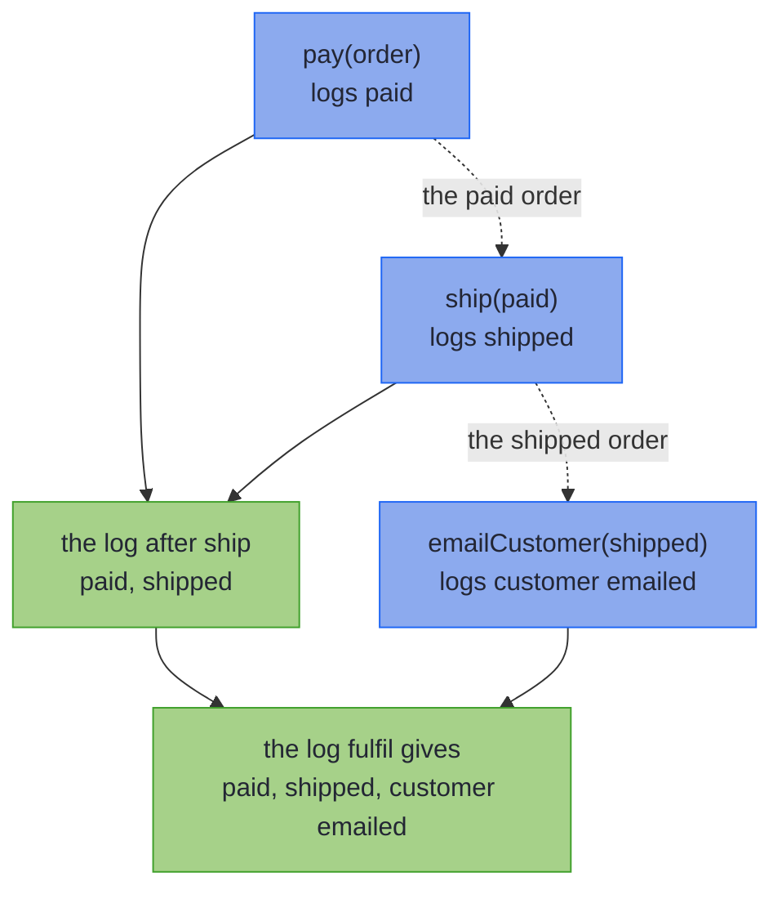

<!-- description: Keep a log beside a result in Java with Writer: build an order's audit log step by step, choose how logs join with a Monoid, and chain steps on a WriterPath. -->

# Writer: Keeping a Log Beside the Result

_Each step returns its result with what it has to log, and the log's `Monoid` joins the entries._

~~~admonish abstract title="Writer at a glance"
| | |
|---|---|
| **Models** | A result together with a log, such as audit entries, that each step adds to |
| **Replaces** | A list passed to every method that logs, or a logger whose output a test has to capture |
| **Effect Path** | [`WriterPath`](../effect/advanced_effects.md#writerpath-accumulating-output) |
{{#include ../../../hkj-examples/src/test/resources/golden/foundations-capabilities.md.golden:writer_monad}}
| **Choose it when** | Steps add to a log that you read once they are done; otherwise [State](state_monad.md), whose steps also read what they keep, or compare every type in [Choosing a Type](supported-types.md#choosing-a-type) |
~~~

~~~admonish info title="What You'll Learn"
- Build an order's audit log from steps that each return a result and the entries they add
- Say how `flatMap` joins two steps' logs, and why a `Writer` has done its work once it is built
- Choose the `Monoid` that says what an empty log is and how two logs join
- Chain steps on a `WriterPath`, which holds the `Monoid` for you
- Use `Writer` in generic code through its `Monad` instance
~~~

~~~admonish example title="See Example Code"
**The code on this page is [WriterBook.java](https://github.com/higher-kinded-j/higher-kinded-j/blob/main/hkj-examples/src/main/java/org/higherkindedj/example/book/foundations/writer/WriterBook.java)**: the page includes it, so the build compiles and runs it. [WriterBookTest.java](https://github.com/higher-kinded-j/higher-kinded-j/blob/main/hkj-examples/src/test/java/org/higherkindedj/example/book/foundations/writer/WriterBookTest.java) holds what the page says each method does.
~~~

---

## An audit log for an order {#an-audit-log-for-an-order}

Paying for an order and shipping it should each leave an entry in the order's audit log. Pass a list to every method that logs, and the log shows nowhere in what a method returns. Return a record of the order and its entries instead, and every caller joins the entries by hand. A `Writer<W, A>` is that record, a result `A` together with a log `W`, and `flatMap` does the joining.

The code on this page uses these imports, with `Order` and `OrderLenses` from the order records the [Optics](../optics/ch_intro.md) chapter introduces, and `AuditEntry` from this chapter's examples:

<!-- verify -->
```java
import java.util.List;
import org.higherkindedj.example.book.foundations.AuditEntry;
import org.higherkindedj.example.book.optics.cast.Order;
import org.higherkindedj.example.book.optics.cast.OrderLenses;
import org.higherkindedj.example.book.optics.cast.OrderStatus;
import org.higherkindedj.hkt.Monoid;
import org.higherkindedj.hkt.Monoids;
import org.higherkindedj.hkt.Unit;
import org.higherkindedj.hkt.effect.Path;
import org.higherkindedj.hkt.effect.WriterPath;
import org.higherkindedj.hkt.writer.Writer;
```

`AuditEntry` is a record of the examples' own:

```java
{{#include ../../../hkj-examples/src/main/java/org/higherkindedj/example/book/foundations/AuditEntry.java:audit_entry}}
```

A [`Monoid`](../functional/semigroup_and_monoid.md) says how logs behave. Its `empty()` is the log before any step, and its `combine` joins two logs, like the identity and the accumulator you pass to `Stream.reduce`. The log here is a list of entries, so `AUDIT` is the list monoid:

```java
{{#include ../../../hkj-examples/src/main/java/org/higherkindedj/example/book/foundations/writer/WriterBook.java:audit}}
```

`pay` and `ship` each return the order with its new status, and the entry they add. `emailCustomer` here only logs that the email went, so it is a `tell`: a log entry with [`Unit`](../hkts/core-concepts.md#unit) as its result:

```java
{{#include ../../../hkj-examples/src/main/java/org/higherkindedj/example/book/foundations/writer/WriterBook.java:steps}}
```

`fulfil` joins the three. Writer's own `flatMap` is given `AUDIT`, so it knows how to join the logs, and `map(_ -> shipped)` keeps the shipped order as the result after the email:

```java
{{#include ../../../hkj-examples/src/main/java/org/higherkindedj/example/book/foundations/writer/WriterBook.java:fulfil}}
```

`NEW_ORDER` is an order for one lamp, not yet paid for. Fulfil it, then read the result with `run()` and the log with `exec()`:

```java
{{#include ../../../hkj-examples/src/main/java/org/higherkindedj/example/book/foundations/writer/WriterBook.java:run}}
```

`shipped` is the order with the status `SHIPPED`, and the log holds three entries in the order the steps ran. No method took the log as a parameter, and a test reads it from the value `fulfil` returns.

## Each step's log joins the log before it {#each-steps-log-joins-the-log-before-it}

`flatMap` calls the next step with this step's result, then joins the two logs with the `Monoid`, the earlier log first.



The order goes from each step to the next, on the dotted lines, while `AUDIT` joins each step's entries onto the log so far. A `Writer` is a value, not a description of work to run later: `flatMap` calls the next step at once. So `fulfil` has done its work when it returns, and `run()` only reads the result it holds. A chain built in a loop runs without growing the stack, but a step that calls itself through `flatMap` recurses as any Java method does. With `Monoids.list()`, each join copies the log so far, so for a chain of thousands of steps the time grows with the square of the log's length. For a log that long, keep a count or a summary instead, or write each entry out as it happens.

## Choosing the log's `Monoid` {#choosing-the-logs-monoid}

The `Monoid` decides what the log is. Choose another, and the steps keep another kind of log:

| The log | The `Monoid` | The empty log | Two logs join into |
|---|---|---|---|
| A list of entries | `Monoids.list()` | an empty list | the first list's entries, then the second's |
| Text | `Monoids.string()` | `""` | the first string, then the second |
| A count | `Monoids.integerAddition()` | `0` | their sum |
| One of your own | `Monoid.of(empty, combine)` | `empty` | what `combine` gives |

[Semigroup and Monoid](../functional/semigroup_and_monoid.md#ready-made-monoids) lists the ready-made monoids, and shows [a monoid of your own](../functional/semigroup_and_monoid.md#a-monoid-of-your-own).

## On a `WriterPath` {#on-a-writerpath}

Application code holds a `Writer` on a `WriterPath`, its Effect Path, and `Path.writer(writer, monoid)` gives you one. The path holds the `Monoid` and joins the logs itself, so `via` is given only the next step. Each step is still put on a path with `Path.writer(step, AUDIT)`, but `via` joins the logs with the path's own `Monoid`:

```java
{{#include ../../../hkj-examples/src/main/java/org/higherkindedj/example/book/foundations/writer/WriterBook.java:path}}
```

```java
{{#include ../../../hkj-examples/src/main/java/org/higherkindedj/example/book/foundations/writer/WriterBook.java:path_outcome}}
```

The path gives the same `Writer` as `fulfil`. `run()` gives that `Writer`, `value()` the result and `written()` the log.

## A Writer always holds a log and a value {#a-writer-always-holds-a-log-and-a-value}

A `Writer` refuses a `null` log or result, so `Writer.of(null, value)`, `Writer.of(log, null)` and `Writer.tell(null)` throw at the call. Because a `Writer` does its work when it is built, a function given to `map` that returns `null` throws at the `map` call too, with `f must not return null`. A function given to `mapWritten` that returns `null` throws at the call with `Writer.construction log cannot be null`. [Values, never null](../hkts/core-concepts.md#values-never-null) sets out the rule every type follows.

## Creating instances {#creating-instances}

`Writer.of(log, value)` pairs a log with a result, and `Writer.value(monoid, value)` starts with the monoid's empty log. `Writer.tell(log)` logs with `Unit` as its result. On a Path, `Path.writer(writer, monoid)`, `Path.writerPure(value, monoid)` and `Path.tell(log, monoid)` start a `WriterPath`.

## Methods {#methods}

| Method | What it does |
|---|---|
| `Writer.of(log, value)` | Pairs `log` with `value` |
| `Writer.value(monoid, value)` | Gives `value` with the monoid's empty log |
| `Writer.tell(log)` | Logs `log`, and gives `Unit` |
| `map(f)` | Changes the result with `f`, and leaves the log as it is |
| `flatMap(monoid, f)` | Calls the step `f` gives for this result, and joins its log onto this one with `monoid` |
| `mapWritten(f)` | Changes the log with `f`, and leaves the result as it is |
| `bimap(onLog, onValue)` | Changes the log and the result together |
| `run()`, `exec()` | Give the result, or the log |
| `writerPath.via(f)`, `then(next)`, `zipWith(other, f)` | Chain, sequence or combine `WriterPath` steps, joining their logs with the first path's entries first |
| `writerPath.censor(f)` | Rewrites the whole log with `f` |
| `writerPath.run()`, `value()`, `written()` | Give the `Writer`, the result, or the log |

## Working with Kind {#working-with-kind}

Generic code, written once for any container, takes `Writer` through its `Monad` instance, from `Instances.writer(monoid)`. The instance needs the `Monoid` to join logs, so it takes one, and the log type is part of the witness, `WriterKind.Witness<W>`. You widen a `Writer` to pass it in. `WRITER.run` and `WRITER.exec` read the result and the log from what comes back, and `WRITER.runWriter` or `WRITER.narrow` gives the `Writer` itself. These are the extra imports:

<!-- verify -->
```java
import static org.higherkindedj.hkt.writer.WriterKindHelper.WRITER;

import org.higherkindedj.hkt.Kind;
import org.higherkindedj.hkt.Monad;
import org.higherkindedj.hkt.instances.Instances;
import org.higherkindedj.hkt.writer.WriterKind;
```

```java
{{#include ../../../hkj-examples/src/main/java/org/higherkindedj/example/book/foundations/writer/WriterBook.java:kind}}
```

Widening allocates nothing: every `Writer` is already a `WriterKind`, so `widen` checks for `null` and returns the same object. `Writer` is also a `Bifunctor`, over the log and the result: `WriterBifunctor.INSTANCE` takes a `Writer` widened with `WRITER.widen2`, and *Writer at a glance*, at the head of the page, lists it. Code that keeps a log through any monad, not only `Writer`, takes a `MonadWriter`, as [Keeping a log with `MonadWriter`](../functional/for_mtl.md#accumulating-output-with-monadwriter) shows.

## When to use `Writer` {#when-to-use-writer}

| You need | Use |
|---|---|
| Steps that add to a log, read once they are done | `Writer`, or [WriterPath](../effect/advanced_effects.md#writerpath-accumulating-output) |
| Steps that also read and change what they keep | [State](state_monad.md) |
| Log lines written out as they happen, to the console or a file | A logger, or a step in [IO](io_monad.md) |
| A log together with failure or asynchronous work | [WriterT](../transformers/writert_transformer.md) |
| A count or a sum beside the result | `Writer` with `Monoids.integerAddition()`, or `Monoids.bigDecimalAddition()` for money |
| A log kept inside one method | A local list: nothing outside the method sees it |

~~~admonish info title="Hands-On Learning"
Practise `MonadWriter`'s `tell` and `censor` in Exercises 9 to 11 of [Tutorial 04: Polymorphic Capabilities](https://github.com/higher-kinded-j/higher-kinded-j/blob/main/hkj-examples/src/test/java/org/higherkindedj/tutorial/transformers/Tutorial04_PolymorphicCapabilities.java) (14 exercises).
~~~

---

**Previous:** [State](state_monad.md)
**Next:** [List](list_monad.md)
