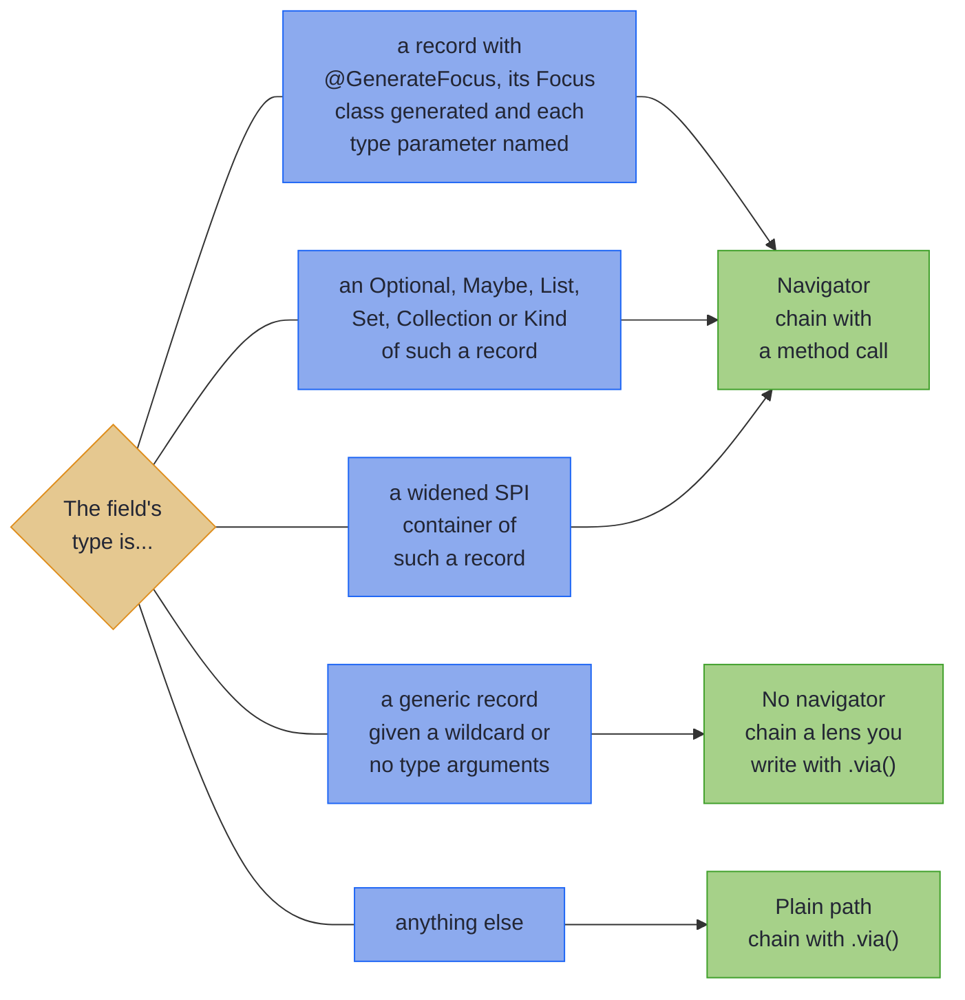

# Collections, Optionals and Sealed Types

_Step into lists, maps, optionals and sealed variants from a generated path, and join a path to any optic._

~~~admonish info title="What You'll Learn"
- Step into a collection's elements, or pick one element by index or key
- Read an optional or nullable value as present or absent
- Focus one variant of a sealed type
- Tell which fields get a generated navigator, and spell the hop where none does
~~~

~~~admonish example title="See Example Code"
**The code on this page is [NavigationBook.java](https://github.com/higher-kinded-j/higher-kinded-j/blob/main/hkj-examples/src/main/java/org/higherkindedj/example/book/optics/navigation/NavigationBook.java) and its [NavigationBookTest.java](https://github.com/higher-kinded-j/higher-kinded-j/blob/main/hkj-examples/src/test/java/org/higherkindedj/example/book/optics/navigation/NavigationBookTest.java)**: the page includes them, so the build compiles and runs them.

[NavigatorExample](https://github.com/higher-kinded-j/higher-kinded-j/blob/main/hkj-examples/src/main/java/org/higherkindedj/example/optics/focus/NavigatorExample.java) and [ContainerNavigationExample](https://github.com/higher-kinded-j/higher-kinded-j/blob/main/hkj-examples/src/main/java/org/higherkindedj/example/optics/focus/ContainerNavigationExample.java) run this page's navigators and container hops as longer programs.
~~~

The previous page gave you one method per record component. This page is about the hops you spell yourself. They step into a collection's elements or one of them, through an optional or nullable value, onto one variant of a sealed type, and onto an optic from somewhere else. How a field's container decides its path type, which the processor calls widening, is in [The fine print](#the-fine-print) at the end.

---

## Collections {#collection-navigation}

### Traverse all elements {#each-traverse-all-elements}

`.each(...)` steps from a collection into its elements. For a `List`, `Set` or `Collection` field the generated method has already applied the right one, which is why `OrderFocus.lines()` focuses each `LineItem`:

``` java
{{#include ../../../hkj-examples/src/main/java/org/higherkindedj/example/book/optics/navigation/NavigationBook.java:each_generated}}
```

### `.each(Each)`: traverse with a custom `Each` instance {#eacheach-traverse-with-a-custom-each-instance}

Every container takes an explicit `Each`: a `List`, a `Set`, a `Collection`, a `Map`, an array, a third-party collection. An `Each` is a small strategy object, as a `Comparator` is for sorting, that says how to visit a container's elements. Its type names the container, so `.each(EachInstances.listEach())` does not compile on a path that focuses anything but a `List`. The generated method already does this for you: `EachInstances.listEach()` for a `List` field, `EachInstances.setEach()` for a `Set`, `EachInstances.collectionEach()` for a `Collection`. Hand-built paths have to say it themselves, and this works on `FocusPath`, `AffinePath` and `TraversalPath` alike. A price list keeps its prices in a `Map` keyed by SKU:

``` java
{{#include ../../../hkj-examples/src/main/java/org/higherkindedj/example/book/optics/navigation/NavigationBook.java:catalogue}}
```

``` java
{{#include ../../../hkj-examples/src/main/java/org/higherkindedj/example/book/optics/navigation/NavigationBook.java:each_custom}}
```

`SavedForLater` holds a line a customer put aside, as an HKJ `Maybe`, and carries no annotation, so a hand-written lens reaches the `Maybe` and the hop names its `Each`.

For available `Each` instances and how to create your own, see [Each](each_typeclass.md).

~~~admonish tip title="Shorter with static imports"
`import static org.higherkindedj.optics.each.EachInstances.listEach;` turns `.each(EachInstances.listEach())` into `.each(listEach())`, and `FocusPaths.optionalSome` and `FocusPaths.mapAt` shorten the same way. Import `listAt`, `listHead` and `listLast` from one class only, since `FocusPaths`, `Affines` and `Prisms` each have their own.
~~~

### Access by index {#access-by-index}

`.via(FocusPaths.listAt(index))` focuses a single element of a list, and `.via(FocusPaths.mapAt(key))` a single value of a map. On a `FocusPath` or an `AffinePath` both give an `AffinePath`, because the position may not be occupied; on a `TraversalPath` the result stays a `TraversalPath`.

The generated Focus class has exactly one method per record component, so there is no generated `order.line(0)` accessor. Index from the path that still focuses the list. The element type comes from that path, so the result composes further with no type witness.

``` java
{{#include ../../../hkj-examples/src/main/java/org/higherkindedj/example/book/optics/navigation/NavigationBook.java:by_index}}
```

~~~admonish warning title="Element-level versus container-level"
`OrderFocus.lines()` focuses each `LineItem`; `FocusPath.of(OrderLenses.lines())` focuses the `List<LineItem>`. Anything that operates on the container as a whole (indexing, `ListPrisms`, a custom list-level optic) has to start from the second. Reach for the generated path when you want to act on every element, and for the lens when you want to act on the collection.
~~~

---

## Optional and nullable values {#optional-and-nullable-values}

### Unwrap an `Optional` {#some-unwrap-optional}

An `Optional<T>` field is unwrapped for you: the generated method applies `.some(FocusPaths.optionalSome())` and returns an `AffinePath`. Apply it yourself when the `Optional` sits behind a hand-written lens.

### `.nullable()`: read a null as absent {#nullable-handle-null-values}

For a field that may be null, `.nullable()` turns null into absence. A contact imported from an older system has a nickname that may be null, and nothing says so:

``` java
{{#include ../../../hkj-examples/src/main/java/org/higherkindedj/example/book/optics/navigation/NavigationBook.java:legacy_contact}}
```

``` java
{{#include ../../../hkj-examples/src/main/java/org/higherkindedj/example/book/optics/navigation/NavigationBook.java:nullable}}
```

`missing` is empty, because Charles's nickname is null, and `present` holds `"Amazing Grace"`.

~~~admonish tip title="A recognised `@Nullable` saves you the chain"
Annotate the component and the generated method hands you the `AffinePath` already. The processor recognises six annotations named `@Nullable`, from `org.jspecify.annotations`, `javax.annotation` (JSR-305), `jakarta.annotation`, `org.jetbrains.annotations`, `androidx.annotation` and `edu.umd.cs.findbugs.annotations` (SpotBugs). It does not read Spring's `org.springframework.lang.Nullable`, so a field carrying that one gives a `FocusPath`, and you chain `.nullable()` as for a field nobody annotated, such as `LegacyContact`'s nickname. [Where a `@Nullable` counts](#where-a-nullable-counts) has the placement rules.
~~~

---

## One variant of a sealed type {#working-with-sum-types-using-instanceof}

A sealed field's path focuses the whole value, and `.via(...)` with a prism narrows it to one variant. For a sealed interface you own, `@GeneratePrisms` names each variant; for a hierarchy you do not own, `AffinePath.instanceOf(Class)` matches by runtime type:

``` java
{{#include ../../../hkj-examples/src/main/java/org/higherkindedj/example/book/optics/cast/Payment.java:payment}}
```

``` java
{{#include ../../../hkj-examples/src/main/java/org/higherkindedj/example/book/optics/cast/Card.java:card}}
```

``` java
{{#include ../../../hkj-examples/src/main/java/org/higherkindedj/example/book/optics/cast/Bank.java:bank}}
```

A customer's payment history holds every payment they have made, of either kind:

``` java
{{#include ../../../hkj-examples/src/main/java/org/higherkindedj/example/book/optics/navigation/NavigationBook.java:payment_history}}
```

``` java
{{#include ../../../hkj-examples/src/main/java/org/higherkindedj/example/book/optics/navigation/NavigationBook.java:sealed}}
```

For a history of a card numbered 4242424242424242 and a bank payment, `pans` holds that one number, and `masked` holds the card as `**** 4242` beside the bank payment as it was. Either route reads and modifies only when the variant fits. On a single sealed field, `set` still writes the variant whatever was there, as [AffinePath](focus_dsl.md#affinepath-zero-or-one-element) warns.

---

## Composition with existing optics {#composition-with-existing-optics}

`.via()` composes a path with any optic, and the result has the wider of the two path types:

``` java
{{#include ../../../hkj-examples/src/main/java/org/higherkindedj/example/book/optics/navigation/NavigationBook.java:compose_existing}}
```

`.via()` also accepts another Focus path, which is how you cross a type boundary the navigator did not cover. `.via(LineItemFocus.sku())` is `.via(LineItemFocus.sku().toLens())` with the ceremony removed, and it keeps the field names the path carries, which locate a failure in an [edit that validates](multi_edit.md#validated-patch-editsaccumulate). The raw-optic overload drops them.

---

## Fluent navigation with generated navigators {#fluent-navigation-with-generated-navigators}

A field whose type is another `@GenerateFocus` record gets a navigator: the field's own path, with a method added for each field of the record it reaches. So the next hop is a method call rather than a `.via()`, and the navigator still goes wherever its path goes:

``` java
{{#include ../../../hkj-examples/src/main/java/org/higherkindedj/example/book/optics/cast/Consignment.java:consignment}}
```

``` java
{{#include ../../../hkj-examples/src/main/java/org/higherkindedj/example/book/optics/cast/Address.java:address}}
```

``` java
{{#include ../../../hkj-examples/src/main/java/org/higherkindedj/example/book/optics/navigation/NavigationBook.java:navigator_use}}
```

### Which fields get a navigator {#which-fields-get-a-navigator}

Not every field does, and knowing which is the difference between a chain that compiles and one that does not. Some container types, such as `Map`, `Either` and third-party collections, reach the processor through a service-provider interface (SPI) for container generators; the chart calls them SPI containers.



A container of such records gets a navigator over the path its method already returns, so the next hop is a method call there too. An `Optional`, `Maybe`, `List`, `Set` or `Collection` is always stepped into: a `List<LineItem> lines` field gives you a `LinesNavigator`, which is a `TraversalPath<Order, LineItem>` with a method for each `LineItem` field.

``` java
{{#include ../../../hkj-examples/src/main/java/org/higherkindedj/example/book/optics/navigation/NavigationBook.java:navigator_hops}}
```

An SPI container (a `Map`, an array, an Eclipse Collections `ImmutableList`, an `Either`) gets a navigator only where the record widens it. An `Either` is always widened; a `Map` or an array is widened under `widenCollections`, or when `widenFields` names the field. Containers nested in one another compose to the record they hold, so `List<Optional<LineItem>>` gets a navigator over each `LineItem` too. So does a [`Kind<F, A>` field](kind_field_support.md) of such records. A record with type parameters of its own gets one when the field names a type for each of them, as [A target with type parameters](#a-target-with-type-parameters) explains.

A chain keeps navigating where a hop widens the path. An order history holds a list of orders:

``` java
{{#include ../../../hkj-examples/src/main/java/org/higherkindedj/example/book/optics/navigation/NavigationBook.java:order_history}}
```

`OrderFocus.customer()` is a `FocusPath`, but `orders().customer()` reaches every order's customer, so it is a traversal. Each navigator has a form for each wider path type, nested in it as `AffineForm` and `TraversalForm`. So `orders().customer()` returns `OrderFocus.CustomerNavigator.TraversalForm`, and `.email()` chains:

``` java
{{#include ../../../hkj-examples/src/main/java/org/higherkindedj/example/book/optics/navigation/NavigationBook.java:wider_hop}}
```

### What a navigator provides {#what-a-navigator-provides}

A navigator is its path, with one method added per field of the target type. Every method of its path type works on it directly, such as `via`, `modifyF` and `traced`. Here `traced` records each postcode it passes before the path normalises it, so a consignment to `n1 1aa` comes back addressed to `N1 1AA`:

``` java
{{#include ../../../hkj-examples/src/main/java/org/higherkindedj/example/book/optics/navigation/NavigationBook.java:path_methods}}
```

`toPath()` hands back the path without the navigation methods, where a type must name the plain path. Every other path method returns a plain path too, so after `OrderFocus.lines().filter(...)` the next hop is `.via(LineItemFocus.price())`.

### When to use navigators {#when-to-use-navigators}

**They are on by default.** A navigable field gets up to three small classes: its navigator, and a form nested in it for each wider path type. Each is a subtype of the plain path it wraps, so code that names the path type keeps compiling, and your IDE can autocomplete the whole path.

**Turn them off** with `@GenerateFocus(generateNavigators = false)` when generated-code size matters more than fluent hops, or the structures are shallow enough that `.via()` costs nothing.

~~~admonish tip title="You can ship now"
You can now step into a collection, read an optional or nullable value, pick one variant of a sealed type, and chain into another record with a navigator or `.via()`. The rest of this page is for a field that surprises you.
~~~

~~~admonish question title="Checkpoint: replace the first line only" id="check-navigation-headoption"
You want to replace only the first line of an order with a sofa. Which of `OrderFocus.lines().headOption().set(sofa, order)` and `FocusPath.of(OrderLenses.lines()).via(FocusPaths.listAt(0)).set(sofa, order)` does that, and what does the other do?
~~~

~~~admonish success title="Answer and why" collapsible=true id="check-navigation-headoption-answer"
**The second.** `listAt(0)` indexes the list itself, so it writes only the first line. `headOption()` narrows the reads to the first element, but its writes go to every element the traversal reaches, so it replaces every line with the sofa.

Where this lives: [Access by index](#access-by-index).
~~~

~~~admonish question title="Checkpoint: a hop from a map" id="check-navigation-map-hop"
`OrderFocus.lines().sku()` compiles. A `Backorders` record holds `Map<String, LineItem> bySku`, and it carries a bare `@GenerateFocus`, as `LineItem` does. Does this compile?

<!-- verify:rejects "cannot find symbol" -->
```java
var skus = BackordersFocus.bySku().sku();
```
~~~

~~~admonish success title="Answer and why" collapsible=true id="check-navigation-map-hop-answer"
**No: the compiler reports `cannot find symbol`.** A `List` is always stepped into, but a `Map` is stepped into only where the record widens it. So `bySku()` is a `FocusPath<Backorders, Map<String, LineItem>>` with no navigator. Add `widenFields = "bySku"` to the annotation on `Backorders` to navigate into its values.

Where this lives: [Which fields get a navigator](#which-fields-get-a-navigator).
~~~

---

## The fine print {#the-fine-print}

The rest of this page is detail for an unusual field or build. It covers an SPI container, a list you take apart, a record in another module, and the annotation's navigator options. Then come a field named like a path method, two fields with one navigator name, a target with type parameters, where a `@Nullable` counts, and the rules by which a path widens.

### `.some(Affine)`: navigate SPI container types {#someaffine-navigate-spi-container-types}

Container types registered through the `TraversableGenerator` service-provider interface (SPI) that hold zero or one element take an `Affine` describing which side to focus. A stockroom, the one an order is picked from, keeps its stock by SKU and a name verified by a check, as an `Either`:

``` java
{{#include ../../../hkj-examples/src/main/java/org/higherkindedj/example/book/optics/navigation/NavigationBook.java:stockroom}}
```

``` java
{{#include ../../../hkj-examples/src/main/java/org/higherkindedj/example/book/optics/navigation/NavigationBook.java:spi_either}}
```

The following `Affine` instances cover HKJ's containers that hold zero or one value:

| Container type | Affine instance | Focuses on |
|----------------|-----------------|------------|
| `Either<L, R>` | `Affines.eitherRight()` | The `Right` value |
| `Try<A>` | `Affines.trySuccess()` | The `Success` value |
| `Validated<E, A>` | `Affines.validatedValid()` | The `Valid` value |
| `Maybe<A>` | `Affines.just()` | The `Just` value |

For a runnable example covering all container types, see [ContainerNavigationExample.java](https://github.com/higher-kinded-j/higher-kinded-j/blob/main/hkj-examples/src/main/java/org/higherkindedj/example/optics/focus/ContainerNavigationExample.java).

### List decomposition with `ListPrisms` {#list-decomposition-with-listprisms}

`ListPrisms` optics work on the list itself, so compose them onto a path that focuses the whole list:

``` java
{{#include ../../../hkj-examples/src/main/java/org/higherkindedj/example/book/optics/navigation/NavigationBook.java:list_prisms}}
```

| ListPrisms Method | Type | Description |
|-------------------|------|-------------|
| `ListPrisms.head()` | `Affine<List<A>, A>` | Focus on first element |
| `ListPrisms.last()` | `Affine<List<A>, A>` | Focus on last element |
| `ListPrisms.tail()` | `Affine<List<A>, List<A>>` | Focus on all but first |
| `ListPrisms.init()` | `Affine<List<A>, List<A>>` | Focus on all but last |
| `ListPrisms.cons()` | `Prism<List<A>, Pair<A, List<A>>>` | Decompose as (head, tail) |
| `ListPrisms.snoc()` | `Prism<List<A>, Pair<List<A>, A>>` | Decompose as (init, last) |

On a path focusing a list, compose the same decompositions with `.via`, from `FocusPaths.listHead()`, `listLast()`, `listTail()`, `listInit()`, `listCons()` and `listSnoc()`.

For the full treatment, including stack-safe operations on large lists, see [List Decomposition](list_decomposition.md).

### Navigators into a dependency {#navigators-into-a-dependency}

**A target in a dependency is navigable too.** The processor asks the field's type whether it carries `@GenerateFocus`, which is kept in the class file, so a record read from a jar is recognised as a sibling source file is. Navigating into it composes the `Focus` class that record's own module generated, reading each field's path type from the method that module published rather than working it out again, so a navigator never composes a method or path type the dependency did not publish, whichever processor version or generator plugins built it. An API module can therefore own the records, and each consuming module's `Focus` classes chain straight into them.

Three things can keep such a navigator from being generated in full, and the processor says which in a note against the field:

- **The dependency did not run the processor.** Its records carry the annotation but it generated no `Focus` classes, so there is nothing to compose, and the field gets no navigator.
- **A field names a type this module cannot see.** A dependency's record may use a type from one of *its* dependencies that is not on this module's compile classpath. That field is left out of the navigator, and the rest are generated as usual.
- **The dependency's `Focus` class does not match its record.** A companion generated from an older version of the record, or a class of the same name the processor did not write, has no method a navigator can compose for some field. That field is left out, and rebuilding the dependency with the processor restores it.

[Multi-module builds](../tooling/manual_setup.md#multi-module-builds) has the build-side detail.

### Controlling navigator generation {#controlling-navigator-generation}

**Depth limiting**: only a `maxNavigatorDepth` of 1 or less changes the generated code. It makes a navigator's own navigation methods return plain paths, so only the first hop chains fluently. A larger value, the default 3 included, does not stop a chain. Each hop into a navigable record returns the navigator that the `Focus` class of the record it leaves declares for that field, or its form for a wider path. Under the default, `OrderFocus.customer().email()` returns `CustomerFocus.EmailNavigator`.

<!-- verify -->
```java
@GenerateFocus(maxNavigatorDepth = 1)
record Order(
    UUID id,
    Customer customer,
    List<LineItem> lines,
    Instant placedAt,
    Currency currency,
    OrderStatus status) {}

// customer() returns a navigator
// customer().email() returns a plain path; compose further hops with .via()
```

**Field filtering** picks which fields are worth a navigator:

<!-- verify -->
```java
// Only these fields get one
@GenerateFocus(includeFields = {"delivery"})
record Contacts(Address billing, Address delivery, Address returns) {}

// All but these do
@GenerateFocus(excludeFields = {"referrer"})
record CustomerReferral(Customer referrer, Customer referred) {}
```

Set one list or the other. Beside a non-empty `includeFields`, `excludeFields` is never read, and the processor [warns](compiler_errors.md#generatefocus-field-list-unread). Each name is checked against the record's components, so a typo is [an error](compiler_errors.md#generatefocus-field-list-unknown-name) that offers the name you meant, rather than a navigator quietly missing. A name whose field has no navigator, such as a `String`, [warns](compiler_errors.md#generatefocus-includefields-no-navigator) too.

### A field named like a path method {#a-field-named-like-a-path-method}

A navigator already has its path's methods, so it cannot navigate to a field named like one that takes no arguments, such as `last`, `head` or `segments`. On a record that leaves navigators to the default, the field that reaches such a record keeps its plain path, with a note; on one that writes `generateNavigators = true`, the processor refuses it. [Compiler Messages](compiler_errors.md#generatefocus-navigator-cannot-navigate) gives both and their fixes. A `Map` or other container of such records that the record leaves unwidened gets [a note](compiler_errors.md#generatefocus-no-navigator-over-elements) asking for the field to be renamed before it is widened. A field named like a method that takes arguments, such as `get` or `count`, navigates as usual. A navigator's form for a wider path follows the same rule. A navigator into a record with a field named `headOption`, which only a `TraversalPath` has, has no `TraversalForm`, so a hop into that record from a list returns the plain path. The record that declares the field reaching it gets [a note](compiler_errors.md#generatefocus-no-form) naming the field to rename, if it writes `generateNavigators = true`.

### Two fields with one navigator name {#two-fields-with-one-navigator-name}

A navigator class takes its field's name with the first letter in upper case. So two fields whose names differ only in that letter's case, such as `pouches` and `Pouches`, would name one class, `PouchesNavigator`, where both would have a navigator. The first in declaration order keeps it. On a record that leaves navigators to the default, the later one keeps its plain path, with [a note](compiler_errors.md#generatefocus-no-navigator-shared-name); on one that writes `generateNavigators = true`, the processor [refuses it](compiler_errors.md#generatefocus-navigator-shares-class-name). Rename either field, or keep the later one a plain path, as the message says. An earlier field with no navigator leaves the name free: a `String pouches`, say, or one kept a plain path because the record it reaches has [a field named like a path method](#a-field-named-like-a-path-method). A message whose fix would end here asks first for one of the two to be renamed.

### A target with type parameters {#a-target-with-type-parameters}

A navigator into a generic record declares that record's type parameters after its source type. The field supplies their type arguments as it declares them, so `Revision<EmailAddress> email` gets an `EmailNavigator<ContactHistory, EmailAddress>`:

<!-- verify -->
```java
// A value kept with the time it last changed, generic so that it can hold any of the cast's values
@GenerateFocus
record Revision<T>(T current, Instant changedAt) {}

@GenerateFocus
record ContactHistory(Revision<EmailAddress> email, Revision<?> lastEdit, Instant openedAt) {}

FocusPath<ContactHistory, EmailAddress> current = ContactHistoryFocus.email().current();
```

A type variable of the declaring record is passed on the same way, and so is an argument that carries a wildcard of its own, such as `List<?>`. An SPI container's element follows the same rule.

A field that names no single type for one of those parameters gets no navigator. That is a wildcard such as `lastEdit`'s `Revision<?>` or `Revision<? extends EmailAddress>`, or a raw `Revision`. No chain through `RevisionFocus` reaches inside it either, because each of its paths starts from one instantiation of `Revision`. The processor says so in a note against the field. Where the parameter's bound is a type it can write, the note names a type to use instead:

<!-- verify:reports "returns FocusPath<ContactHistory, Revision<?>> instead. A path from one instantiation of Revision does not compose with it, but a lens you write from Revision<?> does, through .via()." -->
```java
@GenerateFocus
record Revision<T>(T current, Instant changedAt) {}

@GenerateFocus
record ContactHistory(Revision<EmailAddress> email, Revision<?> lastEdit, Instant openedAt) {}
```

```
Note: Navigator for field 'lastEdit' is not generated: a navigator into Revision has to name one type for each of its type parameters, which Revision<?> does not. ContactHistoryFocus.lastEdit() returns FocusPath<ContactHistory, Revision<?>> instead. A path from one instantiation of Revision does not compose with it, but a lens you write from Revision<?> does, through .via(). Write Revision<Object>, or another concrete instantiation, in place of Revision<?> to get a navigator.
```

The note names the path the field's method returns, which follows the field's [path widening](#path-widening). That path focuses on the record, so a lens you write from `Revision<?>` composes with it, as [A wildcard inside the element](focus_containers.md#a-wildcard-inside-the-element) shows. If the focus may be null, as an element written `@Nullable` may, the note puts `.some(Affines.nullable())` before the lens. A `Map` or an array the record does not widen keeps a path to the whole container, so it has no navigator to miss and draws no note about its wildcard. If the record's companion is also missing or out of reach, the offer says what else a navigator needs. The offer asks first for any field rename the navigator needs.

### Where a `@Nullable` counts {#where-a-nullable-counts}

The processor reads each recognised annotation wherever its own `@Target` puts it: JSpecify's `TYPE_USE` on the component's type, JetBrains', AndroidX's and SpotBugs' on the accessor, JSR-305's and Jakarta's on the component itself. A nullable container widens through `.nullable()`, then its own step if it has one: `@Nullable List<T>` is `.nullable().each(EachInstances.listEach())`, so a null list has no elements. Position counts as Java defines it, so `String @Nullable []` is a nullable array, while `@Nullable String[]` and `List<@Nullable String>` annotate the elements.

Under a JSpecify checker such as NullAway, every optic and Focus path type takes a nullable focus. So a path typed `FocusPath<LegacyContact, @Nullable String>` checks, and its `.nullable()` is the non-null `AffinePath<LegacyContact, String>`. A read that hands the focus back in an `Optional` or a `Maybe`, such as `getOptional`, `preview` or `toMaybePath`, reads a null focus as absent, since neither can hold one. `toEitherPath` and `toTryPath` each have an overload that says what a null focus becomes, as [A focus that may be null](focus_effects.md#a-focus-that-may-be-null) shows. To focus an Effect Path through such a path, pass `path.nullable()` to the Effect Path's `focus`, with the error that overload takes.

### Path widening {#path-widening}

Widening is what turns a lens to a field into the path type the field's shape deserves: a container that may hold nothing widens to an `AffinePath`, one that may hold many widens to a `TraversalPath`. It happens for every path, navigators or not, and it is settled at compile time from the declared type. The gap is the bare nullable reference nobody annotated: its declared type says `String`, so you get a `FocusPath` and chain `.nullable()` yourself.

#### SPI containers {#spi-containers}

Each SPI generator that names an optic declares a `Cardinality`, the number of values its container can hold, and that decides the path type:

| Cardinality | Path | Types |
|-------------|------|-------|
| `ZERO_OR_ONE` | `AffinePath` | `Either<L,R>`, `Try<A>`, `Validated<E,A>` |
| `ZERO_OR_MORE` | `TraversalPath`, under `widenCollections`, or when `widenFields` names the field | `Map<K,V>`, arrays of a reference type, Eclipse Collections, Guava, Vavr, Apache Commons |

``` java
{{#include ../../../hkj-examples/src/main/java/org/higherkindedj/example/book/optics/navigation/NavigationBook.java:spi_widening}}
```

`ZERO_OR_MORE` SPI types are the one asymmetry: a Focus method leaves them un-widened by default, for backwards compatibility. Add `widenCollections = true` to the annotation and `StockroomFocus.stock()` returns the `TraversalPath` directly, or widen that one field with `widenFields = "stock"`. A navigator follows the same rule: it steps into a container only where the record widens it, so a navigator never changes what a field's method focuses on. [Custom Containers and Code Generation](focus_containers.md#the-zero_or_more-asymmetry-and-widencollections) states the rule in full, alongside the table of every supported container.

#### Compound widening {#compound-widening}

Composing paths keeps the wider path type:

| Current | + Field | = Result |
|---------|---------|----------|
| FOCUS | AFFINE | AFFINE |
| FOCUS | TRAVERSAL | TRAVERSAL |
| AFFINE | AFFINE | AFFINE |
| AFFINE | TRAVERSAL | TRAVERSAL |
| TRAVERSAL | anything | TRAVERSAL |

~~~admonish note title="Custom Generators"
If you write a `TraversableGenerator` for your own container type, override `generateOpticExpression()` with the optic that reads it, or the path stops at the container. Override `getCardinality()` to return `ZERO_OR_ONE` for optional-like types; the default `ZERO_OR_MORE` is correct for collection-like types. See [Traversal Generator Plugins](../tooling/generator_plugins.md).
~~~

#### Nested container widening {#nested-container-widening}

A field whose type nests containers gets a composed chain, up to three levels deep. In the table, `optionalSome()` is `FocusPaths.optionalSome()` and `listEach()` is `EachInstances.listEach()`:

| Field Type | Generated Chain | Return Type |
|-----------|----------------|-------------|
| `Optional<List<String>>` | `.some(optionalSome()).each(listEach())` | `TraversalPath` |
| `List<Optional<String>>` | `.each(listEach()).some(optionalSome())` | `TraversalPath` |
| `Optional<Optional<String>>` | `.some(optionalSome()).some(optionalSome())` | `AffinePath` |
| `List<List<String>>` | `.each(listEach()).each(listEach())` | `TraversalPath` |
| `Optional<Either<E, String>>` | `.some(optionalSome()).some(Affines.eitherRight())` | `AffinePath` |
| `Either<E, List<Integer>>` | `.some(Affines.eitherRight()).each(listEach())` | `TraversalPath` |
| `Either<E, Map<K, V>>` | `.some(Affines.eitherRight())` | `AffinePath` to the `Map` |
| `Either<E, Map<K, V>>` with `widenCollections = true` | `.some(Affines.eitherRight()).each(EachInstances.mapValuesEach())` | `TraversalPath` |

The last two rows are the rule in miniature. `Optional`, `Maybe`, `List`, `Set` and `Collection` nest unconditionally, but an inner container that arrives through the SPI is stepped into only when it is `ZERO_OR_ONE`, or `ZERO_OR_MORE` with `widenCollections` on. Otherwise the path stops at the container.

``` java
{{#include ../../../hkj-examples/src/main/java/org/higherkindedj/example/book/optics/navigation/NavigationBook.java:nested}}
```

Beyond three levels, compose the rest with `.via()`.

---

~~~admonish info title="Key Takeaways"
* **A generated collection method is element-level; a generated `Map` method is not.** `FocusPaths.listAt(i)` and `ListPrisms` start from `FocusPath.of(theLens())`, because there is no generated `order.line(0)`. `FocusPaths.mapAt(k)` composes straight onto the generated path, because that path still focuses the whole map.
* **An `Optional`, or a recognised `@Nullable`, is already an `AffinePath`.** Chain `.nullable()` yourself for a field nobody annotated, or one carrying Spring's `@Nullable`.
* **One variant of a sealed type is a prism away.** `@GeneratePrisms` names each variant of a type you own; `AffinePath.instanceOf` matches by runtime type in one you do not.
* **A navigator covers an annotated record, or a container of one.** An `Optional`, `Maybe`, `List`, `Set`, `Collection` or `Either` of one always gets a navigator, nested or not, and so does a `Kind` the processor traverses. A `Map` or an array gets one where the record widens it.
* **A navigator is a path.** Every path method works on it, and it goes wherever a path of its type goes.
~~~

~~~admonish info title="Hands-On Learning"
- [Tutorial12_FocusDSL.java](https://github.com/higher-kinded-j/higher-kinded-j/blob/main/hkj-examples/src/test/java/org/higherkindedj/tutorial/optics/Tutorial12_FocusDSL.java)
- [Tutorial19_NavigatorGeneration.java](https://github.com/higher-kinded-j/higher-kinded-j/blob/main/hkj-examples/src/test/java/org/higherkindedj/tutorial/optics/Tutorial19_NavigatorGeneration.java)
~~~

~~~admonish tip title="See Also"
- [Custom Containers and Code Generation](focus_containers.md): what the processor emits per field type, and the SPI
- [Each](each_typeclass.md): the `Each` instances `.each(Each)` takes
- [List Decomposition](list_decomposition.md): `ListPrisms` in full
~~~

---

**Previous:** [Focus DSL](focus_dsl.md)
**Next:** [What a Path Is Made Of](optics_intro.md)
